<div align="center">

# RouteLens

**공유 교통정보와 분산 경로 계산을, 검증 가능한 로컬 실험부터 만듭니다.**

[English](README.md) · [한국어](README.ko.md) · [프로젝트 위키](wiki/index.md) · [로드맵](docs/11-local-pilot.md)

[](https://github.com/dicebattle/routelens/actions/workflows/fast-checks.yml)
[](LICENSE)

</div>

RouteLens는 **Metro Lens에서 파생된 오픈소스 프로젝트**입니다. 검증된 주행 관측을 공유 교통정보로 만들고, 독립적으로 운영되는 경로 노드들이 같은 지도·교통정보 버전으로 경로를 계산하는 시스템을 목표로 합니다.

**현재 로컬 구현은 실제 서울 도로 위의 GPS를 생성·수집·매칭하고, 서로 다른 기여자 5명 이상의 통과를 집계해 서명된 교통정보를 게시합니다. 별도 수신자의 검증을 거친 불변 속도 파일이 실제 Valhalla 경로를 바꾸고, 정확한 만료 시점에 기본 경로로 돌아갑니다.** 장기 실행 경로 노드·분산 장애 전환·내비게이션 앱은 아직 개발 계획에 있습니다.

## 현재 시뮬레이션 보기

[](docs/media/demo.mp4)

[MP4 보기·내려받기](docs/media/demo.mp4) · [화면을 포함한 검사 보고서](research/pilot/2026-10-25-p08-portability/report.md) · [녹화 출처](docs/media/latest.json)

34.7초 녹화에서 실제 테헤란로의 기본·혼잡·만료 경로를 비교합니다. 합성 여행 15개로 연속된 대상 세 구간에 각각 5명의 기여를 만듭니다. 같은 두 좌표 요청이 **2.119km·147.404초**에서 **2.412km·184.731초**의 우회 경로로 바뀌고, 정확히 420초에 만료되면 원래 경로로 돌아갑니다. 전체 실행에는 테헤란로·도심·마포대교의 차량 9대, GPS 관측 3,204개, 최대 3m 잡음과 누락 60개도 유지합니다. 정답 통과 237개 중 220개를 각각 한 번만 저장했고 **238개 검사**를 모두 통과했습니다. 도로는 실제 자료이고 차량·속도·GPS는 합성입니다. 독립 실주행 정확도·실시간 교통·서울 모든 도로의 지원 범위를 증명하지는 않습니다.

## 지금 실행할 수 있는 것

| 기능 | 실제로 검사하는 내용 |
| --- | --- |
| **P01 — 결정적 시나리오** | 시드 재생·이벤트 순서·검사 실패/생략·기존 출력 보존 |
| **P02 — 실제 경로 그래프** | 고정 OSM 원본으로 새 서울 그래프 생성·시나리오의 방향별 79구간; tiny-city의 22구간·금지 회전 회귀 유지 |
| **P03 — 차량·GPS 생성** | 독립 정답 궤적·속도/대기 일정·잡음 범위·정확한 누락 구간·고정 표본 식별자 |
| **P04 — 도로 매칭** | 실제 도로 대응·관측 경계 통과시간·누락/모호성 제외·전체/분할/중첩 배치 동일성 |
| **P05 — 영속 수집·복구** | 저장 후 접수 응답·중복/충돌 처리·여행 순서 확정·소유 세대 검사·실제 중단 복구·삭제 재조회 |
| **P06 — 교통 집계** | 최소 5명·신호 대기 포함 통과 시간 중앙값·중복/주차 제외·엄격한 자료 마감·동일 트랜잭션 철회·만료 |
| **P07 — 서명 게시** | 표준 Ed25519 JWS·정확한 HTTP 바이트·권한 범위를 정한 공개 키·영속 수신 순번·키 교체·변조/낮은 순번 거부·만료 |
| **P08 — 수용 교통 경로 반영** | 지도별 불변 속도 파일·실제 우회·자동 만료·동시 생성·실제 프로세스/DB 장애·낡은 결과 거부 |
| **통합 증거** | 새 tiny 회귀 48개·서울 그래프/차량/매칭 35개·영속 수집 34개·집계 34개·게시 55개·교통 경로 32개: **총 238개 판정**과 소스·산출물 해시 |
| **재생 보고서** | 외부 연결 없는 서울 재생·기본/교통 적용/만료 경로 비교·실제 복구 증거·한영 조작·원문 링크 |

합성 자료는 별도 **실제 도로 경로 100개·매칭 100개 평가 조건**에 포함하지 않습니다. 현재 실제 지역 검사기에 등록된 검토 완료 도로 자료는 없습니다.

## 구현된 전체 흐름 실행하기

**Node.js 22 또는 24**, npm, curl, Linux 컨테이너를 실행할 Docker가 필요합니다. 처음에는 고정 엔진·Osmium과 날짜가 정해진 한국 OSM 원본 289.9MB를 내려받아 SHA-256을 검사하고 원본만 캐시합니다. 매 실행마다 네트워크를 차단하고 서울 그래프를 새로 생성합니다(2 CPU·4GiB 제한). P05~P08은 전용 볼륨·로컬 포트의 고정 PostgreSQL 컨테이너와 별도 API·처리자·경로 엔진을 자동으로 띄우고 자신이 만든 자원을 정리합니다. 외부 DB·Cloudflare 계정·지도 API 키·실제 GPS 이력은 필요하지 않습니다.

```sh
git clone https://github.com/dicebattle/routelens.git
cd routelens
npm ci
npm run build
npm run simulation:check -- --output data/my-first-run
npm run report:serve -- data/my-first-run
```

서버가 출력한 로컬 주소 뒤에 `/report.html`을 붙여 엽니다. 서버는 15분 뒤 종료됩니다. 매 실행마다 **새 출력 폴더**를 사용하며 기존 증거를 덮어쓰지 않습니다.

원본을 이미 가지고 있다면 `--source /path/to/south-korea-261023.osm.pbf`를 추가합니다. 고정 SHA-256과 정확히 같아야 합니다. 기본 원본 캐시는 `data/seoul-source-cache`이며 `ROUTELENS_SOURCE_CACHE`로 위치를 바꿀 수 있습니다. `npm run simulation:tiny -- --output data/tiny-only`는 작은 회귀만 실행합니다. [서울 모듈 안내](wiki/modules/seoul-simulation.md)를 참고하세요.

자동 검사는 다음 명령으로 실행합니다.

```sh
npm test
npm run media:check
```

`media:check`는 공개 녹화가 현재 구현·보고서·자산 해시와 일치하는지 확인합니다. 실행 동작이 바뀌면 통합 보고서를 다시 생성하고 데모를 재촬영한 뒤 게시합니다. 자세한 절차는 [증거 작업 흐름](docs/17-simulation-evidence-delivery.md)에 있습니다.

## 직접 만드는 부분과 재사용하는 부분

```mermaid
flowchart LR
  F[고정된 실제 서울 OSM 원본] --> O[Osmium · 지역 추출]
  O --> V[Valhalla · 실제 그래프와 경로]
  V --> G[검증된 그래프 묶음]
  S[직접 정한 경로와 속도 일정] --> P[RouteLens · 차량 생성]
  G --> P
  P --> T[독립 정답 궤적]
  P --> N[잡음 GPS와 명시적 누락]
  T --> R[재생 녹화와 검사 보고서]
  G --> M[Valhalla · 도로 매칭]
  N --> I[RouteLens · 영속 HTTP 접수]
  I --> D[PostgreSQL · 여행과 작업 임대]
  D --> W[RouteLens · 처리자와 중단 복구]
  W --> M
  M --> A[RouteLens · 관측시간과 제외]
  A --> C[PostgreSQL · 통과의 원자적 저장]
  C --> U[RouteLens · 마감과 기여자 중앙값]
  U --> Q[서명 전 후보 · 만료와 철회]
  Q --> J[jose · Ed25519 서명]
  J --> H[RouteLens · 불변 HTTP 게시]
  H --> K[RouteLens · 영속 수신 검증]
  K --> B[RouteLens · 불변 교통파일과 만료]
  B --> X[Valhalla · 교통정보를 반영한 실제 경로]
  G --> X
  X --> R
```



RouteLens는 계약·실행 관리·시뮬레이션·수집/처리자 조정·교통파일 연결기·증거 검사를 만듭니다. **PostgreSQL**의 영속 트랜잭션·행 잠금·고유 제약을 재사용하고 완료·저장 권한·삭제 조건은 직접 정의합니다. **Valhalla**는 그래프 생성·교통파일 준비·경로 계산·도로 매칭에, **Osmium**은 서울 범위 추출·OSM 변환에 사용합니다. 표준 JWS 암호 처리는 **jose**를 사용하며 신뢰 범위·정확한 내용 검증·영속 순서는 직접 관리합니다. **MapLibre** 클라이언트·장기 실행 노드 교체·노드 선택은 앞으로 구현합니다. [직접 구현·재사용 결정](docs/03-build-or-reuse.md).

운영 설계는 관리되는 수집 경로와 승인된 독립 경로 노드를 사용하며, 원시 위치정보를 공개 P2P로 배포하지 않습니다. Cloudflare 배포와 PostgreSQL/HTTP 기반 독립 설치 경로를 계획합니다. 현재 로컬 시뮬레이션에는 둘 다 필요하지 않습니다.

## 증거를 확인한 뒤 완료합니다

모듈마다 **설계 → 구현 → 직접 실행 → 증거 확인 → 이중 언어 기록 → 푸시**를 거칩니다. 메인 에이전트가 설계·검토하고 [저장소 지침](AGENTS.md)에 따라 구현을 위임합니다. AI 사용 여부를 품질 보증으로 삼지 않고 실제 검사·한계와 함께 기록합니다.

- [최신 통합 검사 보고서](research/pilot/2026-10-25-p08-portability/report.md)
- [현재 구현과 남은 전체 목표](docs/18-goal-progress.md)
- [누적 작업 기록](wiki/log.md)
- [P01~P14 모듈 계약](docs/11-local-pilot.md)
- [아키텍처](docs/02-architecture.md) · [프로토콜](docs/04-protocol.md) · [개인정보·신뢰](docs/07-privacy-and-trust.md)

**다음은 P09 장기 실행 경로 노드의 수명주기**이며, 이후 P10 중계·장애 전환을 구현합니다. 현재 P08은 요청마다 제한된 엔진을 실행하므로 운영 지연이나 가용성을 증명하지 않습니다. 오프라인 수신자의 파일을 즉시 회수하지 못하므로 만료·수신한 새 버전·설정된 키 철회로 사용을 제한합니다. 운영 인증·연속 GPS 수집·WAL/백업의 물리적 완전 삭제는 남아 있습니다. 증거 재생 화면은 완성된 내비게이션 앱이 아닙니다.

## 기여하기

[기여 방법](CONTRIBUTING.md)과 [개발 절차](docs/12-development-workflow.md)를 먼저 읽어주세요. main은 보호되고 변경은 필수 검사를 통과해야 합니다. 차량 관측은 합성으로 유지하고 지도 자료의 재배포 조건·출처를 지키며, 과거 증거를 보존하며, 변경 이유를 영어·한국어로 기록합니다.

지도는 © OpenStreetMap contributors의 [ODbL 1.0](https://www.openstreetmap.org/copyright) 자료이며 [Geofabrik](https://download.geofabrik.de/asia/south-korea.html)의 2026년 10월 23일자 원본을 사용합니다. 추출 범위는 서울과 인접 경계 도로를 포함하며 정확한 행정경계는 아닙니다. 화면은 전체 내보내기 149,857개 중 1,268개 지형을 표시합니다. 이 수를 자동차 도로 전체 수로 해석하지 않습니다. 파생 지도 자료도 ODbL이며 [NOTICE](NOTICE)를 참고하세요.

프로젝트 코드·문서는 [Apache-2.0](LICENSE)입니다. 외부 도구·데이터의 라이선스는 각각 유지합니다. [보안 정책](SECURITY.md) · [운영 원칙](GOVERNANCE.md).
