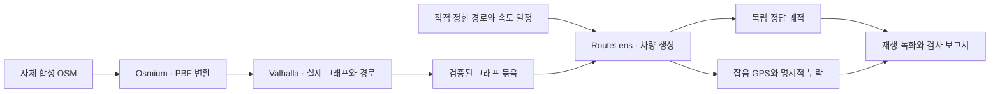

<div align="center">

# RouteLens

**공유 교통정보와 분산 경로 계산을, 검증 가능한 로컬 실험부터 만듭니다.**

[English](README.md) · [한국어](README.ko.md) · [프로젝트 위키](wiki/index.md) · [로드맵](docs/11-local-pilot.md)

[](https://github.com/dicebattle/routelens/actions/workflows/fast-checks.yml)
[](LICENSE)

</div>

RouteLens는 **Metro Lens에서 파생된 오픈소스 프로젝트**입니다. 검증된 주행 관측을 공유 교통정보로 만들고, 독립적으로 운영되는 경로 노드들이 같은 지도·교통정보 버전으로 경로를 계산하는 시스템을 목표로 합니다.

**현재 로컬 구현은 실제 Valhalla 그래프를 만들고, 차량을 이동시키며, 오차·누락을 통제한 GPS 관측을 생성합니다.** 교통정보 집계·실시간 갱신·분산 노드 장애 전환·내비게이션 앱은 아직 개발 계획에 있습니다.

## 현재 시뮬레이션 보기

[](docs/media/demo.mp4)

[MP4 보기·내려받기](docs/media/demo.mp4) · [화면을 포함한 검사 보고서](research/pilot/2026-10-24-p03/report.md) · [녹화 출처](docs/media/latest.json)

새로 통합 실행한 결과에서 생성된 보고서를 실제로 재생·녹화했습니다. 가상 도로, 모의 차량 세 대, 5초 대기, 범위가 정해진 GPS 오차, 예정된 관측 누락 10개를 보여줍니다. **실시간 교통정보나 완료된 GPS 도로 매칭 시연은 아닙니다.**

## 지금 실행할 수 있는 것

| 기능 | 실제로 검사하는 내용 |
| --- | --- |
| **P01 — 결정적 시나리오** | 시드 재생·이벤트 순서·검사 실패/생략·기존 출력 보존 |
| **P02 — 실제 경로 그래프** | Valhalla 그래프 생성·방향별 22구간·합법 대안·금지 회전 우회·일방통행/단절 오류 |
| **P03 — 차량·GPS 생성** | 독립 정답 궤적·속도/대기 일정·잡음 범위·정확한 누락 구간·고정 표본 식별자 |
| **통합 증거** | 새 자료 검사 → P01 → Docker/Valhalla P02 → P03 → 재생·입력 거부 검사, 소스·산출물 해시 |
| **재생 보고서** | 외부 연결 없는 지도 재생·시간/차량 조작·한영 전환·실제 단계별 증거 링크 |

합성 자료는 별도 **실제 도로 경로 100개·매칭 100개 평가 조건**에 포함하지 않습니다. 현재 실제 지역 검사기에 등록된 검토 완료 도로 자료는 없습니다.

## 구현된 전체 흐름 실행하기

**Node.js 22 또는 24**, npm, Linux 컨테이너를 실행할 Docker가 필요합니다. 최초 이미지 준비 때 고정 엔진·Osmium 패키지를 내려받고, 그래프 작업은 네트워크를 차단한 상태로 실행합니다. Cloudflare 계정·지도 API 키·실제 GPS 이력은 필요하지 않습니다.

```sh
git clone https://github.com/dicebattle/routelens.git
cd routelens
npm ci
npm run build
npm run simulation:check -- --output data/my-first-run
npm run report:serve -- data/my-first-run
```

서버가 출력한 로컬 주소 뒤에 `/report.html`을 붙여 엽니다. 서버는 15분 뒤 종료됩니다. 매 실행마다 **새 출력 폴더**를 사용하며 기존 증거를 덮어쓰지 않습니다.

자동 검사는 다음 명령으로 실행합니다.

```sh
npm test
npm run media:check
```

`media:check`는 공개 녹화가 현재 구현·보고서·자산 해시와 일치하는지 확인합니다. 실행 동작이 바뀌면 통합 보고서를 다시 생성하고 데모를 재촬영한 뒤 게시합니다. 자세한 절차는 [증거 작업 흐름](docs/17-simulation-evidence-delivery.md)에 있습니다.

## 직접 만드는 부분과 재사용하는 부분



RouteLens는 계약·실행 관리·시뮬레이션·증거 검사를 만듭니다. **Valhalla**는 그래프 생성·경로 계산과 후속 도로 매칭에, **Osmium**은 OSM 변환에 사용합니다. 클라이언트는 **MapLibre**를 계획하고 있으며, 신뢰할 수 있는 교통정보 게시·노드 선택은 직접 구현할 영역입니다. [재사용 판단 문서](docs/03-build-or-reuse.md)를 참고하세요.

운영 설계는 관리되는 수집 경로와 승인된 독립 경로 노드를 사용하며, 원시 위치정보를 공개 P2P로 배포하지 않습니다. Cloudflare 배포와 PostgreSQL/HTTP 기반 독립 설치 경로를 계획합니다. 현재 로컬 시뮬레이션에는 둘 다 필요하지 않습니다.

## 증거를 확인한 뒤 완료합니다

모듈마다 **설계 → 구현 → 직접 실행 → 증거 확인 → 이중 언어 기록 → 푸시**를 거칩니다. 메인 에이전트가 설계·검토하고 [저장소 지침](AGENTS.md)에 따라 구현을 위임합니다. AI 사용 여부를 품질 보증으로 삼지 않고 실제 검사·한계와 함께 기록합니다.

- [최신 통합 검사 보고서](research/pilot/2026-10-24-p03/report.md)
- [현재 구현과 남은 전체 목표](docs/18-goal-progress.md)
- [누적 작업 기록](wiki/log.md)
- [P01~P14 모듈 계약](docs/11-local-pilot.md)
- [아키텍처](docs/02-architecture.md) · [프로토콜](docs/04-protocol.md) · [개인정보·신뢰](docs/07-privacy-and-trust.md)

**다음은 P04 실제 GPS 도로 매칭·모호한 관측 제외**입니다. 이후 영속 수집·교통 집계/게시·실제 속도 파일 반영·두 노드 장애 전환을 구현합니다. 증거 재생 화면은 완성된 내비게이션 앱이 아닙니다. 로컬 합성 성공만으로 한국 도로 정확도·모바일 배터리·운영 안정성을 증명하지 않습니다.

## 기여하기

[기여 방법](CONTRIBUTING.md)과 [개발 절차](docs/12-development-workflow.md)를 먼저 읽어주세요. main은 보호되고 변경은 필수 검사를 통과해야 합니다. 시험자료는 합성·재배포 가능한 자료로 유지하고, 과거 증거를 보존하며, 변경 이유를 영어·한국어로 기록합니다.

프로젝트 코드·문서는 [Apache-2.0](LICENSE)입니다. 외부 도구·데이터의 라이선스는 각각 유지합니다. [보안 정책](SECURITY.md) · [운영 원칙](GOVERNANCE.md).
