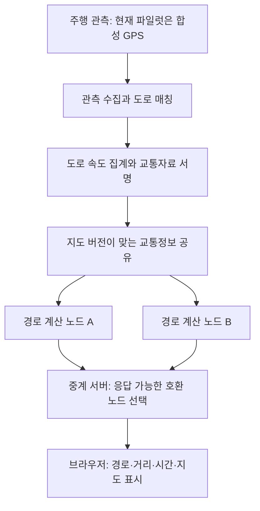

<div align="center">

# RouteLens

**교통정보는 함께 공유하고, 경로 계산은 여러 서버로 나눕니다.**

[English](README.md) · [한국어](README.ko.md) · [문서](wiki/index.md)

[](https://github.com/dicebattle/routelens/actions/workflows/fast-checks.yml)
[](LICENSE)

</div>

## 1. 무엇을 만들려는 프로젝트인가요?

RouteLens는 **Metro Lens에서 파생된 자동차 내비게이션 오픈소스 프로젝트**입니다. 승인된 여러 운영자의 서버가 **같은 지도와 교통정보를 사용해 경로를 계산하는 구조**를 목표로 합니다. 경로 서버 한 곳이 응답하지 못하면, 같은 자료를 사용하는 다른 서버가 요청을 처리합니다.

시스템의 역할은 두 가지입니다. 주행 관측을 모아 공유할 도로 속도를 만들고, 그 자료로 목적지까지의 경로를 계산합니다. RouteLens는 두 과정을 연결하는 규칙과 실행 구조를 만들고, 지도·경로 엔진·데이터베이스는 기존 오픈소스를 재사용합니다.

**현재는 실제 서울 도로 지도에 합성 차량·교통정보를 올린 로컬 웹 파일럿입니다.** 두 지점을 선택해 경로를 계산하고 지도에서 결과를 확인할 수 있습니다. 휴대폰 GPS 수집, 회전별 주행 안내, 운영 서비스 배포는 이후 작업입니다.

## 2. 사용자 입장에서 사용해 보기

[](docs/media/demo.ko.mp4)

[한국어 사용 영상 보기](docs/media/demo.ko.mp4) · [English walkthrough](docs/media/demo.mp4)

영상은 실제 브라우저 화면에서 다음 과정을 보여줍니다.

1. 미리 준비된 **테헤란로 경로**를 선택합니다.
2. **경로 계산** 버튼을 누릅니다.
3. 서울 지도에서 경로와 거리·예상 시간을 확인합니다.

예제에서는 도로 세 구간에 합성 정체를 넣었습니다. 계산된 경로가 주변 도로로 돌아가는 모습을 볼 수 있습니다. 교통정보는 실제 수집값이 아닌 재현 가능한 시연 자료입니다. 자막으로 사용 순서를 설명하며, 원래 애플리케이션 녹화도 함께 보존합니다. [녹화 정보](docs/media/latest.json).

게시 자료 변경·노드 중단·만료·검사 보고서를 보여주는 긴 영상은 [개발 검증 영상](research/pilot/2026-10-25-p13/developer-walkthrough.mp4)으로 따로 제공합니다.

## 3. 큰 그림에서 어떻게 동작하나요?

아래 그림은 관측 자료가 사용자의 경로가 되기까지의 흐름입니다.



**교통정보를 준비하는 과정:** 운영자가 관리하는 수집 서버가 관측을 받아 도로에 대응시키고, 조건을 충족한 통과 기록을 집계합니다. 현재 규칙에서는 서로 다른 기여자가 최소 5명 있어야 도로 속도를 만듭니다. 만들어진 교통자료에는 서명을 붙입니다. 원시 GPS는 수집·매칭 영역에 두고, 공개 교통자료에는 집계된 도로 값만 넣습니다.

**길을 찾는 과정:** 승인된 경로 노드가 호환되는 지도와 서명을 검증한 교통자료를 준비합니다. 중계 서버는 브라우저의 요청을 받아 필요한 버전을 가진 노드를 고르고, 실패하면 다른 노드로 한 번 재시도합니다. 자료가 만료되면 기본 도로 속도를 사용합니다. 브라우저도 교통자료가 바뀌면 이전 경로를 지우고 다시 계산할 수 있게 합니다.

| 담당 부분 | 사용하는 오픈소스 | 사용하는 이유 |
| --- | --- | --- |
| 경로 계산·도로 매칭 | **Valhalla** | 경로 엔진을 새로 만들지 않고 실제 엔진을 재사용합니다. |
| 서울 도로 지도 | **OpenStreetMap + Osmium** | 고정한 원본으로 같은 지역 그래프를 다시 만들 수 있습니다. |
| 접수·집계·복구 | **PostgreSQL** | 저장된 관측·작업·수용 버전을 중단 후에도 유지합니다. |
| 교통자료 서명 | **jose / Ed25519 JWS** | 공유 자료의 바이트를 검증하고 변조·다른 범위의 자료를 거부합니다. |
| 브라우저 지도 | **MapLibre** | 로컬 도로 지형과 실제 계산 경로를 그립니다. |
| 연결 규칙과 실행 관리 | **TypeScript / Node.js** | 수집·버전 검사·장애 전환·재현 가능한 시뮬레이션을 구현합니다. |
| 다른 집계 실행 환경 비교 | **로컬 Cloudflare Worker·Queue·SQLite Durable Objects** | PostgreSQL과 같은 집계 규칙이 동작하는지 비교합니다. 원격 배포는 별도입니다. |

RouteLens가 직접 만드는 부분은 자료 계약, 개인정보·만료 규칙, 실행 관리, 교통파일 연결기, 노드 선택과 검증 도구입니다. [아키텍처](docs/02-architecture.md) · [직접 구현·재사용 구분](docs/03-build-or-reuse.md) · [로컬 파일럿 모듈](docs/11-local-pilot.md).

## 4. 직접 실행하기

**Node.js 22 또는 24**, npm, curl, Linux 컨테이너를 실행할 Docker가 필요합니다. 처음에는 고정 엔진 이미지와 약 290MB의 한국 OSM 원본을 내려받습니다. 전체 실행마다 서울 그래프와 로컬 서비스를 새로 만듭니다. 지도 API 키·외부 DB·Cloudflare 계정은 필요하지 않습니다.

```sh
git clone https://github.com/dicebattle/routelens.git
cd routelens
npm ci
npm run build
npx playwright install chromium
npm run simulation:check -- --output data/my-first-run
```

전체 시뮬레이션이 성공하면 대화형 클라이언트를 실행합니다.

```sh
npm run pilot:serve -- --graph data/my-first-run/seoul/graph --output data/my-client
```

출력된 로컬 주소를 열고 테헤란로 경로를 선택해 계산합니다. 영상 재생이 아니라 새 합성 교통자료를 사용하는 실제 클라이언트입니다. 시각이 자동으로 진행되어 자료가 만료되고, 파일럿은 15분 뒤 종료됩니다. 매번 새 출력 폴더를 사용하세요. Linux에서는 `npx playwright install --with-deps chromium`으로 브라우저 의존성을 설치할 수 있습니다.

완료된 검사 결과를 살펴보려면 다음 명령을 사용합니다.

```sh
npm run report:serve -- data/my-first-run
```

출력된 주소 뒤에 `/report.html`을 붙입니다. 이것은 대화형 클라이언트와 별개인 완료된 검증 보고서입니다. [상세 실행·원본 재사용 안내](wiki/modules/seoul-simulation.md).

## 5. 어디까지 만들고 검증했나요?

로컬 구현에는 차량 생성, 영속 수집, 집계, 서명 게시, 교통정보를 반영한 경로, 독립 노드 두 개, 중계 서버, 브라우저, 장애 시나리오, Cloudflare 로컬 집계 비교가 들어 있습니다. 최신 깨끗한 전체 실행은 **390개 검사**를 통과했습니다. P13 후보의 단위 검사 303개와 보고서 화면 수정의 기존 집중 검사 9개도 통과했습니다. 원격 검증과 보호 병합 상태는 아래 보고서에 진행에 맞춰 기록합니다.

- [최신 검사 보고서와 원본 근거](research/pilot/2026-10-25-p13/report.md)
- [현재 구현 상태](docs/18-goal-progress.md)
- [개발·의사결정 기록](wiki/log.md)
- [기여 방법](CONTRIBUTING.md) · [보호 브랜치 작업 절차](docs/12-development-workflow.md)

```sh
npm test
npm run media:check
npm run cloudflare:types -- --check
```

실제 도로 100개 경로·100개 매칭의 검토 평가, 실제 운전, 실시간 교통 수집, Cloudflare 운영 배포는 로컬 합성 검증과 별도로 진행합니다. [계획과 한계](docs/11-local-pilot.md).

지도는 © OpenStreetMap contributors의 [ODbL1.0](https://www.openstreetmap.org/copyright) 자료이며 [Geofabrik](https://download.geofabrik.de/asia/south-korea.html)의 2026-10-23 원본을 사용합니다. 추출 범위에는 서울과 인접 도로가 포함됩니다. 코드·문서는 [Apache-2.0](LICENSE)이며 외부 도구·지도 자료의 라이선스는 각각 유지합니다. [NOTICE](NOTICE) · [보안 정책](SECURITY.md).
