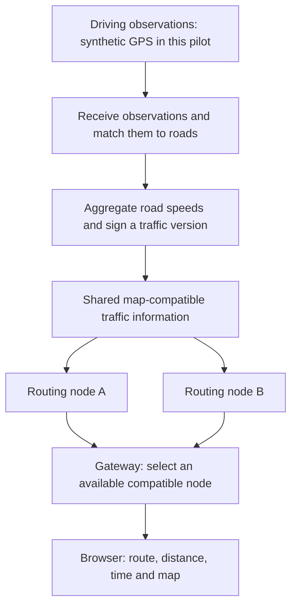

<div align="center">

# RouteLens

**Share traffic information. Calculate routes across independent servers.**

[English](README.md) · [한국어](README.ko.md) · [Documentation](wiki/index.md)

[](https://github.com/dicebattle/routelens/actions/workflows/fast-checks.yml)
[](LICENSE)

</div>

## 1. What is RouteLens for?

RouteLens is an open-source project for car navigation, derived from **Metro Lens**. Its goal is to let several approved, independently operated servers calculate routes from the **same map and traffic information**. If one routing server becomes unavailable, another compatible server can answer the request.

The system has two jobs: turn driving observations into shared road-speed information, and use that information to find routes. RouteLens builds the coordination between those jobs and reuses existing open-source map, routing and database tools.

**Current stage: a local browser pilot on actual Seoul roads, with synthetic vehicles and traffic.** You can choose two points, calculate a route and inspect the result on a map. Phone GPS collection, turn-by-turn driving guidance and production deployment are future work.

## 2. See it from the user's side

[](docs/media/demo.mp4)

[Watch the English walkthrough](docs/media/demo.mp4) · [한국어 영상](docs/media/demo.ko.mp4)

The walkthrough shows the actual browser client:

1. Choose the Teheran-ro route preset.
2. Press **Calculate route**.
3. Read the route, distance and estimated time on the Seoul map.

The sample traffic slows three road segments, so the calculated route takes surrounding streets. The displayed traffic is synthetic; this is a reproducible local example. Captions explain the actions, and the underlying application recording is retained. [Recording details](docs/media/latest.json).

The longer [developer walkthrough](research/pilot/2026-10-25-p13/developer-walkthrough.mp4) separately shows publication changes, node failure, expiry and completed test reports.

## 3. How the system fits together

The diagram follows information from observations to the user's route:



**Traffic preparation:** a managed ingestion service receives observations, matches them to roads, and aggregates eligible traversals. A road-speed value needs at least five contributors under the current policy. The service signs the resulting traffic version. Raw GPS stays inside the collection and matching boundary; public traffic artifacts contain aggregate road values.

**Route calculation:** each approved routing node has a compatible map and verifies the signed traffic version before using it. The gateway receives the browser's request, chooses an available node with the required version, and allows one bounded retry on another node. Expired traffic is removed and default road speeds apply. The browser clears a route when its traffic context changes and lets the user recalculate.

| Component | Open-source tool | Purpose |
| --- | --- | --- |
| Routing and map matching | **Valhalla** | Reuse a real routing engine instead of writing one |
| Seoul road data | **OpenStreetMap + Osmium** | Build a reproducible regional graph from pinned source data |
| Receipt, aggregation and recovery | **PostgreSQL** | Keep committed observations, jobs and accepted versions durable |
| Signed traffic artifacts | **jose / Ed25519 JWS** | Verify exact shared bytes and reject changed or out-of-scope versions |
| Browser map | **MapLibre** | Draw local road geometry and actual calculated routes |
| Coordination and contracts | **TypeScript / Node.js** | Implement ingestion rules, version checks, failover and reproducible simulation |
| Alternative aggregation runtime | **Local Cloudflare Worker, Queue and SQLite Durable Objects** | Compare the same aggregation rules with PostgreSQL; hosted deployment is separate |

RouteLens owns the contracts, privacy and expiry rules, orchestration, traffic-file adapter, node selection and evidence checks. [Architecture](docs/02-architecture.md) · [Build or reuse](docs/03-build-or-reuse.md) · [Local pilot modules](docs/11-local-pilot.md).

## 4. Try the local client

Requirements: **Node.js 22 or 24**, npm, curl and Docker with Linux containers. Initial preparation downloads pinned engine images and a dated South Korea OSM source of about290MB. Every full run builds a fresh Seoul graph and starts its own local services. No map API key, external database or Cloudflare account is required.

```sh
git clone https://github.com/dicebattle/routelens.git
cd routelens
npm ci
npm run build
npx playwright install chromium
npm run simulation:check -- --output data/my-first-run
```

After the full simulation succeeds, start an interactive client:

```sh
npm run pilot:serve -- --graph data/my-first-run/seoul/graph --output data/my-client
```

Open the printed local URL, choose the Teheran-ro preset and calculate. This starts a fresh synthetic traffic fixture, not a video player. Its clock advances automatically, traffic expires, and the pilot stops after15minutes. Use a new output directory for every run. On Linux, browser dependencies can be installed with `npx playwright install --with-deps chromium`.

To inspect the completed simulation instead:

```sh
npm run report:serve -- data/my-first-run
```

Append `/report.html` to its printed URL. This is the completed evidence report, separate from the interactive client. [Detailed setup and source reuse](wiki/modules/seoul-simulation.md).

## 5. Implementation and verification

The implemented local pipeline covers simulation, durable ingestion, aggregation, signed publication, traffic-aware routing, two persistent nodes, a gateway, the browser client, fault scenarios and local Cloudflare aggregation comparison. The latest clean whole run passed **390 assertions**. The P13 candidate passed303 unit tests; the report layout correction passed the existing9 focused report tests. Hosted acceptance and protected delivery are recorded as they complete in the linked report.

- [Latest test report and original evidence](research/pilot/2026-10-25-p13/report.md)
- [Current implementation status](docs/18-goal-progress.md)
- [Development and decision log](wiki/log.md)
- [Contribution guide](CONTRIBUTING.md) · [Protected-branch workflow](docs/12-development-workflow.md)

```sh
npm test
npm run media:check
npm run cloudflare:types -- --check
```

Local synthetic success is separate from the reviewed100-route/100-matching real-road evaluation, real driving, live traffic and hosted Cloudflare operation. [Roadmap and limits](docs/11-local-pilot.md).

The map uses © OpenStreetMap contributors, [ODbL1.0](https://www.openstreetmap.org/copyright), through [Geofabrik](https://download.geofabrik.de/asia/south-korea.html), snapshot2026-10-23. The extraction envelope includes Seoul and adjacent roads. Code and documentation use [Apache-2.0](LICENSE); upstream tools and map data retain their own licenses. [NOTICE](NOTICE) · [Security](SECURITY.md).
