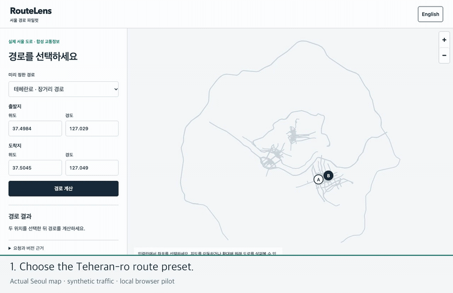

<div align="center">

# RouteLens

**Shared traffic data. Distributed route calculation. Verifiable local experiments.**

[English](README.md) · [한국어](README.ko.md) · [Project handbook](wiki/index.md) · [Roadmap](docs/11-local-pilot.md)

[](https://github.com/dicebattle/routelens/actions/workflows/fast-checks.yml)
[](LICENSE)

</div>

RouteLens is an open-source project derived from **Metro Lens**. The intended system turns verified driving observations into shared traffic data, then lets independent routing nodes calculate routes using the same map and traffic version.

**Today, the local prototype simulates GPS on actual Seoul roads, durably ingests and matches observations, aggregates at least five contributors, and signs and publishes traffic snapshots. A separate consumer verifies them before an immutable speed file changes actual Valhalla routes. Exact expiry restores default routing.** Two independent persistent nodes now activate verified generations, reject stale results and restore baseline routing at expiry. A local gateway independently selects the accepted version and switches to the other approved node after a failure. The navigation client remains on the roadmap.

## Watch the current simulation

[](docs/media/demo.mp4)

[Watch/download the MP4](docs/media/demo.mp4) · [Captured test report](research/pilot/2026-10-25-p10/report.md) · [Recording provenance](docs/media/latest.json)

This 59.75-second recording shows actual Seoul routes, persistent nodes and the version-aware gateway, including primary-node failure and expiry. Fifteen synthetic trips supply five contributors to each of three consecutive target edges. The same two-point request changes from **2.119 km / 147.404 s** to a **2.412 km / 184.731 s** detour; exact expiry at 420 seconds restores the original route. The complete run also retains nine vehicles across Teheran-ro, downtown Seoul and Mapo Bridge: 3,204 GPS observations, up to 3 m noise, 60 omissions, and 220 of 237 true traversals stored exactly once. All **302 assertions** passed. The gateway verifies path-specific live coverage: the long detour avoids all live edges, while a preselected12m interior route exercises positive coverage. Roads are real; vehicles, speeds and GPS are synthetic. This does not establish independent real-driving accuracy, live traffic or coverage of every Seoul road.

## What you can run today

| Capability | What is actually checked |
| --- | --- |
| **P01 — deterministic scenarios** | Seeded replay, event order, failed/skipped assertions and output preservation |
| **P02 — real routing graph** | Fresh Seoul graph from a pinned OSM source; 79 directed scene edges. Tiny-city retains 22-edge legal/forbidden-turn regression |
| **P03 — vehicle and GPS simulation** | Independent trajectories, speed/wait schedules, bounded noise, exact missing-sample intervals and stable sample identities |
| **P04 — map matching** | Real map snapping, observed traversal boundaries, gap/ambiguity exclusions and identical full/split/overlap results |
| **P05 — durable ingestion and recovery** | Committed receipt, duplicate/conflict handling, ordered trip finalization, fenced workers, real crash recovery and deletion read-back |
| **P06 — traffic aggregation** | Five-contributor minimum, median full duration including signal waits, duplicate/PARKED exclusion, strict availability deadline, transactional revocation and expiry |
| **P07 — signed publication** | Standard Ed25519 JWS, exact HTTP bytes, scoped local public keys, durable consumer order, key rotation, tamper/replay rejection and expiry |
| **P08 — accepted traffic routing** | Immutable graph-specific speed files, actual detour, automatic expiry, concurrent generation, real process/database faults and stale-result refusal |
| **P09 — persistent routing nodes** | Two independent nodes, native daemon reuse, request leases, bounded generation draining, durable restart and actual fault recovery |
| **P10 — route gateway** | Independent accepted-version authority, one matching-node retry, actual primary kill,12s shared deadline,4s node budget and public route coverage |
| **Integrated evidence** | Fresh tiny regression (48), Seoul graph/simulation/matching (35), durable ingestion (34), aggregation (34), publication (55), traffic routing (32), persistent nodes (32) and gateway (32): **302 assertions**, with source/artifact hashes |
| **Replay report** | Offline Seoul playback, baseline/live/expired route comparison and actual recovery evidence; English/Korean controls and source links |

Synthetic observations never count toward the separate **100 route / 100 map-matching real-road evaluation**. The geographic validator currently has no reviewed real-road corpus.

## Run the whole implemented pipeline

Requirements: **Node.js 22 or 24**, npm, curl, and Docker with Linux containers. Initial preparation downloads the pinned engine/Osmium and a 289.9 MB dated South Korea OSM file, verifies its SHA-256, then caches only the source. Every run builds a fresh Seoul graph with networking disabled (2 CPU / 4 GiB limits). P05–P10 automatically start pinned PostgreSQL containers with dedicated volumes and loopback ports, plus separate API, worker and engine processes, then remove their owned resources. No external database, Cloudflare account, map API key or real GPS trace is needed.

```sh
git clone https://github.com/dicebattle/routelens.git
cd routelens
npm ci
npm run build
npm run simulation:check -- --output data/my-first-run
npm run report:serve -- data/my-first-run
```

Open the loopback URL printed by the server with `/report.html` appended. The server stops after 15 minutes. Use a **new output directory** for every run; existing evidence is never overwritten.

For offline source reuse, add `--source /path/to/south-korea-261023.osm.pbf` with the exact pinned SHA-256. The default source cache is `data/seoul-source-cache`; `ROUTELENS_SOURCE_CACHE` overrides its location. `npm run simulation:tiny -- --output data/tiny-only` runs the small regression alone. See the [Seoul module guide](wiki/modules/seoul-simulation.md).

For automated checks:

```sh
npm test
npm run media:check
```

`media:check` verifies that the published recording still matches the implementation, report and asset hashes. After changing runtime behavior, regenerate the integration report and recapture the demo before publishing. See the [evidence workflow](docs/17-simulation-evidence-delivery.md).

## Built here, reused upstream

```mermaid
flowchart LR
  F[Pinned actual Seoul OSM source] --> O[Osmium · regional extraction]
  O --> V[Valhalla · real graph and routing]
  V --> G[Verified graph bundle]
  S[Authored paths and speed schedules] --> P[RouteLens · vehicle simulation]
  G --> P
  P --> T[Independent trajectory truth]
  P --> N[Noisy GPS and explicit omissions]
  T --> R[Captured replay and test report]
  G --> M[Valhalla · map matching]
  N --> I[RouteLens · durable HTTP receipt]
  I --> D[PostgreSQL · trips and fenced jobs]
  D --> W[RouteLens · worker and crash recovery]
  W --> M
  M --> A[RouteLens · observed timing and exclusions]
  A --> C[PostgreSQL · atomic traversal commit]
  C --> U[RouteLens · deadline and contributor median]
  U --> Q[Unsigned candidate · expiry and revocation]
  Q --> J[jose · Ed25519 JWS]
  J --> H[RouteLens · immutable HTTP publication]
  H --> K[RouteLens · verified durable consumer]
  K --> B[RouteLens · immutable traffic file and expiry]
  B --> X[Valhalla · actual traffic-aware route]
  G --> X
  X --> Y[RouteLens · same-version gateway and one retry]
  Y --> R
```



RouteLens owns the contracts, orchestration, simulation, ingestion/worker coordination, traffic-file adapter and evidence checks. **PostgreSQL** supplies durable transactions, row locks and uniqueness; RouteLens defines completion, commit ownership and deletion rules. **Valhalla** builds graphs, prepares traffic archives, calculates routes and performs map matching; **Osmium** extracts the Seoul envelope and converts OSM files. **jose** provides standard JWS signing and verification; RouteLens owns trust scope, exact artifact validation and durable order. The planned client uses **MapLibre**; persistent node activation and approved-node gateway selection are implemented. [Build-or-reuse decisions](docs/03-build-or-reuse.md).

The planned production design has a managed ingestion path and approved independent routing nodes. It keeps raw location data out of public peer-to-peer distribution. A Cloudflare deployment and an independently installable PostgreSQL/HTTP path are planned; neither is required for the current local simulation.

## Evidence before completion

Each module follows **design → implementation → direct execution → inspected evidence → bilingual record → push**. The main agent owns design and review; implementation is delegated according to [repository instructions](AGENTS.md). AI assistance is recorded with the actual checks and limits, not used as a quality claim.

- [Latest integrated test report](research/pilot/2026-10-25-p10/report.md)
- [Current implementation and remaining goal](docs/18-goal-progress.md)
- [Append-only work log](wiki/log.md)
- [P01–P14 module contracts](docs/11-local-pilot.md)
- [Architecture](docs/02-architecture.md) · [Protocol](docs/04-protocol.md) · [Privacy and trust](docs/07-privacy-and-trust.md)

**Next: P11 actual route client**, followed by the remaining whole-scenario, Cloudflare parity and CI work. P10 serves authenticated local requests through two approved nodes; public enrollment, signed node responses and explicit base_only requests remain unsupported. P09 keeps native engines alive, while P08 remains the lower-level reference. Local synthetic success does not establish production latency or availability. Previously downloaded artifacts cannot be recalled from offline consumers; expiry, a newer received version or configured key revocation limits their use. Production authentication, continuous GPS ingestion and forensic deletion from WAL/backups remain unimplemented. The evidence viewer is not the finished navigation client.

## Contribute

Read [CONTRIBUTING.md](CONTRIBUTING.md) and the [development workflow](docs/12-development-workflow.md). Main is protected; changes must pass required checks. Keep vehicle observations synthetic and all datasets lawfully redistributable with their source licenses, preserve prior evidence, and explain why a change exists in English and Korean.

The map uses © OpenStreetMap contributors, [ODbL 1.0](https://www.openstreetmap.org/copyright), via [Geofabrik](https://download.geofabrik.de/asia/south-korea.html), snapshot 2026-10-23. The extraction envelope includes Seoul and adjacent boundary roads; it is not an exact administrative polygon. The viewer displays 1,268 selected geometries from 149,857 exported records; these are not full car-road counts. Derived map data retains ODbL; see [NOTICE](NOTICE).

Project code and documentation use [Apache-2.0](LICENSE). Upstream tools and datasets retain their own licenses. [Security policy](SECURITY.md) · [Governance](GOVERNANCE.md).
