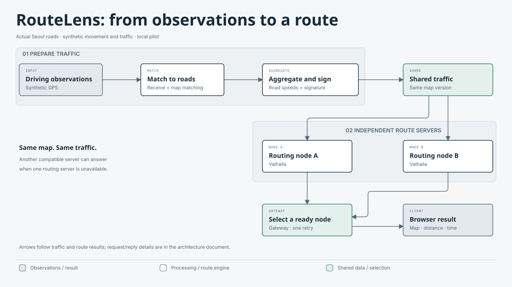

<div align="center">

# RouteLens

**Share traffic information. Calculate routes across independent servers.**

[English](README.md) · [한국어](README.ko.md) · [Documentation](wiki/index.md) · [Metro Lens website](https://metrolens.fyi/)

[](https://github.com/dicebattle/routelens/actions/workflows/fast-checks.yml)
[](LICENSE)

</div>

## 1. What is RouteLens for?

RouteLens is an open-source project for car navigation, derived from **[Metro Lens](https://metrolens.fyi/)**. Its goal is to let several approved, independently operated servers calculate routes from the **same map and traffic information**. If one routing server becomes unavailable, another compatible server can answer the request.

The system has two jobs: turn driving observations into shared road-speed information, and use that information to find routes. RouteLens builds the coordination between those jobs and reuses existing open-source map, routing and database tools.

**Current stage: a local browser pilot on actual Seoul roads, with an actual public-speed option and authored GPS replay.** You can choose two points, calculate a route and inspect the result on a map. The result includes validated native English/Korean turn instructions. The local public-speed option supports MOLIT ITS and a separate Gyeonggi/EX mode before enough users contribute. The key-free whole simulation keeps synthetic traffic. Regional traffic uses verified original timestamps and directed geometry; the expanded regional context currently exceeds the authored GPS replay admission limit. Replay authored GPS positions to see the next turn, remaining distance, departure and rejoin. Phone GPS tracking, rerouting, spoken guidance and production deployment are future work.

## 2. See it from the user's side

[](docs/media/demo.gif)

[Watch the 29.95-second walkthrough (GIF)](docs/media/demo.gif) · [MP4 file](docs/media/demo.mp4) · [한국어 GIF](docs/media/demo.ko.gif)

The walkthrough shows the actual regional public-speed client:

1. Inspect Gyeonggi and EX source attribution and original observation times.
2. Choose the verified regional preset and press **Calculate route**.
3. Read the 4.07km Gyeongbu route, estimated time and **7.58%** live-length coverage.
4. Switch between Korean/English instructions and inspect the 390px display.

The complete29.95s is retained at1×. This video shows actual public observations and local routing; it contains no GPS replay. The separately accepted [standard Seoul GPS walkthrough](https://raw.githubusercontent.com/dicebattle/routelens/54866b77fe176e80045db57051f7d103b27c1b99/docs/media/demo.mp4) remains available. The expanded regional context exceeds its existing GPS bounds, so regional replay is pending. Road and ETA influence are measured separately: twelve fixed routes × four modes passed48 native comparisons, with7.00–56.88% combined coverage. For example, Olympic west changed104.409→225.954s and Gyeongbu south133.382→136.843s for the captured observations. These are calculated changes, not measured ETA accuracy or metropolitan network coverage. [Full dated results](research/public-road-speeds/2026-10-26-regional-routing/report.md) · [Recording details](docs/media/latest.json).

The longer [developer walkthrough](research/pilot/2026-10-25-p13/developer-walkthrough.mp4) separately shows publication changes, node failure, expiry and completed test reports.

## 3. How the system fits together

The diagram follows information from observations to the user's route:

[](docs/diagrams/architecture.svg)

[Figure sources and reproduction](docs/diagrams/README.md)

**Public-speed bootstrap:** an operator chooses the ITS feed or the separate regional adapter, matches exact directed official geometry to the pinned graph, and signs a public artifact. Regional mode prefers a verified EX detector-containing edge, then a compatible Gyeonggi observation; EX currently uses an explicitly captured public-demo document. The local runtime refreshes every 120 seconds and expires each value 600 seconds after its original observation. It uses baseline speeds when data is missing or expired. This local public path is implemented; the two-node architecture pictured above is verified with synthetic traffic. Source-specific reuse terms and API credentials are documented in the [public module](wiki/modules/public-road-speeds.md).

**Crowd traffic preparation:** a managed ingestion service receives observations, matches them to roads, and aggregates eligible traversals. A road-speed value needs at least five contributors under the current policy. The service signs the resulting traffic version. Raw GPS stays inside the collection and matching boundary; public traffic artifacts contain aggregate road values.

**Route calculation:** each approved routing node has a compatible map and verifies the signed traffic version before using it. The gateway receives the browser's request, chooses an available node with the required version, and allows one bounded retry on another node. Expired traffic is removed and default road speeds apply. The browser clears a route when its traffic context changes and lets the user recalculate.

| Component | Open-source tool | Purpose |
| --- | --- | --- |
| Routing and map matching | **Valhalla** | Reuse a real routing engine instead of writing one |
| Seoul road data | **OpenStreetMap + Osmium** | Build a reproducible regional graph from pinned source data |
| Receipt, aggregation and recovery | **PostgreSQL** | Keep committed observations, jobs and accepted versions durable |
| Signed traffic artifacts | **jose / Ed25519 JWS** | Verify exact shared bytes and reject changed or out-of-scope versions |
| Official road geometry | **shapefile + proj4** | Read official projection metadata and compare directed geometry |
| Local public acceptance | **Node SQLite** | Retain signed order, original source data and withdrawal across restarts |
| Browser map | **MapLibre** | Draw local road geometry and actual calculated routes |
| Coordination and contracts | **TypeScript / Node.js** | Implement ingestion rules, version checks, failover and reproducible simulation |
| Alternative aggregation runtime | **Local Cloudflare Worker, Queue and SQLite Durable Objects** | Compare the same aggregation rules with PostgreSQL; hosted deployment is separate |

RouteLens owns the contracts, privacy and expiry rules, orchestration, traffic-file adapter, node selection and evidence checks. [Architecture](docs/02-architecture.md) · [Build or reuse](docs/03-build-or-reuse.md) · [Local pilot modules](docs/11-local-pilot.md).

## 4. Try the local client

Requirements: **Node.js 22.13 or later, or Node.js 24**, npm, curl and Docker with Linux containers. Initial preparation downloads pinned engine images and a dated South Korea OSM source of about 290 MB. Every full run builds a fresh Seoul graph and starts its own local services. The synthetic full run requires no map API key, external database or Cloudflare account. ITS collection needs an operator-provided ITS key. Regional public-demo collection has separate access and operating limits; see the [regional module](wiki/modules/regional-public-routing.md).

```sh
git clone https://github.com/dicebattle/routelens.git
cd routelens
npm ci
npm run build
npx playwright install chromium
npm run simulation:check -- --output data/my-first-run
```

After the full simulation succeeds, start an interactive client:

```sh
npm run pilot:serve -- --graph data/my-first-run/seoul/graph --output data/my-client
```

Open the printed local URL, choose the Teheran-ro preset and calculate. This starts a fresh synthetic traffic fixture, not a video player. Its clock advances automatically, traffic expires, and the pilot stops after 15 minutes. Use a new output directory for every run. On Linux, browser dependencies can be installed with `npx playwright install --with-deps chromium`.

To inspect the completed simulation instead:

```sh
npm run report:serve -- data/my-first-run
```

Append `/report.html` to its printed URL. This is the completed evidence report, separate from the interactive client. [Detailed setup and source reuse](wiki/modules/seoul-simulation.md).

For regional setup, follow [Gyeonggi/EX acquisition, geometry and runtime commands](wiki/modules/regional-public-routing.md). For ITS public speeds, privately set `ROUTELENS_ITS_API_KEY`, then follow the [collect → provider-map → map → serve commands](wiki/modules/public-road-speeds.md). Use the graph and traffic bundle from your completed full run. Never put the key into browser inputs or command arguments.

## 5. Implementation and verification

The regional increment passed **486 fresh integration assertions** (all prior462 plus24 regional cases), **393 tests on Node.js22**,48 real native traffic comparisons, independent source/signature/traffic-byte inspection, actual wall-clock EX expiry and current EN/KO/390px capture. The regional GPS context limit, geographic gaps, EX public-demo access and unmeasured ETA accuracy remain explicit. [Evidence](research/public-road-speeds/2026-10-26-regional-routing/report.md).

The next implementation is **destination search and confirmation**. Reviewed road quality, device lifecycle, rerouting/voice, stable HTTPS operation, broader road coverage and measured ETA evaluation remain. [Prioritized navigation plan](docs/35-usable-navigation-roadmap.md).

- [Latest test report and original evidence](research/public-road-speeds/2026-10-26-regional-routing/report.md)
- [Current implementation status](docs/18-goal-progress.md)
- [Development and decision log](wiki/log.md)
- [Contribution guide](CONTRIBUTING.md) · [Protected-branch workflow](docs/12-development-workflow.md)

```sh
npm test
npm run media:check
npm run cloudflare:types -- --check
```

Local synthetic success is separate from the reviewed 100-route/100-matching real-road evaluation, real driving, live traffic and hosted Cloudflare operation. [Roadmap and limits](docs/11-local-pilot.md).

The map uses © OpenStreetMap contributors, [ODbL 1.0](https://www.openstreetmap.org/copyright), through [Geofabrik](https://download.geofabrik.de/asia/south-korea.html), snapshot 2026-10-23. The extraction envelope includes Seoul and adjacent roads. Code and documentation use [Apache-2.0](LICENSE); upstream tools and map data retain their own licenses. [NOTICE](NOTICE) · [Security](SECURITY.md).
