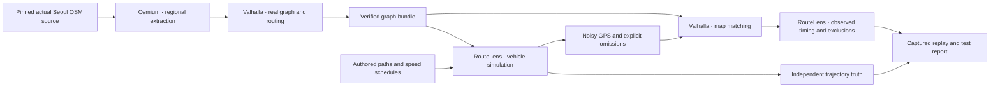

<div align="center">

# RouteLens

**Shared traffic data. Distributed route calculation. Verifiable local experiments.**

[English](README.md) · [한국어](README.ko.md) · [Project handbook](wiki/index.md) · [Roadmap](docs/11-local-pilot.md)

[](https://github.com/dicebattle/routelens/actions/workflows/fast-checks.yml)
[](LICENSE)

</div>

RouteLens is an open-source project derived from **Metro Lens**. The intended system turns verified driving observations into shared traffic data, then lets independent routing nodes calculate routes using the same map and traffic version.

**Today, the local prototype builds a Valhalla graph from actual Seoul OSM roads, simulates vehicles on the full curved road geometry, generates GPS noise and gaps, and accepts only supported complete traversals.** Traffic aggregation, live updates, distributed-node failover and a navigation app are still on the roadmap.

## Watch the current simulation

[](docs/media/demo.mp4)

[Watch/download the MP4](docs/media/demo.mp4) · [Captured test report](research/seoul/2026-10-24/report.md) · [Recording provenance](docs/media/latest.json)

This 17.25-second recording comes from a fresh integrated run on **actual Seoul roads**: Teheran-ro, downtown Seoul and Mapo Bridge. Nine synthetic vehicles produce 3,204 GPS observations with up to 3 m noise and 60 scheduled omissions. Of 237 true road traversals, 215 are accepted and 22 remain unreported; 28 engine candidates are excluded, including ambiguous stops at shared road endpoints. The full-run report retains all denominators. Roads are real; vehicles, speeds and GPS are synthetic. This same-engine round trip does not establish independent real-driving accuracy or live traffic.

## What you can run today

| Capability | What is actually checked |
| --- | --- |
| **P01 — deterministic scenarios** | Seeded replay, event order, failed/skipped assertions and output preservation |
| **P02 — real routing graph** | Fresh Seoul graph from a pinned OSM source; 79 directed scene edges. Tiny-city retains 22-edge legal/forbidden-turn regression |
| **P03 — vehicle and GPS simulation** | Independent trajectories, speed/wait schedules, bounded noise, exact missing-sample intervals and stable sample identities |
| **P04 — map matching** | Real map snapping, observed traversal boundaries, gap/ambiguity exclusions and identical full/split/overlap results |
| **Integrated evidence** | 48 tiny-system checks, then fresh Seoul graph → nine-vehicle simulation → actual full/split/overlap matching: 29 Seoul checks, with source/artifact hashes |
| **Replay report** | Offline Seoul road playback, route/time/vehicle controls, English/Korean text and links to actual stage evidence |

Synthetic observations never count toward the separate **100 route / 100 map-matching real-road evaluation**. The geographic validator currently has no reviewed real-road corpus.

## Run the whole implemented pipeline

Requirements: **Node.js 22 or 24**, npm, curl, and Docker with Linux containers. Initial preparation downloads the pinned engine/Osmium and a 289.9 MB dated South Korea OSM file, verifies its SHA-256, then caches only the source. Every run builds a fresh Seoul graph with networking disabled (2 CPU / 4 GiB limits). No Cloudflare account, map API key or real GPS trace is needed.

```sh
git clone https://github.com/dicebattle/routelens.git
cd routelens
npm ci
npm run build
npm run simulation:check -- --output data/my-first-run
npm run report:serve -- data/my-first-run
```

Open the loopback URL printed by the server with `/report.html` appended. The server stops after 15 minutes. Use a **new output directory** for every run; existing evidence is never overwritten.

For offline source reuse, add `--source /path/to/south-korea-261023.osm.pbf` with the exact pinned SHA-256. The default source cache is `data/seoul-source-cache`; `ROUTELENS_SOURCE_CACHE` overrides its location. `npm run simulation:tiny -- --output data/tiny-only` runs the small regression alone. See the [Seoul module guide](wiki/modules/seoul-simulation.md).

For automated checks:

```sh
npm test
npm run media:check
```

`media:check` verifies that the published recording still matches the implementation, report and asset hashes. After changing runtime behavior, regenerate the integration report and recapture the demo before publishing. See the [evidence workflow](docs/17-simulation-evidence-delivery.md).

## Built here, reused upstream



RouteLens owns the contracts, orchestration, simulation and evidence checks. **Valhalla** builds graphs and calculates routes and performs map matching; **Osmium** extracts the Seoul envelope and converts OSM files. The planned client uses **MapLibre**; trusted traffic publication and node selection remain RouteLens responsibilities. [Build-or-reuse decisions](docs/03-build-or-reuse.md).

The planned production design has a managed ingestion path and approved independent routing nodes. It keeps raw location data out of public peer-to-peer distribution. A Cloudflare deployment and an independently installable PostgreSQL/HTTP path are planned; neither is required for the current local simulation.

## Evidence before completion

Each module follows **design → implementation → direct execution → inspected evidence → bilingual record → push**. The main agent owns design and review; implementation is delegated according to [repository instructions](AGENTS.md). AI assistance is recorded with the actual checks and limits, not used as a quality claim.

- [Latest integrated test report](research/seoul/2026-10-24/report.md)
- [Current implementation and remaining goal](docs/18-goal-progress.md)
- [Append-only work log](wiki/log.md)
- [P01–P14 module contracts](docs/11-local-pilot.md)
- [Architecture](docs/02-architecture.md) · [Protocol](docs/04-protocol.md) · [Privacy and trust](docs/07-privacy-and-trust.md)

**Next: P05 durable ingestion and crash recovery**, followed by traffic aggregation/publication, real speed-file consumption and two-node failover. An evidence replay viewer is not the finished navigation client. Local synthetic success does not establish Korean road accuracy, mobile battery behavior or production reliability.

## Contribute

Read [CONTRIBUTING.md](CONTRIBUTING.md) and the [development workflow](docs/12-development-workflow.md). Main is protected; changes must pass required checks. Keep vehicle observations synthetic and all datasets lawfully redistributable with their source licenses, preserve prior evidence, and explain why a change exists in English and Korean.

The map uses © OpenStreetMap contributors, [ODbL 1.0](https://www.openstreetmap.org/copyright), via [Geofabrik](https://download.geofabrik.de/asia/south-korea.html), snapshot 2026-10-23. The extraction envelope includes Seoul and adjacent boundary roads; it is not an exact administrative polygon. The viewer displays 1,268 selected geometries from 149,857 exported records; these are not full car-road counts. Derived map data retains ODbL; see [NOTICE](NOTICE).

Project code and documentation use [Apache-2.0](LICENSE). Upstream tools and datasets retain their own licenses. [Security policy](SECURITY.md) · [Governance](GOVERNANCE.md).
