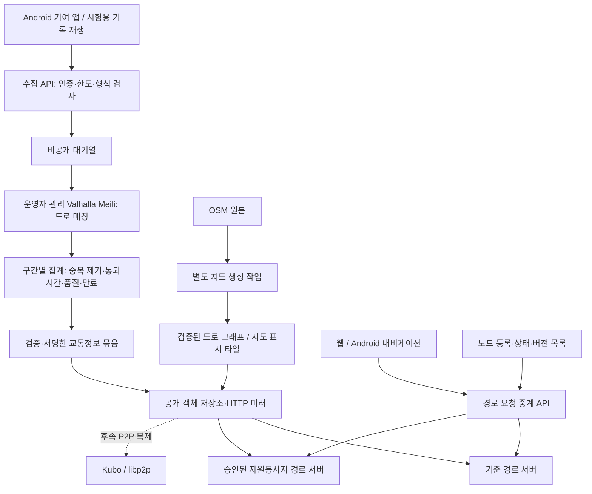

# 구성요소와 데이터 흐름

## 전체 구성



그림의 수집 API·대기열·집계는 Cloudflare 운영 구성에서 Workers·Queues·Durable Objects에 대응합니다. 도로 매칭과 경로 계산은 별도의 일반 컨테이너 서버에서 수행합니다. 일반 Worker의 메모리 한도는 현재 128MB이므로 전국 도로 그래프를 올리는 실행 환경으로 선택하지 않습니다. [Workers 제한](https://developers.cloudflare.com/workers/platform/limits/)

## 구현 단위

처음에는 작은 단일 저장소로 시작합니다. 아래 경로는 **향후 생성할 구조**이며 아직 실행 코드가 아닙니다.

```text
apps/web/                       TypeScript, React, MapLibre GL JS
apps/android/                   Kotlin, MapLibre Native, 시스템 음성 합성
packages/contracts/             JSON Schema / OpenAPI, 버전 호환성 검사
packages/traffic-core/          외부 서비스에 의존하지 않는 TypeScript 집계 로직
services/gateway/               수집·경로 중계 HTTP 처리
services/aggregator/            Cloudflare / PostgreSQL 실행 어댑터
services/node-agent/            TypeScript/Node.js, Valhalla 프로세스 관리·버전 교체
services/traffic-compiler/      TypeScript validated traffic-file adapter / 검증된 교통파일 연결기
tools/map-builder/              OSM 가져오기·그래프 생성·검증·목록 작성
tools/replay/                   TypeScript evaluation/replay tools / 평가·기록 재생
deploy/cloudflare/              Workers, Queues, Durable Objects, R2
deploy/compose/                 일반 서버용 PostgreSQL/PostGIS + 서비스 구성
```

RouteLens orchestration, aggregation and verification use TypeScript. P08 reuses the pinned upstream traffic skeleton generator and patches validated speed records in TypeScript; the earlier custom C++ compiler plan is superseded by [ADR-026](09-decisions.md). Upstream implementation languages remain upstream. P09 adds a narrow persistent-process adapter under [its fixed contract](28-p09-routing-nodes.md). The directory tree above remains a proposed packaging layout, not the current tools/ implementation.

RouteLens 조정·집계·검증은 TypeScript로 통일합니다. P08은 고정 상위도구로 빈 교통파일을 만들고 검증된 속도기록만 TypeScript로 반영하므로 기존 별도C++변환기 계획을 ADR-026으로 대체합니다. 상위 도구의 내부 언어는 그대로 재사용합니다. P09는 고정계약에 따라 좁은 지속프로세스 연결기를 추가합니다. 위 폴더 구조는 향후 패키징 계획이며 현재 tools/ 구현경로와 구분합니다.

## Cloudflare 운영 구성

| 구성 | 맡기는 일 | 맡기지 않는 일 |
| --- | --- | --- |
| Workers | 요청 검증, 기여 권한, 경로 중계, 공개 파일 접근 | 대형 도로 그래프 메모리 적재 |
| Queues | 유한 재시도, 처리량 완충 | 정확히 한 번만 처리된다는 가정 |
| Durable Objects | `graph_id + shard_id`별 집계와 상태 저장 | 서울 전체를 단일 객체에 집중 |
| R2 | 공개 지도·교통정보 결과, 허가된 비공개 평가 자료 | 무제한 원시 GPS 보관 |
| Supabase PostgreSQL/PostGIS | 노드 등록, 지도 목록, 운영 설정, 제한된 시간별 요약 | 관측 GPS 한 점마다 영구 INSERT |
| KV | 비긴급 설정의 보조 캐시만 | 최신 교통정보·노드 폐기 상태의 기준 저장소 |

Queues는 중복 전달될 수 있습니다. 집계 상태 변경과 중복 처리 기록을 같은 트랜잭션에 저장합니다. 일부 도로 구간 처리가 성공하고 다른 구간 처리가 실패한 배치를 재전송해도 이미 반영된 구간은 증가하지 않아야 합니다. [전달 보장](https://developers.cloudflare.com/queues/reference/delivery-guarantees/)

집계 단위는 타일과 구간 해시로 정하고, 한 구간은 한 소유 객체가 처리합니다. 분할 개수가 바뀌면 새로운 분할 버전을 사용하고 전환 시점과 소유권을 지정합니다. 구버전·신버전 객체가 같은 관측을 각각 공개 결과로 반영하지 않도록 합니다.

공개 파일은 내용을 해시한 불변 주소로 저장합니다. 현재 버전을 알려주는 목록은 강한 일관성을 가진 게시 담당 객체에서 제공하고 짧게 캐시합니다. 소비자는 캐시의 존재가 아니라 결과의 `valid_until`을 확인합니다. KV 전파가 60초 이상 지연될 수 있어 이 목록의 기준 저장소로 쓰지 않습니다. [KV 일관성](https://developers.cloudflare.com/kv/concepts/how-kv-works/)

Supabase에는 공개 API 스키마와 내부 스키마를 분리하고, 노출된 테이블은 행 접근 정책을 적용합니다. 서버 비밀 키는 휴대폰·자원봉사자 서버에 주지 않습니다. PostGIS는 공간 조회에만 우선 사용하며 MobilityDB 같은 추가 확장은 필수로 만들지 않습니다. [Supabase PostGIS](https://supabase.com/docs/guides/database/extensions/postgis)

## Cloudflare 없이 설치하는 구성

동일 HTTP 규격·동일 `traffic-core`를 사용하고, 대기열은 PostgreSQL의 작업 테이블과 `FOR UPDATE SKIP LOCKED`, 집계는 구간별 트랜잭션으로 대체합니다. 작업에는 임대 만료시각·시도 횟수·고유 입력 키를 두고 중단된 작업을 회수합니다. 작은 설치에서는 Kafka나 Kubernetes를 요구하지 않습니다.

파일은 로컬 볼륨과 HTTP 서버 또는 S3 호환 저장소로 배포합니다. 인증은 표준 토큰 검증으로 분리하고 Supabase Auth를 필수 조건으로 만들지 않습니다. 두 구성은 같은 재생 입력에서 같은 공개 결과를 내야 합니다. 독립 설치 경로는 v0.1 완료 조건입니다.

## 지도와 교통정보가 만나는 지점

지도 생성 작업은 OSM 원본 해시, 엔진 버전·이미지 해시, 생성 설정, 출력 파일 해시를 하나의 `graph_id`에 묶습니다. 경로 엔진 내부의 `edge_id`는 그래프를 다시 만들면 달라질 수 있으므로 단독으로 저장·교환하지 않습니다.

집계 결과는 `(graph_id, edge_id, direction, time_window)`에 연결합니다. `edge_id`는 Valhalla 방향성 구간 식별자이며 문자열로 전달합니다. OSM way 번호와 같은 것으로 취급하지 않습니다. 그래프를 바꾸면 구버전 관측을 신버전 구간에 임의로 합치지 않습니다.

Valhalla는 외부에서 생성한 live traffic overlay를 읽습니다. 따라서 RouteLens가 만드는 핵심 연결부는 **검증된 구간 통과시간을 해당 그래프의 바이너리 속도 파일로 변환하는 도구**입니다. 형식·속도 범위·0 값 의미·폐쇄 표현을 고정된 엔진 버전에서 시험합니다. 단순 JSON 파일을 두는 것만으로 엔진이 교통정보를 반영하지는 않습니다. [속도 처리 문서](https://valhalla.github.io/valhalla/concepts/speeds/)

M0에서는 작은 그래프의 속도 파일 전체를 생성하고 두 프로세스를 번갈아 교체합니다. 사용 중인 파일을 덮어쓰지 않습니다. 노드는 검증 → 새 프로세스 실행 → 정해진 경로 검사 → 준비 완료 표시 → 요청 전환 → 기존 요청 종료 순서로 교체합니다. 전체 파일 교체 비용이 과도하면 그때 타일별 변경과 안전한 갱신 방식을 검증합니다.

## 경로 요청과 장애 처리

휴대폰 → 중계 API → 한 경로 노드 순서로 요청합니다. 전국 그래프나 실시간 전체 교통정보는 휴대폰으로 보내지 않습니다. 서버는 미리 데이터를 보유해야 하며 요청 중 다운로드를 시작하는 노드는 준비 상태가 아닙니다.

선택 기준은 승인 상태, 지역 범위, 엔진·규격 버전, 정확한 `graph_id`와 `traffic_snapshot_id`, 최근 응답 상태, 대기 작업 수입니다. 최초에는 같은 지역 전체 그래프를 가진 노드 두 대를 사용합니다. 장거리 요청은 전체 경로 범위를 포함한 노드에 맡기고, 없으면 `OUT_OF_COVERAGE`를 반환합니다.

전체 요청 예산은 가안 3초, 노드 한 대 예산은 가안 1.2초로 시작해 실측 조정합니다. 실패하면 동일 버전의 두 번째 노드로 한 번만 재시도합니다. 최신 교통정보를 가진 노드가 없으면 기본 지도 속도 사용 여부를 명시하고 계산합니다. 준비된 노드가 전혀 없으면 `NO_HEALTHY_NODE`이며 결과를 꾸며내지 않습니다.

서버 서명은 누가 응답했는지 알려주지만 경로의 정확성을 증명하지 않습니다. 요청 해시·결과 버전·제한조건 검사와 작은 비율의 기준 서버 대조를 사용합니다. 기준 서버도 독립적인 진실은 아니며, 실제 도로 품질 검사는 별도로 합니다.

## Cloudflare Containers의 위치

Valhalla를 Containers에 올리는 것은 비교 실험 후보입니다. 일반 서버의 지속 디스크와 상시 준비 상태가 첫 기준입니다. 현재 Containers에는 파일시스템 스냅샷 기능도 있으므로 '재시작할 때 항상 전부 다운로드해야 한다'고 단정하지 않습니다. 지원되는 실행 정책, 복원 시간, 그래프 메모리 사용, 활성 시간 비용을 측정한 뒤 선택합니다. [Containers](https://developers.cloudflare.com/containers/), [스냅샷](https://developers.cloudflare.com/containers/guides/snapshots/)
