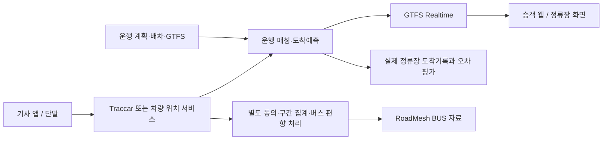

# 버스 관리 제품으로의 확장

자동차 내비게이션과 버스 운영 제품은 사용자·권한·데이터 성격이 다릅니다. 이번 저장소의 첫 구현은 자동차 경로와 교통정보에 집중하고, 버스 제품은 이후 별도 저장소 또는 별도 배포 단위로 진행합니다.

## 재사용할 구성

| 프로젝트 | 활용 범위 | 확인한 활동 | 판단 |
| --- | --- | --- | --- |
| Traccar | GPS 단말·기사 앱 수집, 차량 위치 이력 | v6.16.0, 2026-09-27; 기본 브랜치 10-23 | 다양한 단말 지원이 필요할 때 우선 후보 |
| OneBusAway application-modules | 표준 대중교통 API·승객 정보 | v2.7.2, 2026-10-13 | 성숙한 계열의 우선 비교 대상 |
| OneBusAway maglev | 새로운 Go 기반 API 서버 | 0.1.1, 기본 브랜치 2026-10-23 | 기능 호환성·실운영 사례 검증 후 선택 |
| OneBusAway vehicle-positions | 버스 운행과 연결된 위치 수집 | 2026-02 생성, 기본 브랜치 10-22, 대표 릴리스 없음 | 최근 프로젝트. 장기 검증과 구분 |
| OneBusAway trip-updates | GPS→GTFS-RT 도착예측 후보 | 2026-04 생성, 기본 브랜치 05-01, 대표 릴리스 없음 | 시험 전 채택 확정하지 않음 |
| TheTransitClock/transitime | 도착예측 구조 참고 | 기본 브랜치 2023-03-30 | 최신 핵심 의존성으로 자동 채택하지 않음 |
| OpenTripPlanner | 버스·철도 환승 경로 | v2.10.0, 2026-09-09 | 단일 셔틀에는 제외, 환승 확장 때 검토 |

이전 설명과 달리 OneBusAway라는 조직의 활동만 보고 `trip-updates`까지 활발히 관리된다고 볼 수 없습니다. 이번 조회에서는 최신 기본 브랜치 커밋이 2026-05-01이었고 별도 최신 릴리스가 없었습니다. 오래된 TransitClock 원본과 새로운 포크를 구분해 기록했습니다. [trip-updates](https://github.com/OneBusAway/trip-updates), [vehicle-positions](https://github.com/OneBusAway/vehicle-positions)

`trip-updates`와 TransitClock은 GPL-3.0 계열입니다. Apache-2.0 코드에 복사해 넣지 않습니다. 독립 실행프로그램의 표준 API 연동을 우선 검토하고, 실제 코드 결합·컨테이너 재배포 시 해당 라이선스와 소스 제공 의무를 별도로 확인합니다. 프로세스를 나누는 것만으로 모든 의무가 사라진다고 가정하지 않습니다.

## 버스 제품에서 직접 만들 일

사업자별 차량·기사·배차·운행 시작/종료·차량 교체·운휴 처리와 권한 모델은 별도로 필요합니다. 정류장 순서가 반복되는 노선에서 `vehicle_id`, `trip_id`, `service_date`, `stop_sequence`를 구분해야 합니다. 한국어 운영 화면과 실제 업체의 업무 절차도 제품 개발 범위입니다.

GTFS Schedule과 GTFS Realtime을 교환 규격으로 사용합니다. 위치가 끊긴 버스를 계속 '3분 남음'으로 표시하지 않습니다. GTFS 권장사항의 잦은 갱신과 데이터 신선도 기준을 평가하고, 오래된 자료는 실시간 예측과 시간표를 구분해 표시합니다. [GTFS Realtime 권장사항](https://gtfs.org/documentation/realtime/realtime-best-practices/)

## 별도 제품의 첫 범위

성인 이용자 중심의 기업·대학 셔틀 한 업체, 노선 1~2개, 차량 3~10대를 가정합니다. 운행 지정 → 위치 수집 → 정류장 예측 → 실제 도착 확인 흐름을 먼저 검증합니다. 첫 도착예측은 단순 시간표·최근 구간 통과시간을 기준 모델로 두고, TransitClock 계열이 더 낫다는 사실을 실제 기록으로 입증했을 때 채택합니다.

자동차 교통정보에는 버스 자료를 섞지 않고 `BUS`로 별도 보관합니다. 정류장 정차를 제거해도 버스전용차로의 속도가 일반 차로 속도를 뜻하지 않습니다. 자동차 대표성을 검증할 수 없는 자료는 승용차 경로의 live 속도에 사용하지 않습니다.

기존 대중교통 서비스의 수집 코드·데이터는 사용권과 공개 가능 범위를 확인한 뒤 어댑터로 연결합니다. 그 서비스의 운영 DB, 키, 비공개 실험 기록을 새 오픈소스에 복사하지 않습니다.
