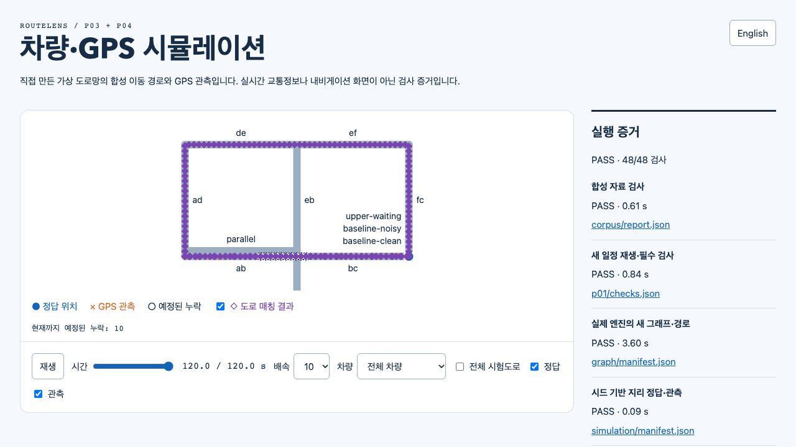
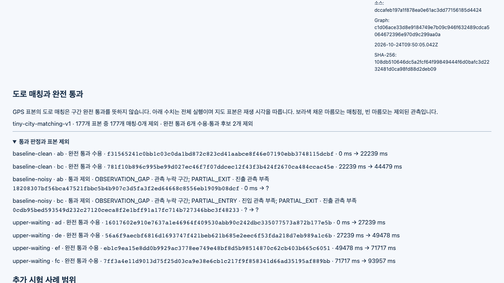

# P04 matching and whole-system simulation / P04 매칭·전체 구현 시뮬레이션

**Local result:48/48 integrated assertions passed. Hosted verification is pending.** This runs every currently implemented module, not the complete future P01–P14 pilot.

**로컬 결과:통합 검사48/48 통과. 원격 검증은 아직 전입니다.** 현재 구현한 모든 모듈을 실행한 결과이며 향후 P01~P14 전체 파일럿의 완료는 아닙니다.

[Actual recorded playback / 실제 재생 녹화](../../../docs/media/demo.mp4) · [Offline report / 오프라인 보고서](report.html) · [Manifest / 실행 목록](manifest.json) · [Independent main inspection / 메인 독립 검사](main-verification.json) · [Media provenance / 미디어 출처](../../../docs/media/latest.json)

## Exact run / 정확한 실행

- Clean implementation commit:`dccafeb197a1f878ea0e61ac3dd77156185d4424`; Node22.23.4 on macOS arm64; pinned Valhalla3.9.1 in Linux arm64 Docker. Source and implementation fingerprint are embedded in the report.
  구현 커밋은 위 값이며 미커밋 변경 없이 macOS arm64·Node22.23.4에서 Linux arm64 Docker의 고정 Valhalla3.9.1을 실행했습니다. 소스·구현 지문은 보고서에도 있습니다.
- Command:`node dist/tools/simulation_checks.js --output data/p04-main-20261024-r2` exited0. Stages:fresh corpus → P01 schedule → P02 graph/routing → P03 trajectories/GPS → replay/faults → P04 actual matching.
  위 명령은 종료0이며 자료 검사→P01일정→P02그래프/경로→P03궤적/GPS→재생/장애→P04실제매칭을 새로 실행했습니다.
- Graph:`c1d06ace33d8e9184749e7b09c946f632489cdca5064672396e970d9c299aa0a`. The matcher revalidates its bundle, mounts the graph read-only, preserves real requests/responses, and checks owned-container removal. Main independently verified137 matching evidence file hashes, exact split/overlap result bytes and no remaining owned containers.
  그래프는 위 식별자입니다. 묶음 재검사·읽기 전용 연결·실제 요청/응답 보존·소유 컨테이너 제거를 수행했습니다. 메인이 매칭 증거137파일 해시·분할/중첩 결과 바이트 동일성·잔여 컨테이너 없음을 독립 확인했습니다.

## Measured outcomes / 측정 결과

| Case / 사례 | Input coverage / 입력 범위 | Complete traversal outcome / 완전 통과 결과 |
| --- | --- | --- |
| Clean + waiting + gap / 깨끗한·정지·누락 차량 |177/177 road matches /177개 모두 도로 대응 |6 of8 truth traversals accepted;2 intentionally withheld,0 false traversals / 정답8개 중6수용·2보류·오수용0 |
| Clean boundaries / 깨끗한 경계 |6 complete traversals / 완전 통과6개 |Maximum1ms error vs fixed5ms tolerance; initial5s wait retained / 허용5ms에 최대1ms오차·초기5초정지 유지 |
| Continuous3m noise / 연속3m잡음 |90/90 road matches /90개 모두 대응 |3 of4 complete traversals accepted;1 partial excluded,0 false; internalDE/EF max444ms vs750ms /4개 중3수용·일부1제외·오수용0, 내부구간최대444ms/허용750ms |
| Parallel midpoint / 평행도로 중간점 |21/21 excluded /21개 모두 제외 |AMBIGUOUS_PARALLEL; no invented complete traversal / 모호성으로 완전 통과를 만들지 않음 |
| Split37 and overlap5 /37개분할·5개중첩 |Same177 input observations /동일177관측 |Result bytes, semantic hashes and traversal IDs identical /결과 바이트·의미 해시·통과ID 동일 |
| Invalid and upstream failure / 입력·엔진 실패 |Reversed, duplicate, wrong graph, changed graph, off-graph trace /역순·중복·다른/변조그래프·지도밖궤적 |Explicit rejection/failure, no successful output manifest; actual failing engine removed /명시적거부·실패·성공목록없음·실패한실제엔진정리 |

The gap trace loses observations from15 through24seconds; the14–25second interval hides the AB→BC crossing. Road assignment of its remaining points is not sufficient to calculate either complete traversal. All-vehicle and all-edge evaluations deliberately report missed truth traversals. Their `passed:false` means incomplete coverage, not a hidden failed integration assertion: the acceptance contract requires these uncertain outputs to be withheld.

누락 궤적은15~24초 관측이 없어14~25초 사이 AB→BC경계를 볼 수 없습니다. 남은 점의 도로 대응만으로 두 완전 통과를 계산할 수 없습니다. 전체차량/구간 평가에는 놓친 정답 통과를 숨기지 않습니다. 해당 자료의 `passed:false`는 전체 통과를 회수하지 못했다는 의미이며 숨긴 통합 실패가 아닙니다. 불확실한 출력을 보류하는 것이 이번 수용 계약입니다.

[All-vehicle evaluation / 전체차량 평가](matching/baseline.all-vehicle-evaluation.json) · [All noisy edges / 전체잡음구간](matching/continuous-noisy.all-edge-evaluation.json) · [P04 assertions / P04 검사](matching/checks.json) · [First failed attempt / 첫 실패 보존](failed-first-run/README.md)

## Browser and recording / 화면·녹화

Main inspected the actual generated report in the in-app browser: English/Korean,25s with10 omissions, vehicle selection, matching toggle and playback. Desktop1280×720 and mobile390×844 had no horizontal overflow. The report distinguishes matched samples from accepted traversals and retains exclusion reasons. An isolated Playwright session is used only for recording; the recording is actual report playback, not a generated animation.

메인이 내장 브라우저에서 실제 생성 보고서의 한영 전환·25초/누락10개·차량 선택·매칭 표시·재생을 확인했습니다. 데스크톱1280×720과 모바일390×844에 가로 넘침이 없었습니다. 매칭 표본과 통과 수용을 구분하고 제외 사유를 남깁니다. 영상은 격리된 Playwright 세션으로 실제 보고서를 재생한 녹화이며 가짜 애니메이션이 아닙니다.

## Boundaries / 한계

This policy is bounded, synthetic-only, finalized at trip end and specific to the authored tiny-city geometry. It is not a real-time or durable queue, probability estimate, real-road accuracy evaluation, complete navigation client or production reliability demonstration. Full P05–P14 behavior remains pending. Do not use these exclusions as a calibrated production quality threshold.

이 정책은 제한된 합성 여행 종료 시점에 작동하며 직접 만든 tiny-city지형 전용입니다. 실시간·영속 큐, 확률 추정, 실제도로 정확도 평가, 완전한 내비게이션, 운영 안정성 시연이 아닙니다. P05~P14전체 동작은 남아 있고 이 제외 기준을 보정된 운영 품질 기준으로 사용하면 안 됩니다.

The compact archive preserves requests, responses, configuration and results; local PBF/tiles and duplicated tampered graph bundles are omitted. Manifests retain the original full inventory. Reproduce a fresh local run to verify those binary paths. Main owns design/review; Sol agents `bilingual_cli` and `simulation_viewer` implemented separate runtime and integration/viewer scopes.

작은 공개 자료에는 요청·응답·설정·결과를 보존하며 로컬 PBF/타일·중복 변조 묶음은 생략합니다. 목록의 원래 전체 해시는 유지합니다. 바이너리 경로 검증은 새 로컬 실행으로 재현합니다. 메인이 설계·검토했고 Sol두명이 실행 코드와 통합/화면을 나눠 구현했습니다.
