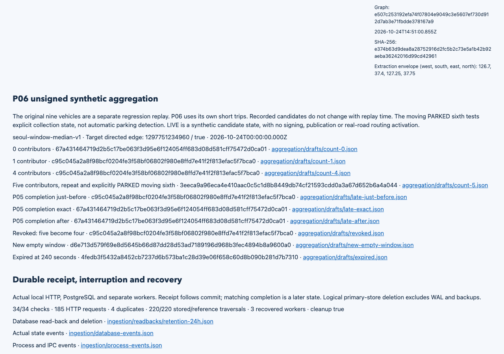

# Seoul traffic aggregation proof / 서울 교통 집계 검증

**Local PASS:151/151 = tiny48 + Seoul35 + ingestion34 + aggregation34.** Clean source `f295d8d2a6bc32227a868c4002aba38bd82c4df9`, completed2026-10-24T14:51:00.855Z. Main designed and independently inspected the results; Sol (`gpt-6.1-sol`) implemented the core, integration and matcher changes. Hosted verification is pending.

**로컬151/151 통과 = 작은 회귀48 + 서울35 + 수집34 + 집계34.** 위 깨끗한 소스로 실행했고 메인이 설계·독립 검사를, Sol이 코어·통합·매칭 구현을 맡았습니다. 원격 검증은 아직 전입니다.

[Recording / 실제 녹화](../../../docs/media/demo.mp4) · [Interactive report / 재생 보고서](report.html) · [Main inspection / 메인 검사](main-verification.json) · [Aggregation inspection / 집계 검사](aggregation/main-verification.json) · [Contract / 계약](../../../docs/23-p06-aggregation-contract.md) · [Module guide / 모듈 안내](../../../wiki/modules/traffic-aggregation.md)


## Actual execution / 실제 실행

A fresh Valhalla graph was built from the pinned Seoul OSM source. Nine synthetic GPS streams went through the real engine, HTTP ingestion and PostgreSQL workers. P06 then authored six short trips on the first three Teheran edges, with five travel speeds3/4/5/6/7m/s and an8s signal wait. A moving sixth declared PARKED tests explicit activity filtering, not automatic parking detection. Expectations were written before matching. Tiny-city remains regression-only.

고정된 실제 서울 OSM으로 Valhalla 그래프를 새로 만들고 합성 GPS9개 흐름을 실제 엔진·HTTP·PostgreSQL 처리자로 실행했습니다. P06은 테헤란로 첫3구간에서 속도3/4/5/6/7m/s·신호 대기8초인 주행5대와 PARKED로 선언한 이동1대를 만들었습니다. 여섯 번째는 명시 상태 필터 검사이며 자동 주차 감지가 아닙니다. 기대값은 매칭 전에 작성했고 작은 도로망은 회귀용으로만 유지합니다.

```sh
npm ci
npm run build
npm run simulation:check -- --output data/new-p06-run
npm run report:serve -- data/new-p06-run
```

Use Node22 or24 and Docker. Add `--source PATH` to reuse the exact pinned PBF. A new output directory is required. Local stage durations with cached source/images were8.44s tiny,37.06s graph,28.14s Seoul matching,78.32s ingestion and60.31s aggregation; these are not throughput benchmarks.

Node22·24와 Docker가 필요하고 정확한 고정 PBF를 재사용하려면 원본 인자를 추가합니다. 출력은 새 폴더여야 합니다. 캐시를 사용한 로컬 단계별 실측은 위 시간이며 처리량 성능 평가가 아닙니다.

## Inspected results / 직접 확인한 결과

| Contributors / 기여자 | Target state / 대상 상태 | Public speed / 공개 속도 |
| --- | --- | --- |
| 0 | UNKNOWN | null |
| 1 or4 / 1명 또는4명 | INSUFFICIENT | null |
| 5, plus repeat and PARKED / 5명·재통과·주차 포함 | LIVE | 2.70958m/s |
| 5→4 after revocation / 철회 후4명 | INSUFFICIENT | null |
| Exact expiry240s / 정확한 만료240초 | STALE | null |

Main verified **2,650 unique raw file hashes**, all220 stored baseline traversals, independently recomputed geometry/duration, retry byte equality and cleanup. The unchanged truth denominator is237:220 accepted,17 missed. The23 excluded engine candidates have a different denominator. There were no false complete traversals or gap bridges; maximum accepted boundary error260ms. All six noisy/gapped vehicles meet the fixed70% floor. Clean inputs accept79/79.

메인이 **서로 다른 원문 해시2,650개**, 저장된 기본 통과220개, 독립 거리·시간 계산, 복구 바이트 동일성과 정리를 확인했습니다. 정답237개 중220개 채택·17개 미회수이며 제외된 엔진 후보23개는 다른 분모입니다. 잘못된 완전 통과·누락 연결은0개, 최대 채택 경계시각 오차260ms이고 잡음·누락6대 모두 고정70%를 충족했습니다. 정상 입력은79/79입니다.

For P06, all79 public edges in every population were compared with actual stored contributions and authored activity. Five eligible contributors produce three LIVE edges;76 remain UNKNOWN. A repeat and moving PARKED sixth do not inflate the count. Maximum target duration error was0.478803ms; expected median speed2.709505623m/s versus actual2.70958m/s, relative difference0.002745%. A separate [live database query](main-live-contributions.json) captured21 committed contributions with actual activity, consent and availability before cleanup.

P06의 차량군별 공개79구간을 저장 통과·명시 활동과 대조했습니다. 적격5명은 LIVE3구간을 만들고 나머지76구간은 UNKNOWN입니다. 재통과·PARKED가 인원을 늘리지 않습니다. 최대 시간오차0.478803ms, 사전 계산 속도와 실제 차이는0.002745%였습니다. 별도 실행 중 DB조회로 정리 전 통과21건과 실제 활동·동의·사용 가능 시각을 읽었습니다.

Actual checks cover: persisted completion at89.999/90/90.001s; SIGKILL before/after aggregate commit; two concurrent workers converging to identical bytes; a real PostgreSQL revoke lock wait followed by same-transaction candidate invalidation; clock-only expiry; a newer empty window; plain SQL retention read-back and idempotent deletion; conflicting catalogs with one winner; strict public field whitelist. Main confirmed64 child PIDs and exact owned database/volume/engine absence. [P06 assertions](aggregation/assertions.json), [read-backs](aggregation/readbacks/), [process events](aggregation/process-events.json).

실제 성공 저장 시각의 마감 전후1ms·집계 커밋 전후 강제 종료·두 처리자의 동일 바이트 수렴·실제 DB 철회 잠금 대기와 같은 트랜잭션 후보 무효화·시계 만료·새 빈 창·직접 SQL 보존기한 삭제·반복 삭제·목록 충돌·공개 필드를 확인했습니다. 메인은 자식 PID64개와 소유 DB·볼륨·엔진 부재도 확인했습니다.



## Corrections and limits / 보정과 한계

The [initial probe](design-probe/README.md) failed endpoint rounding/timing. [Projection development](projection-development/) preserved the input and restored all5 targets. The [first clean run](prepublication-01/README.md) passed145 checks but review found degraded noisy coverage; the gate was strengthened to151. The [second run](failed-second-clean/README.md) failed Mapo12/18 and exposed false projected reversals plus lost native endpoint eligibility. The [third run](failed-third-clean/README.md) passed117 prior checks but an outdated parent count blocked P06. All failures remain recorded. The final fourth run uses unchanged inputs/thresholds and explicitly labeled engine endpoint anchors. See [v3 policy](../../../docs/24-observed-projection-policy.md).

최초 조사의 끝점 반올림·시간 실패를 같은 입력의 투영 보정으로 해결했습니다. 첫 전체 실행은145개를 통과했지만 검토에서 잡음 보존 감소를 찾아151개로 강화했습니다. 두 번째의 마포12/18 실패에서 투영 가짜 역행·엔진 끝점 자격 손실을 찾았고, 세 번째는 선행117개 통과 뒤 상위의 옛 개수 때문에 멈췄습니다. 실패를 모두 보존했으며 최종 네 번째는 입력·기준을 바꾸지 않고 엔진 끝점 근거를 명시합니다.

These are **unsigned SYNTHETIC candidates**. P07 signing/publication, P08 routing activation and P09–P14 remain incomplete. Native endpoint eligibility is uncertainty-bounded engineering evidence, not proof of a physical driver's crossing. This is not independent real-road accuracy, the reviewed100/100 geographic corpus, production authentication or physical erasure of WAL/backups. Exported artifacts cannot be recalled by database revocation.

이는 **서명 전 합성 후보**입니다. P07 서명·게시, P08 경로 반영과 P09~P14는 남아 있습니다. 엔진 끝점 자격은 불확실성 범위 안의 처리 근거이며 실제 운전자 통과의 독립 증명이 아닙니다. 실도로 정확도·검토된100/100자료·운영 인증·WAL/백업 물리삭제도 증명하지 않으며 DB철회로 내보낸 파일을 회수하지 않습니다.

## Provenance / 출처

- Runtime SHA256: `e374b63d9dea8a28752916d2fc5b2c73e5a1b42b92aeba36242016d99cd42961`.
- Graph: `e507c253192efa74f07804e9049c3e5607ef730d912d7ab3e71fbdde378167a9`.
- [Geofabrik source](https://download.geofabrik.de/asia/south-korea-261023.osm.pbf):289,916,859bytes, SHA256 `282d012b7629c643695f286d4424d7f6d88548d99edb5577ca5b678906f13c17`.
- PostgreSQL18.6 and Valhalla3.9.1 images are pinned in [original manifests](manifest.json). Graph2CPU/4GiB; database1CPU/512MiB.
- [Full text archive](evidence.tar.gz), [archive scope](ARCHIVE-SCOPE.md), [recording hashes](media-manifest.json).

Road geometry is © OpenStreetMap contributors, ODbL1.0; the envelope includes adjacent roads and is not an administrative polygon. All movement and identities are authored synthetic fixtures. No real-person traces or private credentials are published. Main inspected English/Korean desktop and390px mobile state changes with no horizontal overflow or recorded JavaScript errors.

지도는 OSM 기여자·ODbL1.0을 유지하며 추출 범위에는 인접 도로도 포함됩니다. 이동·식별자는 자체 합성이며 실제 개인 이력·인증정보는 공개하지 않습니다. 메인이 한영 데스크톱·390px 모바일 상태 전환을 확인했고 가로 넘침·기록된 JavaScript 오류는 없었습니다.

Actual recording: 25.350000s at1280×900/20fps, converted in full to MP4/GIF; full MP4 decoding passed and screenshots were inspected. Owned capture browser and report server are closed after inspection. / 실제 25.350000초를1280×900·20fps로 촬영해 전체를 변환했고 MP4전체 디코딩·화면 검사를 통과했습니다. 소유 촬영 브라우저·보고서 서버를 종료했습니다.
