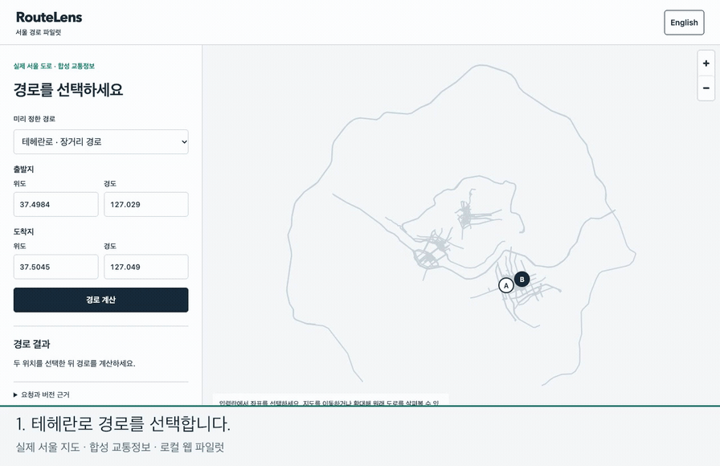

# NAV-01 native turn guidance / NAV-01 엔진 회전 안내

Status: local406 acceptance and direct original inspection complete; feature-branch delivery. Hosted CI is not yet claimed. / 상태: 로컬406개·직접 원문 검사 완료·작업 브랜치 전달이며 원격 CI 통과는 아직 주장하지 않습니다.

## Purpose and priority / 목적과 우선순위

The accepted P01–P14 pilot produced a route line. NAV-01 adds the native turn sequence that later GPS progress, rerouting and speech need. [Roadmap35](../../../docs/35-usable-navigation-roadmap.md) keeps independent geographic quality as a release gate. Phone lifecycle, rerouting/voice, real-clock hosted operation, measured traffic quality and independent operators remain separate increments.

기존 파일럿의 경로선에 이후 GPS 진행·재탐색·음성이 사용할 원 회전 목록을 연결합니다. 후속 계획에서 독립 도로 품질을 출시 조건으로 유지하며 휴대폰 수명주기·재탐색/음성·실제 시계 운영·교통 품질 실측·독립 운영자는 다음 구현으로 구분합니다.

Main Sol owns design, coding and direct review; the repository's Sol-main rule permits direct implementation. No new subagents, PR, merge or deployment are part of this increment. / 메인 Sol이 설계·구현·직접 검토했고 지침의 Sol 직접 구현 규칙을 따랐습니다. 이번 작업은 작업 브랜치 푸시까지입니다.

## Implemented contract / 구현 계약

- Optional `guidance_language` reaches the actual Valhalla3.9.1 daemon. Omission retains the original wire response. / 선택 언어를 실제 엔진까지 전달하며 생략하면 기존 전송 응답을 유지합니다.
- Native narrative is projected onto the exact validated polyline. Validate locale, car mode, known types, departure/arrival, bounds, continuity, plain text and explicit rounding tolerances. Missing/bad guidance refuses the node reply; existing deadlines, hashes and final freshness remain. / 언어·자동차·종류·출도착·범위·연결·문장·반올림 오차와 기존 해시·기한·최종 신선도를 검증합니다.
- The browser reads native English/Korean instructions in order. Language/input/freshness/failure changes clear route and guidance together. No real location collection, speech or start-driving claim is added. / 브라우저에 한영 원 안내를 표시하고 언어·입력·신선도·실패 때 경로와 함께 지웁니다. GPS 수집·음성은 후속입니다.

[Fixed contract36](../../../docs/36-nav01-turn-guidance.md), [upstream source notes](../../../wiki/sources/valhalla-guidance.md). A native locale is reused, not AI translation. Some Korean phrases are terse (for example a bear-left instruction); translation and driving usability need later review. / 고정 계약·공식 소스에 따라 엔진 언어를 재사용합니다. 한국어 일부 안내가 짧아 실주행 사용성·표현 검토는 남아 있습니다.

## Source and commands / 소스·명령

Clean source `eca1f9c4c8f705388d8d9f14a3016249470c9603`, implementation `e45cd76833284c384ef280f57fdedd3a62bf3af5eba4535363ae1a03f37c632e`. Node22.23.4 is the actual supported local runtime. Reports/media are copied after the run and do not alter those runtime bytes.

깨끗한 위 소스·실행 지문과 실제 Node22.23.4에서 검증했습니다. 보고서·녹화 파일은 실행 뒤 반영하며 실행 소스 바이트는 바꾸지 않습니다.

```sh
npm run build
node --test dist/tests/guidance.test.js dist/tests/gateway_core.test.js dist/tests/node_core.test.js dist/tests/traffic_core.test.js dist/tests/client_core.test.js dist/tests/client_state.test.js dist/tests/client_server.test.js dist/tests/client_integration.test.js dist/tests/scenario_report.test.js
npm test
npm run client:check -- --graph data/p13-final-20261025/seoul/graph --output data/nav01-development01
npm run simulation:check -- --output data/nav01-whole01
```

Focused58 and full310 tests passed. First standalone actual-browser32 + guidance16 passed; two independent audits checked2570 hashes,30 native pairs/14 browser success bindings and4 explicit bilingual baseline/traffic guidance bindings. Development reused the earlier verified graph and is not the fresh whole acceptance.

집중58개·전체310개와 첫 실제 브라우저32개+안내16개를 통과했습니다. 독립 감사 두 개에서2570해시·엔진30쌍/화면14건·한영 기본/교통 안내4건을 확인했습니다. 개발 검사는 이전 지도를 재사용했으며 새 전체 수용과 구분합니다.

## Actual recording / 실제 녹화

[](../../../docs/media/demo.ko.mp4)

A fresh automatic pilot on this run's Seoul graph produced three successes: desktop English,390px Korean IAB and the actual captured Korean route. Each is2412m/184.731s with9 native instructions. Synthetic traffic detours around three slow edges, so the returned path has0 live coverage despite an accepted snapshot. No live-traffic accuracy is inferred.

이번 새 서울 지도에서 자동 파일럿의 영어·390픽셀 한국어 내장 브라우저·한국어 녹화 경로3건을 확인했습니다. 각2412m·184.731초·원 안내9개입니다. 합성 저속 구간 세 개를 우회해 수용 자료가 있어도 반환 구간 적용률은0이며 실제 교통 정확도 근거로 보지 않습니다.

Raw28.5s is retained in full at1× speed. English/Korean caption bands occupy108px below the untouched1280×720 application frame; published videos are1280×828. App-region SSIM against the raw capture is0.996998 after ordinary H.264 compression. Main read native originals and inspected the captured frame and manual390px list, language reset and console. The recording browser's9 process identities and21 demo container names are absent after close; the demo app port is closed.

원본28.5초 전체를 원속도로 보존합니다. 한영 자막은 원 화면 아래108픽셀 띠에만 넣고 H.264 압축 후 원 화면 영역 유사도0.996998을 확인했습니다. 메인이 원문·영상 프레임·수동390픽셀 목록·언어 전환·콘솔을 확인하고 녹화 프로세스9개·시연 컨테이너21개·앱 포트를 정리했습니다.

## Corrections and limits / 수정·한계

Initial compile-only duplicate insertion/type errors were corrected before the clean source commit; logs are retained. An auxiliary IAB inspector first assumed `scrollWidth === 390`; the observed viewport was390 and the content375 because of a15px scrollbar. Corrected the auxiliary assertion to require no overflow within the actual viewport. The adapted whole-run inspector also initially changed the existing `mobile390` case name while updating the total count; that inspector-only typo was corrected and its failure log retained. Product acceptance criteria and code were unchanged. The CLI capture's console calls did not print a JSON sidecar; retained actual server HTTP/native originals and IAB DOM evidence provide the bindings, and the full video remains available.

깨끗한 커밋 전에 초기 중복 삽입·타입 컴파일 오류를 수정하고 기록을 보존했습니다. 보조 내장 브라우저 감사기의 너비 동등 비교는390픽셀 화면·15픽셀 스크롤바를 관찰한 뒤 실제 화면 안 넘침 없음으로 바로잡았습니다. 전체 감사기를 옮기며 기존 `mobile390` 검사 이름까지 전체 수로 바꾼 보조 도구 오타도 수정하고 실패 로그를 보존했습니다. 제품 코드·통과 조건은 바꾸지 않았습니다. 녹화 명령의 콘솔 호출은 JSON 부속 출력을 남기지 않아 보존 HTTP·엔진 원본·내장 화면 근거로 연결하며 전체 영상도 보존합니다.

This is a validated instruction preview. GPS progress, off-route detection, rerouting, voice, device permissions/background behavior, reviewed100/100 road evidence, real traffic/ETA quality and deployed service operation remain unverified. The desktop map scrolls with the document while reading a long list; the upcoming progress view needs its own driving layout/usability review. No PR/merge/deployment was performed.

검증한 경로 안내 미리보기입니다. GPS 진행·이탈·재탐색·음성·단말 권한/백그라운드·실도로100/100·실제 교통/시간 품질·배포 운영은 미검증입니다. 긴 목록을 읽으면 데스크톱 지도도 문서와 함께 스크롤되므로 이후 진행 화면에서 별도 배치·사용성 검토가 필요합니다. 병합·배포는 수행하지 않았습니다.

## Fresh whole acceptance / 새 전체 수용

Fresh actual Seoul graph `3d73519eb63737c10fddfa3e8a846c87e9f3d620ec82f6b4e178d6dee49130af` passed406/406 with the original390 cases preserved and16 fixed NAV-01 cases added. Main independently checked16276 unique original hashes, the new client/guidance boundaries, full native route/trace originals, standard signatures/durable state and all earlier modules. The Cloudflare audit checked11 complete PostgreSQL/Worker pairs and21 SQLite copies across14 actors, then rehashed unchanged originals.

새 실제 서울 지도에서 기존390개+고정 NAV-01의16개인406/406개를 통과했습니다. 메인이 독립 원문 해시16276개와 새 안내·브라우저 경계·엔진 경로/추적·표준 서명/영속 상태·기존 모듈을 검사했습니다. Cloudflare의 전체 집계11쌍·객체14개의 SQLite21개도 검사하고 원문 바이트를 재대조했습니다.

[Interactive completed report](report.html), [whole audit](main-whole-verification.json), [guidance audit](main-guidance-verification.json), [browser audit](main-client-verification.json), [native gateway audit](main-gateway-verification.json), [domain/scenario audit](main-domain-verification.json), [Cloudflare audit](main-cloudflare-verification.json), [actual recording audit](demo-verification.json). / 완료 보고서·전체·안내·브라우저·중계·업무 시나리오·Cloudflare·실제 녹화 감사를 각각 보존합니다.

## Reconstruct the originals / 원본 복원

[Whole inventory and archive receipt](originals/archive-verification.json), [exact declared map omissions](originals/omitted-files.json), [demo receipt](demo-originals/archive-verification.json), [development receipt](development/originals/archive-verification.json). Combine each directory's ordered `originals.tar.gz.part*`, verify the receipt hash, then extract into a fresh directory. Map binaries are excluded only at manifest-declared exact hashes; XML, SQLite/WAL/SHM and native JSON remain. [Inspectors](inspectors/), [manual IAB](iab/ko-mobile.png), [raw recording](capture-original.webm).

각 폴더의 순서 조각을 합치고 영수증 해시를 확인해 새 폴더에 풀 수 있습니다. 정확한 목록 지도 해시만 제외하고 XML·SQLite/WAL/SHM·엔진 JSON을 보존합니다. 감사기·수동 내장 화면·녹화 원본도 함께 저장합니다.

## Final publication checks / 최종 공개 자료 검사

The current media fingerprint/hashes passed. The bounded credential-pattern scan checked21,018 original text files with no findings; the preserved invalid-private-field rejection fixture is explicitly identified as a synthetic marker. All1,153 staged Markdown links resolved in the Git index. The whole archive was extracted into a new directory and all16,619 original sizes/hashes matched. Previous P13 media bytes were preserved unchanged at fixed paths before advancing the latest assets. These checks do not claim a universal secret detector or hosted CI acceptance.

현재 미디어 지문·해시와 원문 텍스트21,018개의 지정 자격정보 검사를 통과했습니다. 암호 비밀이 아닌 거부 검사 표식은 별도로 구분했고 최종 Git 목록의 문서 링크1,153개가 모두 연결됐습니다. 전체 묶음의16,619개 원문 크기·해시를 새 폴더에서 확인하고 이전 P13영상을 고정 경로에 그대로 보존했습니다. 모든 비밀의 탐지나 이번 원격 CI 통과를 주장하지 않습니다.

[Publication check receipt](delivery-check.json), [restoration proof](restoration-verification.json), [previous recording preservation](prior-media-preservation.json). / 공개 검사·복원·이전 녹화 보존 영수증입니다.
