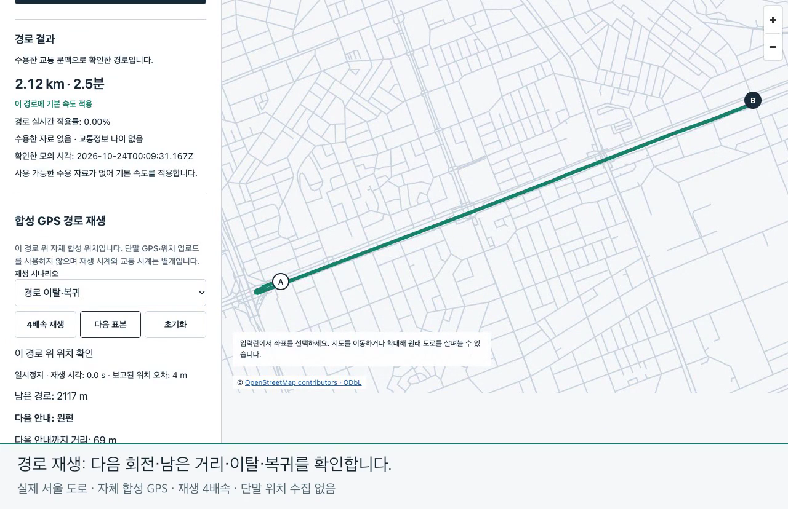

# NAV-02 route progress and replay / 경로 진행·재생

NAV-02 implements route-bound synthetic GPS replay on the actual Seoul OSM graph. Current location, next native turn and geometric remaining distance appear only when position is confirmed. Departure needs three usable positions over two seconds; rejoin and endpoint arrival require two positions over one second. Uncertainty withholds current guidance. No device GPS permission/upload, automatic rerouting or spoken guidance is implemented.

실제 서울 OSM 도로망에서 경로에 연결한 합성 GPS를 재생합니다. 위치를 확인한 경우에만 현재 위치·다음 엔진 회전·남은 기하 거리를 보여줍니다. 이탈은 유효 위치3개·2초, 복귀·경로 끝 도착은2개·1초를 요구하며 모호하면 현재 안내를 보류합니다. 단말 GPS 권한/업로드·자동 재탐색·음성 안내는 후속입니다.

## Identity and design / 식별과 설계

- Design, implementation and direct review: main Sol; no subagents. Contract37 and ADR032 fixed before coding. / 메인 Sol이 설계·구현·직접 검토했고 구현 전에 계약37·ADR032를 고정했습니다.
- Clean source: `7078d6f6b83572286408a5d8cfcf1beee74d4364`; implementation SHA256 `6d853cf2d924ea6a424a7d5338c16c6be7cc70df87d7e8b8b1a2ea0ec9ffe58d`.
- Fresh Seoul graph: `683ff7cfd037957f50504bd32040b6030585d439091dd593e2ca1b04ab84aa43`. Public OSM geometry and authored synthetic locations are distinct. / 공개 OSM 지형과 자체 합성 위치를 구분합니다.
- Branch `feat/navigation-progress` starts from protected main9b88a46 and includes the unmerged NAV-01 dependency without rewriting its history. The user authorized push and protected PR merge. / 보호 main에서 시작해 NAV-01의 미병합 의존 이력을 포함하고 사용자 승인 범위는 푸시·보호 PR 병합입니다.

## Direct verification / 직접 검증

- Node22.23.4 strict builds; focused31/31 and full320/320 tests. / 엄격 빌드·집중31개·전체320개 통과.
- Fresh whole438/438: all previous406 plus fixed32 NAV-02 cases, including actual native/browser flow, noisy positions, parallel/revisited roads, stale/future/reordered points, jumps, departure/rejoin/arrival and invalidation. See [whole report](report.html), [manifest](manifest.json), [independent progress](main-progress-verification.json), [whole audit](main-whole-verification.json). / 기존406개와 새32개를 모두 새 실행으로 검증하며 실제 엔진·화면·오차·평행/재방문·시간/순서·도약·이탈/복귀/도착·초기화를 포함합니다.
- Independent inspectors use original bytes and separate local-coordinate geometry math; standard Ed25519 verification, committed data, native requests/responses and copied SQLite are checked separately. Exact results are in the linked JSON receipts. / 독립 좌표 계산·원문 바이트·표준 서명·커밋된 저장 상태·엔진 요청/응답·복사 SQLite를 각각 검사하며 정확한 수치는 연결 JSON에 있습니다.
- Development run1 stopped because the test used visible `innerText` on collapsed diagnostics. Visible progress was correct. Commit7078d6f changes only those diagnostic reads to DOM `textContent`; one retry passed. Failure and retry originals are both retained. / 첫 개발 검사는 접힌 진단 읽기 오류로 중단됐고 실제 화면은 정상이었습니다. 진단 읽기만 수정해 한 번 재검사했으며 실패·성공 원문을 모두 보존합니다.
- Manual IAB: English next/remaining, language invalidation, Korean confirmed departure without current distances/confirmed marker, two-point rejoin,390px without horizontal overflow; no warning/error logs. [Manual evidence](iab/review.json). / 내장 브라우저에서 한영·다음/남은 거리·언어 초기화·이탈 보류·복귀·모바일390픽셀을 직접 확인했습니다.

## Actual recording / 실제 녹화

[](user-demo/demo.ko.gif)

[English GIF](user-demo/demo.gif) · [한국어 GIF](user-demo/demo.ko.gif) · [한국어 MP4](user-demo/demo.ko.mp4) · [untouched original42.7s](capture-original.webm).

The whole original recording is retained at1×; the application explicitly plays authored GPS at4×. English/Korean captions occupy a108px band below the original1280×720 application. There is no frame replacement, result replacement or fabricated location. The recorded route uses default speeds because the synthetic traffic snapshot had expired, and all three actual requests bind to original native outputs. It is not a live traffic demonstration. [Demo audit](demo-verification.json), [capture source](capture/), [media provenance](../../../docs/media/latest.json).

42.7초 전체 원 녹화를 원속도로 보존했고 화면의 GPS 자체 재생만4배속입니다. 자막은 원1280×720화면 밖 아래108픽셀에만 넣었으며 화면·결과·위치를 바꾸지 않았습니다. 촬영 시 합성 교통이 만료되어 기본 속도였고 실제 요청3건을 엔진 원문과 대조했습니다. 실시간 교통 시연으로 주장하지 않습니다.

## Reproduce and inspect / 재현·검사

```sh
npm ci --ignore-scripts --no-audit --no-fund
npm test
npm run simulation:check -- --output data/your-new-nav02-run
npm run media:check
npm run cloudflare:types -- --check
```

Inspectors and exact commands are retained under [inspectors](inspectors/); original stdout under [logs](logs/). Concatenate each archive's `originals.tar.gz.part*` in lexical order, verify the receipt SHA256, extract to a fresh directory, then check every original size/hash against `original-files.json.gz`. Only exact manifest-declared map binaries are omitted; native JSON/XML, diagnostics and SQLite/WAL/SHM remain. This is bounded credential-pattern screening, not a universal secret detector. / 독립 검사기·명령·원 출력·원문 묶음을 보존합니다. 분할 파일을 이름순으로 연결해 영수증 해시를 확인하고 새 폴더에 풀어 원문 전체를 목록의 크기/해시와 대조합니다. 선언한 지도 바이너리만 제외하고 엔진·진단·SQLite를 유지합니다.

## Limits and next work / 한계와 다음 작업

This proves authored route-bound behavior on original Seoul geometry. It does not measure real phone GPS accuracy, actual driving safety, legal road correctness, accessible destination entrances, real ETA or hosted Cloudflare operation. RM-001's independent100-route/100-matching quality gate remains open. Next is NAV-06 destination search/confirmation, followed by device lifecycle, rerouting/voice and separately authorized HTTPS deployment. / 서울 원 지형 위 자체 입력 동작을 증명했으며 실제 단말 정확도·실주행 안전·도로 법규·접근 출입구·실제 도착시간·운영 Cloudflare 검증이 아닙니다. 독립100/100기준을 유지하며 다음은 목적지 검색/확인입니다.

Hosted exact-head CI and merge results are appended only after observed completion. Main protection remains enabled; no deployment is performed. / 원격 정확한 커밋의 CI·병합 결과는 실제 확인 후 추가하며 보호를 유지하고 배포하지 않습니다.

Media preservation2026-10-25: First NAV-02 original42.7s assets now use stable paths; corrected runtime and new43.5s recording supersede this first acceptance. Historical measurements are unchanged. / 첫 NAV-02 원42.7초 자료를 고정 경로로 보존하고 수정 소스·새43.5초 녹화로 대체했으며 과거 측정은 그대로입니다.
