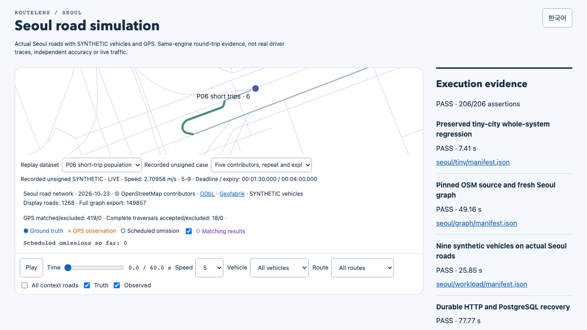
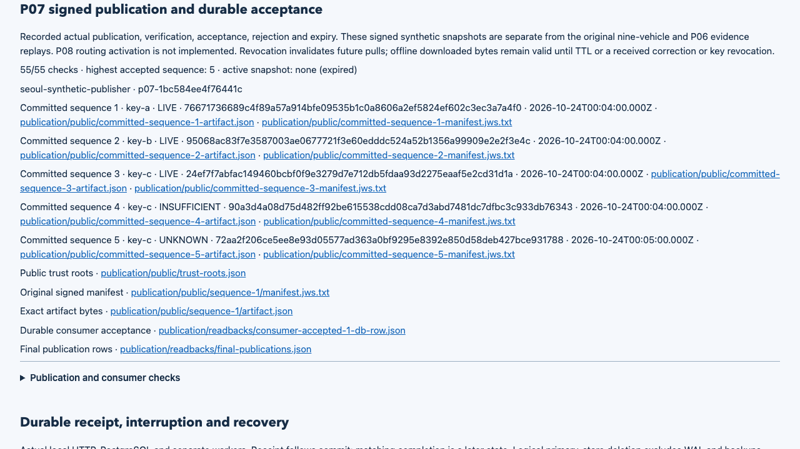

# Seoul publication after queue-race correction / 작업 선택 경쟁 수정 후 서울 게시 검증

**Local206/206 PASS** on clean source `4b8bf793d44beb110614987359e7a76fcd651159`. Main designed and reviewed the correction; Sol implemented the three-line claim fix, worker diagnostics and two focused regressions. A fresh graph and every implemented module ran again. Hosted verification of this corrected runtime is pending.

**깨끗한 소스에서 로컬206개 모두 통과했습니다.** 메인이 수정 설계·검토를, Sol이 claim3줄·처리자 진단·집중회귀2개를 구현했습니다. 새 그래프와 구현된 모든 모듈을 다시 실행했으며 수정한 실행 코드의 원격 검증은 남아 있습니다.

[Recording / 녹화](../../../docs/media/demo.mp4) · [Replay / 재생](report.html) · [Whole inspection / 전체 검사](main-verification.json) · [Publication / 게시 상태](publication/main-state-verification.json) · [Independent signatures / 독립 서명](publication/main-signature-verification.json) · [Correction contract / 수정 계약](../../../docs/26-p05-claim-race.md)

## Why this follow-up exists / 후속 수정 이유

The [earlier P07 report](../2026-10-25-p07/report.md) passed local/hosted206. Final-head PR execution then found one worker IDLE while another succeeded and five trips had been READY. A controlled PostgreSQL reproduction confirmed that a contributor chosen from an older statement snapshot could have no eligible trip in the next statement while another contributor still had work. Exact historical CI interleaving was not recorded. The fix retries only this stale selection after the transaction finishes; genuine empty selection, lock order, lease/fence, expiry and attempt limits stay unchanged. The two-success gate was not relaxed.

이전 P07은 로컬·원격206개를 통과했지만 최종 PR실행에서 대기 여행이 남아 있는데 한 처리자가IDLE을 반환했습니다. 실제DB 재현으로 첫 조회의 옛 시점에서 고른 기여자가 다음 조회에는 적격 여행이 없고 다른 기여자의 작업은 남아 있는 경우를 확인했습니다. 과거CI의 정확한 명령 순서는 기록되지 않았습니다. 해당 경우에만 트랜잭션 종료 뒤 재선택하며 실제 빈 큐·잠금순서·임대/소유권·만료·시도제한·두 처리자 성공 기준은 유지합니다.

[Original failure](failed-ci/evidence.tar.gz) · [Reproduction](reproduction/summary.md) · [Fixed production-claim probe](fixed-probe/summary.md) · [Main review](fixed-probe/main-verification.json). The first fixed-probe wrapper failed before the intended gate; its evidence is preserved, and only that test facade was corrected before one successful retry. Focused2/2 and strict Node22 build passed once. The actual corrected probe returned distinct a/b leases, each fence1/attempt1.

실패·재현·수정 후 실제생산claim 근거를 보존합니다. 최초후속시험은 시험장치가 대기 지점 전에 실패해 보존하고 시험장치만 정정한 뒤 한 번 재실행했습니다. 집중2개·엄격빌드는 한 번 통과했고 실제수정검사는 a/b를 각각fence1·attempt1로 확보했습니다.

## New whole-system evidence / 새 전체 실행 근거

Main checked **3053 distinct original hashes**,220 stored/reference traversals and independent geometry/timing (maximum260ms), identical recovery bytes, real database/process failure/restart and deletion. The fresh run keeps237 truth traversals:220 accepted and17 missed;23 excluded engine candidates have a different denominator. P06 again produces2.70958m/s from five contributors, with0.002745% relative error.

메인이 **서로 다른 원문 해시3053개**·저장/기준220통과·독립거리/시간(최대260ms)·동일복구바이트·실제DB/프로세스장애/재시작·삭제를 확인했습니다. 정답237중220채택·17미회수이며 제외된엔진후보23개는 다른분모입니다. P06의5명속도2.70958m/s·상대오차0.002745%도 유지했습니다.

P07 retains55 checks. Five standard JWS signatures were independently verified with Node crypto; four HTTP captures exactly match committed bytes. Version3 was committed then invalidated before retrieval; versions1/2 are LIVE,4 is INSUFFICIENT after revocation,5 is an empty UNKNOWN window. Thirty negative cases retain exact refusal reasons and unchanged prior state. Actual crashes, locking, revocation and clock-only expiry remain verified. Main checked126 owned child PIDs and exact owned database/volume/engine absence.

P07검사55개를 유지했습니다. Node암호로서명5개를 독립검증했고 HTTP4개는 저장바이트와 정확히 같습니다.3번은저장후조회전무효화됐고1/2는LIVE·4는철회후INSUFFICIENT·5는빈UNKNOWN창입니다. 부정30사례의정확한거부·기존상태보존, 실제중단·잠금·철회·시계만료·소유PID126개와DB/볼륨/엔진부재를확인했습니다.

## Reproduce and limits / 재현과 한계

Use Node22/24 and Docker: `npm ci`, `npm run build`, `npm run simulation:check -- --output data/new-run`, then `npm run report:serve -- data/new-run`. A new output directory is required. Road source is the pinned2026-10-23 Seoul OSM envelope; all vehicles and GPS remain synthetic. The26.95-second recording is actual playback of this new report, not the earlier run. Exact duration and hashes are in [media manifest](media-manifest.json).

Node22/24·Docker에서 위 명령으로 실행하며 새 출력 폴더를 사용합니다. 고정2026-10-23 서울OSM범위를 사용하고 차량·GPS는 합성입니다. 약27초 녹화는 이전자료가 아닌 새 보고서의 실제재생이며 정확한 길이·해시는미디어목록에 있습니다.

- Runtime SHA256: `dcb2d3aa1de9c457d3119af0ddf6c18663de4fe800bb82ed20ef0791e305320e`.
- Graph: `7f4fd63e63aae5e5b961fc26d36ecae0fe30128c5508d4e184109ef16d59a4be`.
- Source SHA256: `282d012b7629c643695f286d4424d7f6d88548d99edb5577ca5b678906f13c17`.
- [Raw evidence](evidence.tar.gz) · [Omissions/license](ARCHIVE-SCOPE.md) · [Original manifests](manifest.json).

OSM-derived geometry retains © OpenStreetMap contributors and ODbL1.0. Private keys and real-person traces are excluded. P07 proves signed publication/durable acceptance; P08 actual traffic activation and P09–P14 remain incomplete. No production authentication, real-driving accuracy or immediate recall of offline artifacts is claimed.

OSM지형은기여자·ODbL1.0을유지하고비밀키·실제개인이력을제외합니다. P07은서명게시/영속수용이며P08실제속도반영과P09~P14는남았습니다. 운영인증·실주행정확도·오프라인파일즉시회수는주장하지않습니다.

Main inspected bilingual rendered states,390px mobile and1280px desktop without horizontal overflow or recorded JS errors. The corrected26.95s capture was fully decoded and its screenshots/frame reviewed. Eight capture processes, both temporary report-server sessions and IAB tabs are closed. A first framing-only recording was discarded and retained locally; no simulation was repeated for this. [Media inspection](media-verification.json).

메인이한영상태·모바일390px·데스크톱1280px에서가로넘침·JS오류없음을확인하고26.95초녹화전체디코딩·화면/프레임을검사했습니다. 촬영프로세스8개·임시보고서서버두세션·내장탭을정리했습니다. 첫촬영의가로위치문제로녹화만교체하고원본을로컬에보존했으며시뮬레이션을반복하지않았습니다.
