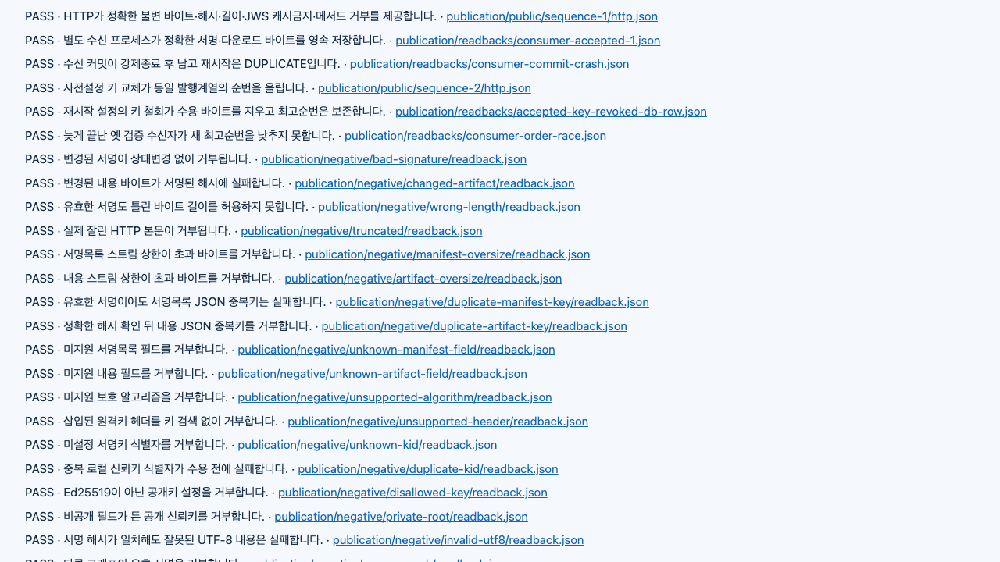

# Seoul signed traffic publication / 서울 교통정보 서명 게시 검증

**Local PASS: 206/206 = tiny48 + Seoul35 + P05 ingestion34 + P06 aggregation34 + P07 publication55.** Clean source `d78b2c1aaee471360dd59b5a277d7b83f23dc77f`. Main designed the contract, reviewed the implementation and directly inspected original outputs. Sol (`gpt-6.1-sol`) implemented the production modules and tests. Hosted Node22/24 each200/200 and the actual Linux206/206 run passed; main independently inspected the downloaded artifacts below.

**로컬206개 모두 통과: 작은 회귀48·서울35·수집34·집계34·게시55.** 위 깨끗한 소스에서 실행했습니다. 메인이 계약 설계·구현 검토·원문 직접 검사를, Sol이 생산 코드·테스트 구현을 담당했습니다. 원격 Node22/24 각각200개·실제Linux206개도 통과했고 메인이 다운로드 결과를 아래와 같이 독립 검사했습니다.

[Actual recording / 실제 녹화](../../../docs/media/demo.mp4) · [Interactive report / 재생 보고서](report.html) · [Whole inspection / 전체 검사](main-verification.json) · [Independent signatures / 독립 서명 검사](publication/main-signature-verification.json) · [Durable state / 영속 상태 검사](publication/main-state-verification.json) · [Contract / 계약](../../../docs/25-p07-publication-contract.md) · [Module / 모듈](../../../wiki/modules/signed-publication.md)


## What ran / 실행한 내용

A fresh Valhalla graph was built from the pinned actual Seoul OSM source. Nine authored GPS streams exercised real matching, HTTP ingestion and PostgreSQL recovery. Separate short-trip populations then exercised P06 aggregation and P07 publication: five contributors traversed actual Teheran-ro edges; P05 workers stored matched observations, P06 created the authoritative candidate, a publisher committed signed bytes, an HTTP process served them, and separate consumer processes verified and durably accepted them. No successful P07 draft was injected directly. Tiny-city is regression-only.

고정한 실제 서울 OSM으로 Valhalla 그래프를 새로 만들었습니다. 합성 GPS9개 흐름으로 실제 매칭·HTTP 수집·PostgreSQL 복구를 실행했습니다. 별도의 짧은 여행 차량군으로 집계·게시를 검사했습니다. 테헤란로 실제 구간을 통과한5명의 자료를 P05가 저장하고 P06이 원본 후보를 만들면 게시자가 서명 바이트를 저장하고 HTTP 서버가 제공하며 별도 수신 프로세스가 검증·영속 수용합니다. 성공 후보를 P07에 직접 넣지 않았습니다. 작은 도로망은 회귀용입니다.

```sh
npm ci
npm run build
npm run simulation:check -- --output data/new-p07-run
npm run report:serve -- data/new-p07-run
```

Use Node22/24 and Docker; add `--source PATH` to reuse the exact pinned source. Always choose a new output directory. Cached local stage times: tiny10.10s, graph41.78s, Seoul33.35s, ingestion81.79s, aggregation61.21s, publication31.93s. These are execution observations, not throughput benchmarks.

Node22/24·Docker가 필요하고 정확한 고정 원본 재사용에는 원본 경로 인자를 추가합니다. 출력은 항상 새 폴더를 사용합니다. 위 시간은 캐시를 사용한 이번 로컬 실행 실측이며 처리량 성능 평가가 아닙니다.

## Direct findings / 직접 확인한 결과

Main checked **3,047 distinct original file hashes**, all220 stored/reference baseline traversals, independently recomputed geometry and timing, exact recovery-result bytes and original failure/restart/deletion read-backs. The unchanged truth denominator is237:220 accepted,17 missed;23 excluded engine candidates use a different denominator. No false complete traversal or gap bridge occurred; maximum accepted boundary error260ms. P06 retained all79 entries, with five contributors producing three LIVE edges and76 UNKNOWN. Median speed2.70958m/s differs from the authored expectation by0.002745%.

메인이 **서로 다른 원문 해시3,047개**, 저장/기준 통과220개, 독립 거리·시간 계산, 복구 결과 바이트, 원래 장애·재시작·삭제 재조회를 확인했습니다. 정답237개 중220개 채택·17개 미회수이며 제외된 엔진 후보23개는 분모가 다릅니다. 잘못된 완전 통과·누락 연결은0개, 최대 경계 오차260ms입니다. P06은 전체79항목을 유지하고5명에서 LIVE3개·UNKNOWN76개를 만듭니다. 중앙값 속도2.70958m/s의 사전 기대값 대비 오차는0.002745%입니다.

| Version / 버전 | Signing key / 서명 키 | Public contents / 공개 내용 | Observed transport / 전송 근거 |
| --- | --- | --- | --- |
| 1 | key-a | LIVE3 + UNKNOWN76 | Exact HTTP bytes / 정확한 HTTP 바이트 |
| 2 | key-b | LIVE3 + UNKNOWN76 | Rotation; exact HTTP bytes / 키 교체·HTTP 바이트 |
| 3 | key-c | LIVE3 + UNKNOWN76 | Committed, then invalidated before retrieval / 저장 후 조회 전에 철회로 무효화 |
| 4 | key-c | INSUFFICIENT3 + UNKNOWN76 | Fresh correction after5→4 contributors / 철회 후4명으로 재집계한 정정본 |
| 5 | key-c | UNKNOWN79 | New empty window replaces prior speeds / 새 빈 창이 이전 속도를 대체 |

Main independently verified all five compact JWS signatures with Node `crypto.verify`, without reusing jose or the product crypto helper. Four actual HTTP captures matched committed bytes exactly. All five signed contents matched the respective authoritative P06 candidate. Sequence3 was never claimed as successfully served: revocation invalidated its current pointer before retrieval. A separate [live SQL observation](main-live-publication.json) found two publications and zero consumers at the sampled instant; it is not the final row count.

메인은 제품의 jose·암호 도우미를 재사용하지 않고 Node 암호 API로 JWS5개를 독립 검증했습니다. 실제 HTTP 캡처4개가 저장 바이트와 정확히 같고 서명 내용5개가 해당 P06 원본 후보와 일치했습니다.3번은 조회 전에 철회돼 제공 성공으로 세지 않았습니다. 별도 실행 중 SQL은 당시 게시2개·수신0개를 관찰했으며 최종 행 개수로 사용하지 않습니다.

The55 P07 checks include four actual SIGKILL events, publisher rollback and post-commit retry, initial publication and key-rotation races, consumer restart/order, accepted-key revocation,30 exact negative rejection reasons with unchanged prior state, real HTTP redirects/timeouts, a PostgreSQL lock wait during HTTP revocation, same-transaction current-pointer removal,239.999s valid versus240.000s expired, and expiry between crypto verification and durable acceptance. Main checked406 P07 raw hashes within the overall total and confirmed126 owned child PIDs plus exact owned database/volume/engine absence across the whole run.

P07의55개 검사는 실제 강제 종료4회·게시 롤백/커밋 후 재시도·최초 게시/키 교체 경쟁·수신 재시작/순서·수용한 키의 철회·기존 상태를 보존하는 정확한 부정 사유30개·실제 HTTP 리다이렉트/시간 초과·HTTP 철회 중 DB 잠금 대기·동일 트랜잭션 현재 참조 삭제·239.999초 유효/240초 만료·암호 검증 후 저장 전 만료를 포함합니다. 전체 해시 중 P07 원문406개를 검사했고 전체 소유 자식 PID126개·정확한 DB/볼륨/엔진 부재를 확인했습니다.




## Corrections, provenance and limits / 정정·출처·한계

[Core development](core-development/README.md) passed14 focused cases; integration tests passed3 after correcting only a missing fixture field in the one failed test. [Actual development run](development/README.md) passed55. The [first clean whole run](interrupted-first-clean/README.md) stopped during P07 database readiness after prior151 passed; on resumption its processes and local Docker runtime were stopped. The initiating cause is unknown. Partial evidence and exact cleanup are retained. The final second clean run above uses unchanged runtime code and gates. Main also corrected accidentally mixed Japanese paragraphs in the Korean contract without changing its requirements.

코어 집중14개·통합3개를 검증했고 통합의 최초 실패1개는 시험자료 필드 누락만 바로잡아 해당 검사만 다시 실행했습니다. 실제 개발 실행55개를 통과했습니다. 첫 깨끗한 전체 실행은 선행151개 이후 P07 DB 준비 중 멈췄고 재개 시 프로세스·로컬 Docker가 중지돼 있었습니다. 최초 원인은 미확정이며 부분 증거·정리를 보존했습니다. 최종 두 번째 실행은 코드·기준을 바꾸지 않았습니다. 한국어 계약에 잘못 섞인 일본어 문단도 요구사항 변경 없이 정정했습니다.

- Runtime SHA256: `80cefb7edfcb5055139da48b886073b6dc9d2cce87366e3832093dbb12ae59e9`.
- Graph: `def78e7b971076f5cc82529283a607bf621961ea98db87d56ad0b0c60afa6ff6`.
- [Geofabrik source](https://download.geofabrik.de/asia/south-korea-261023.osm.pbf):289,916,859bytes; SHA256 `282d012b7629c643695f286d4424d7f6d88548d99edb5577ca5b678906f13c17`.
- Pinned Valhalla3.9.1 and PostgreSQL18.6 identities: [original manifests](manifest.json). Exact jose6.2.13: [source note](../../../wiki/sources/jose-publication.md).
- [Raw archive](evidence.tar.gz) · [Archive omissions and license](ARCHIVE-SCOPE.md) · [Media identities](media-manifest.json).

Road geometry is © OpenStreetMap contributors, ODbL1.0. The Seoul envelope includes adjacent roads, not an administrative polygon. All movement and identities are authored SYNTHETIC fixtures. Per-run private keys and credentials are excluded; the deliberately invalid private-root fixture uses only the fixed literal `d: "invalid-private-field"`.

도로 지형은 OSM 기여자·ODbL1.0을 유지하며 서울 추출 범위에는 인접 도로도 포함됩니다. 이동·식별자는 자체 합성입니다. 실행별 비밀 키·인증정보는 제외하며 잘못된 비밀 키 입력 사례에는 고정된 무효 문자열만 사용합니다.

P07 proves signed publication and durable acceptance, **not P08 activation in Valhalla**. Already downloaded files cannot be recalled from offline clients. Production HTTPS/authentication, independently reviewed real-driving accuracy, the100/100 geographic corpus, distributed nodes and a complete navigation client remain separate work. The viewer replays recorded evidence; P08–P14 remain incomplete.

P07은 서명 게시·영속 수용을 검증하며 **P08의 Valhalla 속도 반영은 아직 아닙니다.** 오프라인 클라이언트가 받은 파일을 즉시 회수할 수 없습니다. 운영 HTTPS·인증·독립 실주행 정확도·100/100 지역 자료·분산 노드·완성된 내비게이션은 별도입니다. 화면은 기록된 증거를 재생하며 P08~P14는 남아 있습니다.

Actual recording:27.05s at1280×720/20fps; the entire recording was converted and MP4 fully decoded. Main inspected screenshots and a moving frame, bilingual controls and390px mobile layout without horizontal overflow or recorded JavaScript errors. All8 capture processes, report server and temporary IAB tab were closed. [Capture inspection](media-verification.json) · [Original WebM](capture.webm).

실제27.05초를1280×720·20fps로 녹화해 전체 변환·MP4 전체 디코딩을 확인했습니다. 메인이 화면·움직이는 프레임·한영 조작·390px 모바일을 확인했고 가로 넘침·기록된 JavaScript 오류는 없었습니다. 촬영 프로세스8개·보고서 서버·임시 내장 탭을 정리했습니다.

## Hosted verification / 원격 검증

[Run40110857288](https://github.com/dicebattle/routelens/actions/runs/40110857288), clean push `7ccaabfb269eb689011e5cca6449f6f71d342710`, passed Node22/24 each200/200, actual Linux Docker206/206 and Required checks. Main checked3,064 available original hashes, all220 stored/reference traversals and independent geometry/timing, P06 stored populations, five standard signatures/four HTTP captures,30 exact negative reasons, durable accepted bytes/order, real SIGKILL/lock/revoke/expiry and original cleanup diagnostics. [Whole proof](hosted-verification.json) · [Aggregation](hosted-aggregation-verification.json) · [Signatures](hosted-signature-verification.json) · [Publication state](hosted-publication-verification.json) · [Original CI](hosted/ci.json).

깨끗한 푸시에서 원격 Node22/24 각각200개·실제 Linux Docker206개·필수 검사를 통과했습니다. 메인이 가능한 원문3,064해시·저장/기준220통과·독립거리/시간·P06차량군·서명5개/HTTP4개·정확한부정30사례·영속내용/순서·실제강제종료/잠금/철회/만료·원래정리진단을검사했습니다.

Remote graph `be72b68d2b37cf5411af8ca2bd5014fc17e8a6835c689661bf5ca8b85e792675` has a distinct verified identity. Fifteen graph binaries omitted by CI are explicitly listed and were not rehashed after download. Remote cleanup is supported by execution diagnostics, not a later live remote PID query. Selected original files are retained under hosted/; the complete CI artifact uses workflow retention. Main inspected the public README GIF and confirmed public MP4 bytes equal the local recording. Final documentation-head checks precede protected PR#8 merge.

원격 그래프는 별도 식별자를 검증했습니다. CI가 제외한 그래프 바이너리15개는 명시하고 다운로드 후 검사한 것으로 세지 않았습니다. 원격 정리는 실행 진단 근거이고 실시간 원격 PID 조회는 아닙니다. 주요 원문은 hosted에 보존하며 전체 CI 결과물에는 보관기간이 적용됩니다. 공개 README GIF·MP4의 로컬동일바이트를 확인했고 최종 문서 커밋 검사 후 보호된 PR#8을 병합합니다.
