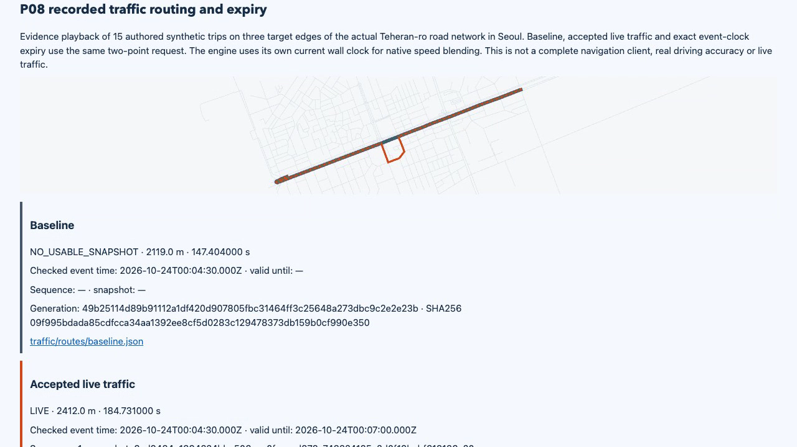
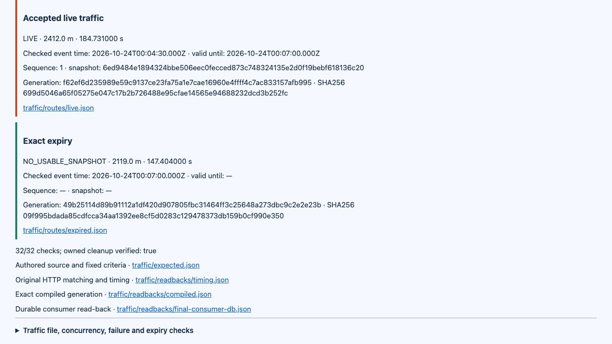

# Seoul routing after endpoint portability correction / 끝점 호환성 보완 후 서울 경로 검증

**Corrected local238/238 PASS** on clean source `4e3265fb92016e3642670fe44ae516df1f68d903`. Main fixed the design, reviewed Sol's narrow selector change, and directly reran every implemented module with a fresh Seoul graph. Corrected hosted validation also passed: 238/238 and Node 22/24 each 217/217; see the [downloaded original evidence and independent audit](hosted/README.md).

**수정한 깨끗한 소스에서 로컬238개를 모두 통과했습니다.** 메인이 설계를 정하고 Sol의 좁은 선택기 수정을 검토한 뒤, 서울 그래프를 새로 만들어 구현된 모든 모듈을 직접 다시 실행했습니다. 수정 후 원격 전체 238개와 Node 22·24 각각 217개도 통과했으며 내려받은 원문을 독립 검사했습니다.

[Actual34.7s recording / 실제34.7초 녹화](demo.mp4) · [Replay / 재생](report.html) · [Whole inspection / 전체 검사](main-verification.json) · [Independent P08 inspection / 독립 P08 검사](main-traffic-verification.json) · [Correction and failed originals / 수정·실패 원문](README.md)

## Correction boundary / 수정 범위

The initial [P08 report](../2026-10-25-p08/report.md) passed locally, but the Linux runner recorded one west endpoint longitude differently by a single polyline6 grid unit, approximately0.088m. Main verified matching source bytes, source lock, Dockerfile and engine version, plus the same OSM way, car access and directed connectivity. The exact low-level arithmetic cause remains unproven.

최초P08은 로컬에서 통과했지만 Linux가 서쪽 끝점 경도를 소수6자리 격자 한 칸, 약0.088m 다르게 기록했습니다. 메인은 동일한 원본 바이트·잠금·Dockerfile·엔진 버전과 같은 OSM도로·자동차 접근·방향 연결을 확인했습니다. 하부 산술 원인까지 확정하지는 않았습니다.

Only source selection changed: compare integer microdegrees within one unit per axis, require a unique candidate on the fixed way and route, and use the original graph coordinates unchanged. Two-unit drift, duplicate candidates and reverse orientation remain rejected. The five-contributor, three-LIVE,150ms timing,2% median, minimum detour and exact420s expiry checks are unchanged. Focused source3/3 and actual downloaded-hosted-metadata generation passed before this clean full execution. Their earlier fixture-only arithmetic error is preserved in [the source evidence archive](source-verification.tar.gz).

원본 선택만 바꿨습니다. 정수 마이크로도 축별 한 칸 이내를 비교하고 고정 도로·경로의 고유 후보를 요구하며, 그래프 좌표를 고치지 않고 사용합니다. 두 칸 차이·중복·역방향은 거부합니다. 기여자5명·LIVE3개·150ms·중앙값2%·최소 우회·정확420초 만료 검사는 유지합니다. 집중3개·실제 원격 메타데이터 생성 검사를 통과한 뒤 이번 깨끗한 전체 실행을 수행했으며 최초 시험자료만의 산술 오류도 보존합니다.

## Fresh actual results / 새 실제 결과

| Scope / 범위 | Result / 결과 |
| --- | --- |
| Previous modules / 기존 모듈 | tiny48 + Seoul35 + ingestion34 + aggregation34 + publication55 =206 |
| P08 actual routing lifecycle / 실제 경로 수명주기 |32/32 |
| Whole clean run / 깨끗한 전체 실행 |238/238 |
| Main distinct original hashes / 메인의 고유 원문 해시 |4,159 |
| New authored congestion / 새 합성 정체 |15 trips,2,956 observations,15 accepted target traversals, no neighboring contribution / 15여행·관측2,956개·대상통과15개·이웃기여없음 |
| Baseline / 기본 |2.119km,147.404s |
| Accepted congestion / 수용 정체 |2.412km,184.731s; actual trace avoids all three targets / 실제 통과가 세 대상을 모두 회피 |
| Exact expiry / 정확한 만료 |LIVE at419.999s; identical baseline shape/ETA at420s / 419.999초유효·420초동일기본복구 |

All routes use the same two-point request without excluded roads or artificial cost weights. Main independently recomputed source kinematics, geometry and medians; maximum target boundary error is0.494ms. Standard Node crypto verified three P08 signatures, and an independent parser checked the14-member traffic archive and exact three positive speed records. Original route/trace stdout, seven exact negative reasons, real pre/post-publication kills, corrections, high-water values and expiry were inspected. The updated audit also reports endpoint anchor/actual grid and metre differences explicitly.

모든 경로는 도로 제외·인위 비용 가중 없이 같은 두 좌표 요청을 사용합니다. 메인은 원본 이동·지형·중앙값을 독립 재계산했고 대상 경계 최대 오차0.494ms를 확인했습니다. 표준 Node암호로 P08서명3개를, 독립 해석기로14멤버 교통파일과 양수속도3기록을 검사했습니다. 원 경로/통과 stdout·부정7개의 정확사유·실제 게시 전후 종료·정정·최고순번·만료를 검사했습니다. 갱신한 감사에는 끝점 기준/실제 좌표의 격자·미터 차이도 명시합니다.

Main separately queried the actual running [P07 database](main-live-publication.json) and [P08 database](main-live-traffic.json). These are point-in-time observations. Earlier behavior remains verified through [P06 raw aggregation](aggregation/main-verification.json), [P07 standard signatures](publication/main-signature-verification.json) and [durable state/crash/revocation/expiry inspection](publication/main-state-verification.json). Current exact owned-resource absence was checked locally; this is not a claim about a future remote host.

메인은 실행 중인 P07·P08 DB도 별도로 직접 조회했으며, 그 수치는 해당 시점의 관측입니다. 기존 집계·표준 서명·영속 상태/중단/철회/만료의 원문 검사도 유지합니다. 현재 정확한 소유 자원 부재는 로컬에서 확인했으며 아직 실행하지 않은 원격 호스트에 대한 주장이 아닙니다.

## Current recording and reproduction / 최신 녹화·재현

The new recording is34.7s at1280×720/20fps, captured from this corrected clean run rather than reused from the prior report. Main decoded the entire MP4, inspected the exported frames and checked EN/KO controls,32 expanded cases and390px mobile without overflow or JavaScript errors. All eight recording processes, the report server and the IAB tab were closed. [Media proof](media-verification.json) · [Exact media hashes](media-manifest.json) · [Capture cleanup](capture-cleanup.json).

새 영상은 보완한 깨끗한 실행에서 실제로 촬영한34.7초·1280×720·20fps이며 이전 영상을 재사용하지 않았습니다. 메인은 전체 디코딩·추출 화면·한영 조작·펼친32사례·390px 넘침/스크립트 오류 없음을 확인하고 촬영8프로세스·보고서 서버·내장탭을 종료했습니다.

- Runtime SHA256: `12b6c0164fba48fd08f6b2732ccd24197634ec9ae734ecf0a5de500a5e365404`.
- Graph / 그래프: `bae9f30609e49d87f496dd92380894800262b55a8f927f0cc1c3805c6692e384`.
- Source SHA256: `282d012b7629c643695f286d4424d7f6d88548d99edb5577ca5b678906f13c17`.
- [Raw evidence](evidence.tar.gz) · [Archive hash](archive-sha256.json) · [Exact archive inventory](archive-contents-verification.json) · [Omitted map binaries](omitted-files.json) · [Inspectors](inspectors/).

The archive retains all4,842 original files within its stated boundary, including hidden staging evidence and27 traffic archives. Only26 regenerable map binaries/extracts are omitted with exact lengths and locally checked hashes; this does not verify absent bytes for a future downloader. The report directory separately provides216 linked files. Extract the archive into a new directory to browse the full relative evidence tree.

압축은 숨김 임시 근거·교통파일27개를 포함해 명시한 범위의 원문4,842개를 보존합니다. 다시 생성할 지도 바이너리/묶음26개만 크기·로컬 확인 해시와 함께 제외했으며, 이것을 이후 내려받는 사람의 제외 바이트 검증으로 해석하지 않습니다. 보고서 폴더에는 링크 파일216개도 따로 제공합니다. 전체 상대 근거 구조는 새 폴더에 압축을 풀어 확인합니다.

Run with Node22/24 and Docker: `npm ci`, `npm run build`, `npm run simulation:check -- --output data/new-run`, then `npm run report:serve -- data/new-run`. Always choose a new output directory. Public OSM roads retain © OpenStreetMap contributors and ODbL1.0; the movement is synthetic. No real-driving accuracy, complete Seoul coverage, production authentication/availability or persistent-node performance is claimed. P09–P14 remain part of the active goal.

Node22/24·Docker에서 위 명령을 실행하고 항상 새 출력 폴더를 선택합니다. 공개 OSM도로의 기여자·ODbL1.0을 유지하며 이동은 합성입니다. 실주행 정확도·서울 전체 지원·운영 인증/가용성·영속 노드 성능은 주장하지 않습니다. P09~P14는 계속 진행할 전체 목표에 남아 있습니다.
