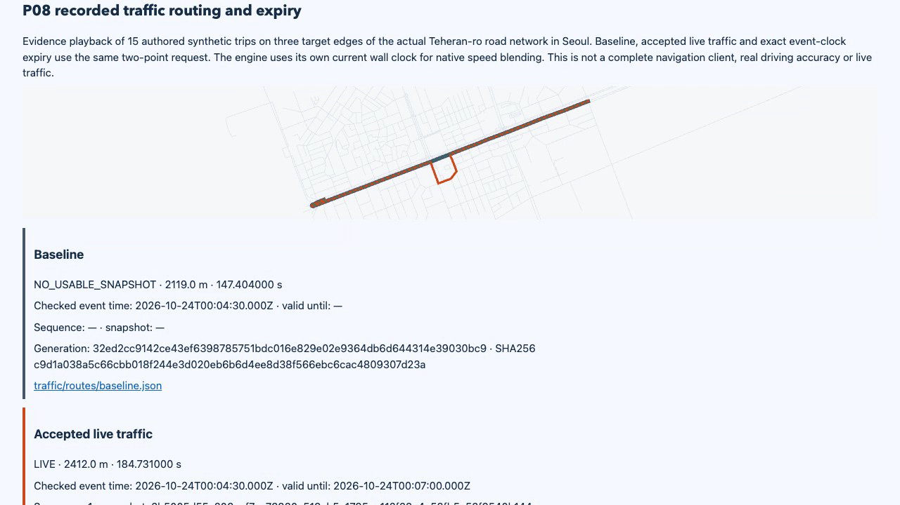
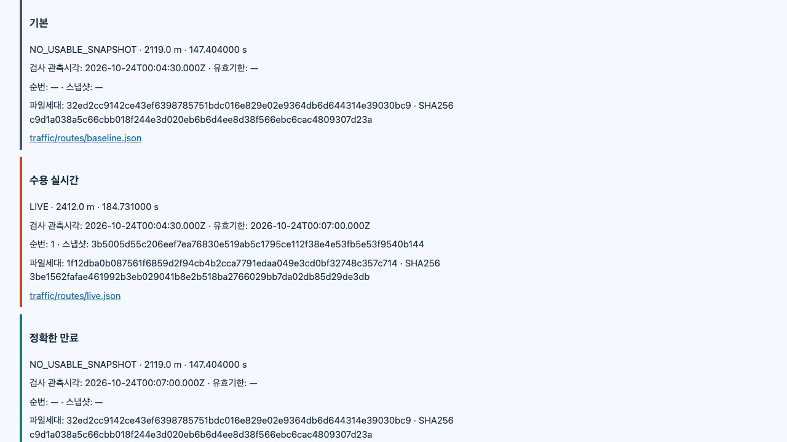

# Actual Seoul traffic routing and expiry / 실제 서울 교통 경로·만료 검증

**Local 238/238 PASS** on clean source `eb541399ed11c7fd26a14f9336a0a7c4ebc51639`. Main designed, reviewed and directly ran the complete pipeline; Sol `gpt-6.1-sol` implemented P08. Every implemented module ran together from a fresh Seoul graph. Hosted evidence and protected merge are pending at this entry.

**깨끗한 소스에서 로컬 238개를 모두 통과했습니다.** 메인이 설계·검토·전체 직접 실행을 맡고 Sol이 P08을 구현했습니다. 서울 그래프를 새로 만들고 구현된 모든 모듈을 함께 실행했습니다. 이 기록 시점 원격 근거와 보호 병합은 아직 남아 있습니다.

[Actual recording / 실제 녹화](demo.mp4) · [Replay / 재생](report.html) · [Whole inspection / 전체 검사](main-verification.json) · [Independent P08 inspection / 독립 P08 검사](main-traffic-verification.json) · [Development history / 개발 이력](development/README.md)

## What changed / 구현한 동작

P07's signed acceptance now authorizes a graph-specific immutable traffic file that the real Valhalla engine consumes. The adapter preserves unknown roads as unknown, encodes positive eligible speeds without turning them into closures, validates existing cached bytes and checks accepted state before selection and after the actual response. It rejects results that cross expiry or version replacement. Each P08 request uses a bounded owned engine; persistent two-node activation/draining remains P09.

P07의 서명 수용으로 승인한 지도별 불변 교통파일을 실제 Valhalla 엔진이 읽습니다. 모르는 도로는 모르는 상태로 두고, 유효한 양수 속도를 도로 폐쇄로 바꾸지 않으며, 캐시 바이트·선택 전 수용 상태·실제 응답 뒤 상태를 검사합니다. 만료·버전 교체를 사이에 둔 결과는 거부합니다. P08은 요청마다 제한된 소유 엔진을 실행하며, 장기 실행 두 노드의 교체·기존 요청 마무리는 P09에 남습니다.

The new source contains 15 synthetic trips over three consecutive eastbound Teheran-ro edges on OSM way `919983793`. Each target gets five independent contributors. Target averages are 0.4/0.45/0.5/0.55/0.6m/s; the first and last 3m use 5m/s to keep boundary crossings observable. Only partial neighboring context is submitted. Original geometry, complete simulator truth and expectations are written before matching; truth and edge IDs are not sent to the matcher.

새 자료는 OSM way `919983793`의 테헤란로 동향 연속 세 구간을 지나는 합성 15여행입니다. 각 대상에는 독립 기여자 5명을 사용합니다. 대상 평균 속도는 위 다섯 값이며, 처음과 마지막 3m는 5m/s로 통과해 경계를 확인할 수 있게 합니다. 앞뒤 구간은 부분 문맥만 제출합니다. 실제 매칭 전에 원 지형·전체 합성 정답·기대값을 기록하고 정답이나 구간 식별자를 매칭 입력에 넣지 않습니다.

## Observed routes / 실제 경로 결과

Every row uses the same original two-point car request. No excluded road, added waypoint or artificial cost weight creates the detour.

모든 행은 같은 원래 두 좌표의 자동차 요청입니다. 도로 제외·추가 경유·인위적인 비용 가중으로 우회를 만들지 않습니다.

| State / 상태 | Distance / 거리 | ETA / 예상시간 | Evidence / 근거 |
| --- | --- | --- | --- |
| Before acceptance / 수용 전 기본값 | 2.119km | 147.404s | [Original response](traffic/routes/baseline.json) |
| Accepted LIVE / 유효 교통 적용 | 2.412km | 184.731s | [Actual detour](traffic/routes/live.json) |
| Exact 420s expiry / 정확한 420초 만료 | 2.119km | 147.404s | [Restored response](traffic/routes/expired.json) |

The live trace avoids all three targets. The accepted traffic remains usable at 419.999s; at 420.000s the next request returns the identical baseline shape and ETA. A completed live route paused before response and a complete generation paused before selection both return `ACCEPTED_STATE_CHANGED` after expiry. An older compilation resumed after a higher-sequence correction returns the same precise reason.

교통 적용 경로의 실제 통과 구간에서 세 대상을 모두 피했습니다. 419.999초까지 수용 자료가 유효하고, 420초의 다음 요청은 동일한 기본 모양과 예상시간을 반환했습니다. 응답 직전에 멈춘 실제 계산 결과와 선택 전에 멈춘 완성 파일은 만료 뒤 명시 사유로 거부했고, 높은 순번의 정정 후 재개한 이전 생성도 같은 사유로 거부했습니다.

## Independent inspection / 독립 검사

Main checked **4,153 distinct original file hashes**, source/graph identities and all 238 required cases. The original nine-vehicle regression retains 220 stored traversals from 237 truth traversals, with no duplicate stored identity and a maximum 260ms boundary error. Excluded engine candidates use a different denominator and are not substituted for the 17 missed truth traversals.

메인은 **서로 다른 원문 해시 4,153개**·소스/그래프 식별·필수 238사례를 검사했습니다. 기존 차량 9대의 회귀는 정답 통과 237개 중 220개를 중복 없이 저장했고 최대 경계 오차는 260ms입니다. 제외된 엔진 후보는 분모가 다르므로 미회수 정답 17개와 혼용하지 않습니다.

- P08 produced exactly 15 stored target traversals, no neighboring contribution and five contributors per target. Independently calculated geometry and stored durations reproduce the approximately 0.5m/s medians. Maximum target boundary error was 0.494ms, within the predeclared 150ms limit.
  P08은 대상 통과 15개·이웃 기여 없음·대상별 5명을 확인했습니다. 독립 계산한 지형과 저장 시간으로 약 0.5m/s 중앙값이 재현됐고, 경계 최대 오차 0.494ms는 미리 정한 150ms 이내였습니다.
- Node's standard crypto, independent of the product's jose library, verified all three P08 signatures and exact artifact bytes. The independent TAR parser checked 14 tile records, the 32-byte header/8-byte speed layout, original header/index preservation and the three exact `810000f00f000000` speed records (2km/h minimum positive representation).
  제품의 jose와 별도로 Node 표준 암호 기능으로 P08 서명 3개와 정확한 파일 바이트를 검증했습니다. 독립 TAR 해석은 타일 14개·헤더32/속도8바이트·헤더/목록 보존·양수 최소 표현인 2km/h 세 기록을 검사했습니다.
- Actual concurrent writers, pre/post-publication SIGKILL, corrupt archive/cache, publisher outage, accepted-key revocation, DB stop/restart and an exactly identified engine interruption were inspected. Restart compares the original durable clock, traversal count and accepted byte hashes without reacceptance. [Separate live SQL](main-live-traffic-sql.json) is a point-in-time observation, not final totals.
  실제 동시 작성·게시 전후 강제종료·파일/캐시 손상·게시 장애·수용 키 철회·DB 중단/재시작·정확히 소유 확인한 엔진 중단을 검사했습니다. DB 복구는 재수용 없이 원래 시계·통과 수·수용 바이트 해시를 비교합니다. 메인의 별도 실행 중 SQL 조회는 당시 관측이며 최종 합계가 아닙니다.
- The prior P06/P07 checks remain intact: [aggregation inspection](aggregation/main-verification.json), [five independently verified signatures](publication/main-signature-verification.json), and [durable order, 30 exact negative reasons, actual crashes/locks/revocation/expiry](publication/main-state-verification.json). Four original P07 HTTP captures are expected; its third publication was invalidated before retrieval.
  기존 P06/P07 검사를 보존하고 집계·독립 서명5개·영속 순번·부정30개의 정확 사유·실제 중단/잠금/철회/만료를 다시 확인했습니다. P07의 3번 게시물은 조회 전에 무효화되므로 원 HTTP 보존은 4개입니다.

The independent inspector initially compared a depth-first file listing with a globally sorted inventory and refused equal file sets. Main confirmed no missing/extra files, changed only the inspector's ordering and reran the audit successfully. Both [first result](development/first-inspector-result.json) and [successful development audit](development/main-independent-verification.json) are retained. No engine or simulation rerun was performed for that inspection-only correction.

독립 검사기는 처음에 깊이 우선 파일 순서를 전체 정렬 목록과 비교해 같은 파일 집합을 거부했습니다. 메인이 누락·추가 없음부터 확인하고 검사기의 정렬만 수정해 재검사했습니다. 최초 결과와 성공 결과를 함께 보존하고 이 검사기 수정 때문에 엔진·시뮬레이션을 다시 실행하지 않았습니다.

## Captures, source and reproduction / 녹화·소스·재현

The **34.7s** video is actual browser playback at 1280×720/20fps. Main inspected the full MP4 decode and the exported frames; IAB checks covered English/Korean, 32 expanded P08 rows and 390px mobile without horizontal overflow or JavaScript errors. The eight recording processes, two owned report-server sessions and IAB tabs were closed. [Media verification](media-verification.json) · [Capture cleanup](capture-cleanup.json) · [Hashes](media-manifest.json).

영상은 **34.7초**의 실제 브라우저 재생 녹화입니다. 메인은 MP4 전체 디코딩·추출 화면을 검사하고 내장 브라우저에서 한영·P08 펼친32행·390px 가로 넘침/스크립트 오류 없음을 확인했습니다. 녹화 프로세스8개·소유 보고서 서버 두 세션·내장 탭을 종료했습니다.

- Runtime SHA256: `21b3fc4aa287e009a293bbfab3046b0b8535540d6b683e239b2fe9c57ac2e1ff`.
- Fresh graph / 새 그래프: `41a52d348bfeb0a71a988b0fb1680affe510626ac6865cc9b0f775716ffca070`.
- Pinned OSM SHA256: `282d012b7629c643695f286d4424d7f6d88548d99edb5577ca5b678906f13c17`.
- [Raw archive](evidence.tar.gz) · [Archive hash](archive-sha256.json) · [Archive boundary](ARCHIVE-SCOPE.md) · [Exact inspectors](inspectors/) · [Contract](../../../docs/27-p08-traffic-activation.md).

With Node22/24 and Docker: `npm ci`, `npm run build`, `npm run simulation:check -- --output data/new-run`, then `npm run report:serve -- data/new-run`. Always use a new output directory. The runtime remains unchanged after the clean source above; a later CI-only setting retains hidden staging evidence using the pinned upload action's [documented input](https://raw.githubusercontent.com/actions/upload-artifact/ea165f8d65b6e75b540449e92b4886f43607fa02/action.yml).

Node22/24·Docker에서 위 명령을 실행하고 항상 새 출력 폴더를 사용합니다. 위 깨끗한 소스 이후 실행 코드는 그대로이며, 후속 CI 설정만 숨김 임시 폴더의 증거를 보존하도록 바꿨습니다.

OSM geometry retains © OpenStreetMap contributors and ODbL1.0. Movement, congestion and GPS are synthetic. This does not prove real-driving accuracy, coverage of every Seoul road, production latency, immediate recall of offline artifacts or deployed availability. P09–P14 remain incomplete; the full project goal is still active.

OSM 지형의 기여자 표시와 ODbL1.0을 유지합니다. 이동·혼잡·GPS는 합성입니다. 실주행 정확도·서울 모든 도로 지원·운영 지연·오프라인 파일 즉시 회수·배포 가용성을 증명하지 않습니다. P09~P14가 남아 있으며 전체 프로젝트 목표는 계속 진행 중입니다.
