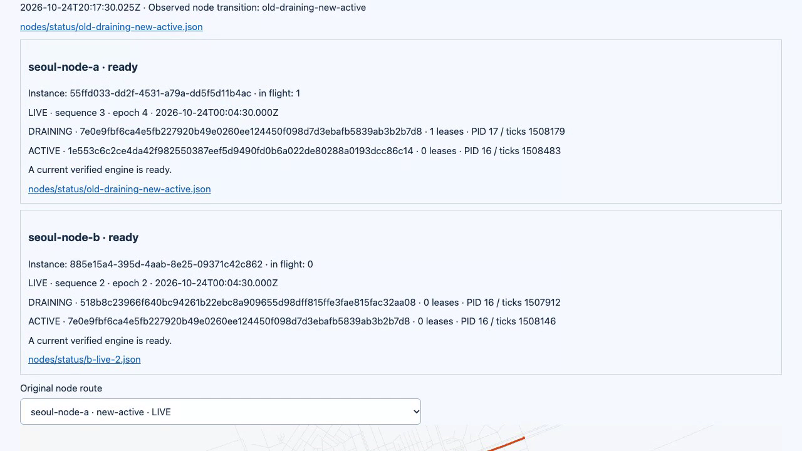
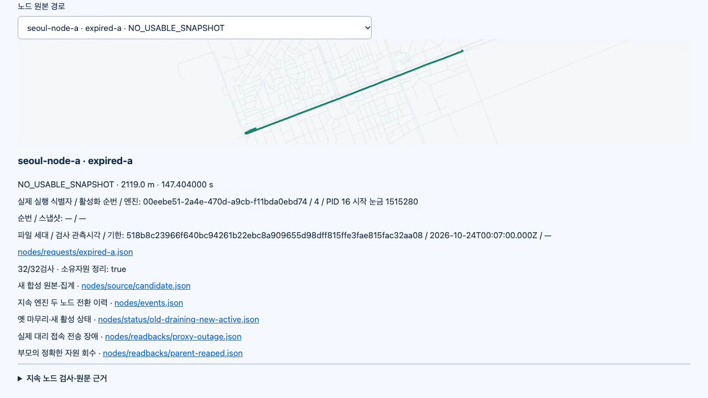

# Persistent Seoul routing nodes / 서울 장기 실행 경로 노드

The clean local P01–P09 run passed **270/270** actual assertions, including all32 P09 lifecycle cases. Main independently inspected **7,062 unique listed original-file hashes**, raw routes, signatures, database state and owned cleanup. Hosted verification and protected delivery are pending; P10–P14 remain unfinished.

깨끗한 로컬 P01~P09 실행에서 P09 수명주기32개를 포함한 **270개 전체 판정**을 통과했습니다. 메인이 **목록에 있는 고유 원문 파일 해시7,062개**, 원경로·서명·DB 상태·소유 자원 정리를 독립 검사했습니다. 원격 검증·보호 병합은 대기 중이며 P10~P14는 미완료입니다.

[Actual48.7s recording / 실제48.7초 녹화](demo.mp4) · [GIF](demo.gif) · [Interactive evidence / 대화형 근거](report.html) · [Assertions / 판정](assertions.json) · [Source manifest / 소스 명세](manifest.json) · [Media provenance / 미디어 출처](media-manifest.json)

## Identity and execution / 식별과 실행

| Item / 항목 | Value / 값 |
| --- | --- |
| Clean source / 깨끗한 소스 | `537cf0cd8f34509fa24023420d71bfa6dabe7614` |
| Runtime fingerprint / 실행 지문 | `d95a3627c0711e8df618e31ceb34c25bc17c7518ac06d0260eed358437152798` |
| Fresh graph / 새 그래프 | `9759ac2d23d395e0f588f9071eca014b0abde7cdcc3428165ec22b8f2bd60565` |
| Local output / 로컬 출력 | `data/p09-responsive-main-20261025` |
| Source OSM / 원본 OSM | Geofabrik South Korea2026-10-23; SHA-256 `282d012b7629c643695f286d4424d7f6d88548d99edb5577ca5b678906f13c17` |
| Main runtime / 메인 실행 환경 | Node22.23.4; Docker, pinned Valhalla and PostgreSQL |

Main ran `npm test` on clean ead1914:235/235 passed. The subsequent13-line mobile-only CSS correction passed build and4 focused integration tests. Main then ran the fresh whole command on clean537cf0c: `npm run simulation:check -- --output data/p09-responsive-main-20261025 --source data/seoul-source-20261023/south-korea-261023.osm.pbf`. Its270 cases and independent whole/node/traffic plus prior aggregation/signature/state inspections passed. The earlier execution is preserved in [layout evidence](layout/README.md), not relabeled as the latest source.

메인은 깨끗한 ead1914에서 단위235개를 실행해 통과했습니다. 이후 모바일 CSS13줄 수정은 빌드·영향 통합4개를 통과했습니다. 깨끗한537cf0c에서 위 새 전체 명령을 실행하여270개와 독립 전체/노드/교통 및 기존 집계/서명/영속 상태 검사를 통과했습니다. 이전 실행은 별도 보존하며 최신 소스의 결과로 바꾸어 적지 않습니다.

## What the originals prove / 원문으로 확인한 내용

- Two independent nodes reuse persistent native daemons. All44 native routing operations include a route/trace pair;21 successful node API replies are tied to distinct native pairs. Nine standard Ed25519 publications and146 slot events were inspected; no node exceeded two engine slots.
  독립 노드 두 개가 지속 엔진을 재사용합니다. 실제 엔진 작업44건은 각각 경로/추적 쌍이며 성공 API 응답21건을 서로 다른 원문 쌍과 연결했습니다. 표준서명9개·상태 이벤트146개를 검사했고 노드별 엔진 두 개 상한을 넘지 않았습니다.
- The same two-point baseline is2.119km/147.404s; accepted congestion changes it to2.412km/184.731s. Both nodes return to baseline at exact420s expiry. Request leases pin generation identity; obsolete results are rejected after updates rather than returned as current.
  같은 두 좌표의 기본 경로는2.119km/147.404초이며 수용한 혼잡 자료로2.412km/184.731초 우회로 바뀝니다. 두 노드 모두 정확히420초 만료에 기본 경로로 돌아가고, 요청별 세대 고정과 결과 반환 직전 재검사로 교체된 결과를 거부합니다.
- The measured deadline response was30.027s. Raw DRAINING→RETIRED was28.076s; the observer interval was27.887s. Real process kill, database pause/unpause, HTTP502, corrupt generation and durable restart cases passed. Parent cleanup also reaped resources after node SIGKILL.
  요청 제한 응답은30.027초, 원문 세대 정리 전이는28.076초, 관찰 구간은27.887초였습니다. 실제 프로세스 종료·DB 일시정지/복구·HTTP502·손상 세대·영속 재시작을 통과했고 노드 강제 종료 뒤 부모의 자원 정리도 확인했습니다.
- Main separately queried live publication/traffic/node databases and later confirmed113 owned process identities absent. P09-specific32 process identities, owned containers and the database volume were absent. These are local observations, not remote host claims.
  메인이 게시/교통/노드 DB를 실행 중 별도로 조회하고 전체 소유 프로세스113개의 부재를 확인했습니다. P09 프로세스32개·소유 컨테이너·DB 볼륨도 남지 않았습니다. 이는 로컬 관찰이며 원격 호스트 주장과 구분합니다.

[Whole inspection / 전체 검사](main-verification.json) · [Detailed node inspection / 노드 상세 검사](main-node-verification.json) · [Traffic inspection / 교통 검사](main-traffic-verification.json) · [Live node SQL / 실행 중 노드SQL](main-live-nodes.json) · [Contract / 계약](../../../docs/28-p09-routing-nodes.md)

## Evidence and recording / 증거와 녹화

[Original archive](evidence.tar.gz) contains7,743 of7,770 files. The27 omitted regenerable map binaries are exactly listed and locally hashed in [omitted-files.json](omitted-files.json); traffic archives, native responses/logs and hidden staging evidence remain. [Archive inventory comparison](archive-contents-verification.json) and [archive hash](archive-sha256.json) verify packaging.270 viewer-linked files are available separately. Archive coverage is broader than the7,062 independently checked listed hashes; these counts are not interchangeable. Standalone inspectors are preserved under `inspectors/`.

[원문 압축](evidence.tar.gz)은 전체7,770개 중7,743개를 포함합니다. 재생성 가능한 지도 바이너리27개는 정확한 제외 목록·로컬 해시를 남겼고 교통파일·엔진 응답/로그·숨김 준비 자료는 보존했습니다. 압축 목록 비교·전체 해시도 기록했으며 화면에서 연결하는270개 파일은 별도 제공합니다. 압축 파일 수와 독립 검사한 목록 해시7,062개는 서로 다른 범위입니다.

Main reviewed the complete converted48.7s MP4, nine extracted frames and actual IAB controls in English/Korean. Both mobile views fit390px without horizontal overflow, including32 expanded cases. No console errors were observed. The nine owned capture processes, report server and IAB tabs were closed. [UI proof](ui-verification.json), [capture cleanup](capture-cleanup.json), [original WebM](capture.webm). Frames are selected from the actual recording; no synthetic playback video was substituted.

전체48.7초 변환 영상·추출9화면·실제 내장브라우저의 한영 조작을 확인했습니다. 두 언어 모두390픽셀에서32개 펼친 판정을 포함해 가로 넘침이 없고 콘솔 오류가 없었습니다. 촬영 프로세스9개·보고서 서버·내장 탭을 정리했습니다. 화면은 실제 녹화에서 추출했으며 합성 영상으로 대체하지 않았습니다.

## Corrections and limits / 수정과 한계

[Development failures](development/README.md) preserve the path guard, reconcile starvation and stacked native grace failures, followed by their fixes and32-case proof. [Layout evidence](layout/README.md) preserves the mobile overflow and the independent inspector's corrected JWS-header assumption. Original failures were not rewritten as success.

개발 기록에 경로 보호조건·조정 응답 지연·엔진 추가 대기 실패와 수정 후32개 근거를 보존했습니다. 화면 기록은 모바일 넘침·독립 검사기의 JWS 헤더 가정 오류를 포함합니다. 실패를 성공으로 바꾸어 적지 않았습니다.

The revoked-root private runtime config was removed during cleanup. Its exact loaded bytes cannot be reconstructed independently; evidence verifies same durable consumer, new process identity, cleared acceptance and retained high-water order, alongside source review. HTTP502 is an actual transport failure case, not packet-loss proof. Nodes share one local host; no gateway failover, Internet-scale availability or production latency is claimed. Roads are actual OSM geometry, but movements and traffic are authored synthetic inputs. Real-driving100/100, mobile client, P10–P14 and production deployment remain separate work. OSM attribution and ODbL are retained in [NOTICE](../../../NOTICE).

키 철회 실행의 비공개 설정은 정리 과정에서 삭제되어 실제 로드한 바이트를 독립 복원할 수 없습니다. 같은 영속 수신자·새 프로세스·수용 해제·최고 수신 순번 유지와 소스 검토까지 확인했습니다. HTTP502는 실제 통신 실패 사례이며 패킷 손실 증거는 아닙니다. 두 노드는 같은 로컬 호스트에서 실행하므로 중계 장애 전환·인터넷 규모 가용성·운영 지연을 주장하지 않습니다. 도로는 실제 OSM 지형이지만 이동·교통은 합성입니다. 실주행100/100·모바일 클라이언트·P10~P14·운영 배포는 별도 작업으로 남습니다.
