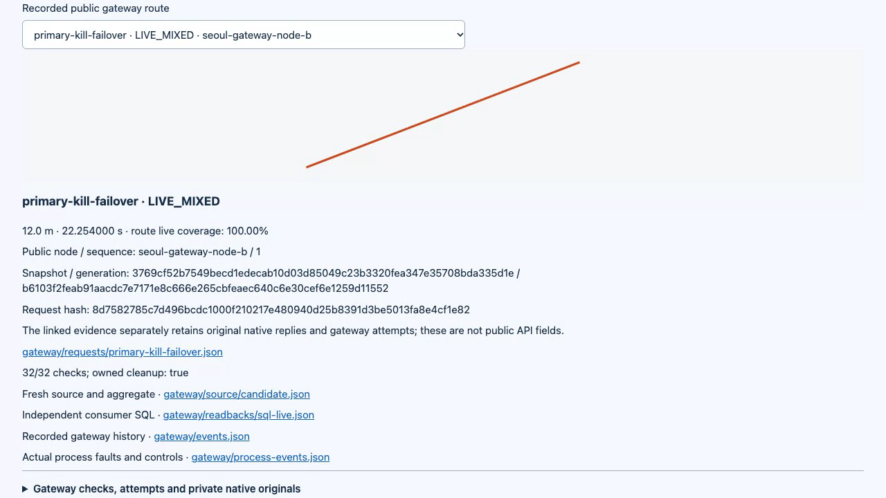
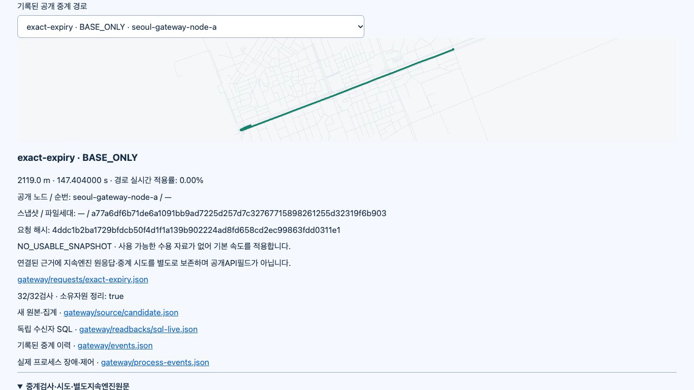

# P10 gateway worker correction / P10 중계 작업 스레드 수정

**The clean P01–P10 run passed all 302 assertions and all 262 unit tests.** Main independently checked 9,799 inventoried original-file hashes and the actual native routes, signed publications, durable state and owned cleanup. This corrects the earlier hosted concurrency failures without changing the eight-success criterion or the 12s/4s deadlines. New hosted verification and protected merge remain pending; P11–P14 are unfinished.

**깨끗한 P01~P10 실행에서 전체 302개 판정과 단위 262개를 통과했습니다.** 메인이 원문 목록 해시 9,799개·실제 엔진 경로·서명 게시·영속 상태·소유 자원 정리를 독립 검사했습니다. 동시 요청 8개 성공 기준과 전체 12초·노드 4초를 유지하면서 앞선 원격 동시 요청 실패를 수정했습니다. 새 원격 검증·보호 병합은 아직 남았고 P11~P14는 미완료입니다.

[Actual 60.45s MP4](demo.mp4) · [GIF preview](demo.gif) · [Raw recording](capture.webm) · [Interactive evidence HTML](report.html) · [Media hashes](media-manifest.json)

[실제 60.45초 영상](demo.mp4) · [미리보기](demo.gif) · [원래 녹화](capture.webm) · [증거 재생 화면](report.html) · [영상 해시](media-manifest.json)

## Identity and execution / 식별과 실행

| Item / 항목 | Value / 값 |
| --- | --- |
| Clean source / 깨끗한 소스 | `8f9c9f76762820f43b4606627738537c7d84fe51`, dirty=false |
| Runtime fingerprint / 실행 지문 | `0b37b365f8ffc8636f7455d5ac64f0c7734d94ba09497813f015150d7badc521` |
| Fresh graph / 새 그래프 | `e2674fbd7bfaa6fd47de6b3843f2cd29c4e46ea8ce35bb19934a82ce81734eab` |
| Pinned OSM source / 고정 지도 원본 | South Korea 2026-10-23, SHA256 `282d012b7629c643695f286d4424d7f6d88548d99edb5577ca5b678906f13c17` |
| Runtime / 실행 환경 | Node 22.23.4, real PostgreSQL and pinned Valhalla 3.9.1 / 실제 PostgreSQL·고정 Valhalla |
| Full result / 전체 결과 | 302/302 assertions; 262/262 unit tests; owned cleanup verified / 판정·단위·소유 자원 정리 확인 |

Main ran `npm test`, then `node dist/tools/pilot_integration.js --output data/p10-worker-main-20261025 --source /Users/dice/Documents/routelens/data/seoul-source-20261023/south-korea-261023.osm.pbf` with Node 22.23.4. Source and HEAD stayed fixed during the whole simulation. [Manifest](manifest.json), [assertions](assertions.json), [unit log](main-unit.log.gz).

메인은 위 명령으로 단위 검사 뒤 고정된 원본에서 서울 그래프를 새로 만들고 모든 구현 모듈을 실행했습니다. 전체 실행 중 소스와 커밋을 바꾸지 않았으며 원래 목록·판정·로그를 보존합니다.

## Failure and correction / 실패와 수정

The [final hosted PR and push failures](../2026-10-25-p10/hosted-failures/README.md) are preserved. Eight admitted requests repeatedly performed synchronous full-bundle validation on the HTTP loop. Main measured eight read-only validations locally: 4,434.674ms total, delaying a 10ms timer until 4,435.080ms. This is direct local event-loop evidence, not a remote CPU profile.

[최종 원격 PR·푸시 실패](../2026-10-25-p10/hosted-failures/README.md)를 보존했습니다. 동시 접수 요청들이 HTTP 이벤트 루프에서 전체 지도 검증을 동기 반복했습니다. 로컬에서 읽기 전용 검증 8회가 총 4,434.674밀리초를 사용해 10밀리초 타이머가 4,435.080밀리초 뒤 실행됨을 직접 측정했습니다. 원격 CPU 분석으로 주장하지 않습니다.

One owned worker thread now performs the unchanged P08 loading, compilation and byte checks. Only identical in-flight preparation is shared; settled results are never reused as authorization for later requests. Every pre-dispatch/final byte check remains awaited. The worker has bounded jobs and fails closed on thread error, exit or deadline. Parent admission, cancellation and deadline timers remain responsive, and shutdown waits for the worker.

소유 작업 스레드 하나가 기존 P08 읽기·변환·바이트 검사를 그대로 수행합니다. 정확히 같은 진행 중 준비만 공유하고 완료된 결과를 이후 요청의 승인으로 재사용하지 않습니다. 전달 전·최종 바이트 검사는 계속 기다립니다. 작업 수와 기한을 제한하고 스레드 오류·종료·기한 초과는 안전하게 실패하며, 부모의 접수·취소·타이머 응답과 종료 정리를 유지합니다.

The separate [actual Seoul preparation measurement](preparation/README.md) completed eight callers with one pending preparation and eight separate verifications in 654.749ms; the 10ms parent timer fired after 10.123ms. The clean full run then returned **200 for all eight held requests in 2.752–3.448s**, with **429 for the ninth**. Those times include the deliberate test hold and are measured pilot results, not production latency guarantees.

별도 [실제 서울 준비 측정](preparation/README.md)은 요청 8개·진행 준비 1개·별도 검사 8개를 654.749밀리초에 완료했고 타이머는 10.123밀리초에 실행됐습니다. 이후 깨끗한 전체 실행에서 **고정했던 요청 8개가 모두 2.752~3.448초에 200을 반환했고 아홉째는 429**였습니다. 의도적인 시험 대기도 포함한 측정이며 운영 지연 보장은 아닙니다.

## Independent checks / 독립 검사

- [Whole original-byte inspection](main-verification.json): 9,799 unique listed hashes and all previous modules. / 전체 원문 해시와 이전 모듈 연결 검사.
- [Gateway inspection](main-gateway-verification.json): 2,718 hashes, 94 graph hashes, three standard Ed25519 signatures, 38 native route/trace pairs, 18 successful API bindings and 73 worker jobs. The worker's parent/thread identity and termination match the gateway cleanup. / 중계·지도 해시, 표준 서명, 원래 엔진 응답, API 연결과 작업 스레드 종료를 대조했습니다.
- [Node](main-node-verification.json), [traffic](main-traffic-verification.json), [aggregation](main-aggregation-verification.json), [publication signatures](main-signature-verification.json), [publication state](main-state-verification.json). / 이전 단계별 독립 검사.
- Actual shared deadline 12.012s, propagated native lease 4.146s and client-abort admission release 34.038ms met the unchanged predeclared bounds. / 전체 기한·노드 요청 유지·연결 취소 후 접수 해제가 기존 기준을 만족합니다.
- Main directly queried the live [publication](main-live-publication.json), [traffic](main-live-traffic.json), [node](main-live-nodes.json) and [gateway](main-live-gateway.json) databases in read-only transactions. / 네 단계 실제 DB를 읽기 전용으로 조회했습니다.

The native protocol does not carry the public request ID. Each API success is assigned a distinct exact matching native request/route/trace pair with node-instance, daemon and generation identity; repeated identical calculations can have several matching candidates. Live coverage uses already-trimmed native trace lengths, without multiplying partial-edge fractions again. A long detour can have zero live coverage while the preselected 12m route has positive coverage.

네이티브 규격에는 공개 요청 ID가 없습니다. 성공마다 노드 실행·엔진·세대가 맞는 서로 다른 원요청/경로/추적 쌍을 연결하며 동일 반복 계산은 여러 후보와 일치할 수 있습니다. 이미 잘린 엔진 구간 길이를 사용해 부분 비율을 중복 적용하지 않습니다. 긴 우회의 적용률은 0일 수 있고 미리 정한 12미터 경로는 양수 적용률을 가집니다.

## Screen, recording and preservation / 화면·녹화·보존

Main verified English and Korean at390px in IAB: document390px, selector362px, actual secondary-node and expiry results, 32 expanded cases, no console errors/warnings. The viewport was reset and tab16 closed. A separate owned recording session captured60.45s at1280×720/20fps; the full MP4 decoded successfully and 11 frames were visually reviewed. Two Korean frame timestamps were corrected within the unchanged raw video; no simulation or capture was repeated. All nine recording processes and the temporary report server12933 were confirmed absent. [UI proof](ui-verification.json), [capture cleanup](capture-cleanup.json), [frame times](frame-times.json).

메인은 내장 브라우저에서 한영 390픽셀·문서 폭 390·선택 폭 362·두 번째 노드 전환·만료·펼친 32개·콘솔 오류/경고 없음을 확인했습니다. 화면 크기를 원복하고 검증 탭을 닫았습니다. 별도 소유 세션으로 실제 60.45초를 녹화하고 전체 MP4 디코딩과 화면 11개를 확인했습니다. 한국어 두 화면의 추출 시점만 원래 영상 안에서 바로잡았으며 시뮬레이션·녹화를 반복하지 않았습니다. 촬영 프로세스 9개와 임시 서버도 종료를 확인했습니다.

[Archive proof](archive-verification.json) retains 10,473 original files in three ordered parts, with28 exact map-binary omissions listed in [omitted files](omitted-files.json). Three inspector-created supplements stay separate;298 UI-linked originals are also directly available. Concatenate the archive parts in listed order before extraction. Original full graph bytes remain local; the public archive does not claim to contain them. Inspectors are preserved under [whole](inspectors/whole.mjs) and [gateway](inspectors/gateway.mjs); whole inspection used the explicit expected source SHA above.

원문 10,473개를 순서가 있는 세 압축 조각에 보존하고 정확한 지도 제외 28개를 따로 열거했습니다. 검사기가 만든 추가 근거 세 개는 원문과 분리하며 화면 연결 원문 298개도 직접 제공합니다. 압축 조각을 목록 순서로 연결한 뒤 풀어야 합니다. 전체 지도 바이트는 로컬에 남아 있으며 공개 압축에 포함됐다고 주장하지 않습니다. 독립 검사기와 명시적 예상 소스도 보존했습니다.

Actual OSM roads and synthetic movement remain distinct. This evidence player is not the P11 request client; real-driving accuracy, production availability and public-peer honesty remain separate gates. The earlier hosted failures stay immutable. New hosted originals must be inspected before protected merge.

실제 OSM 도로와 합성 이동을 구분합니다. 이 화면은 P11 요청 클라이언트가 아닌 증거 재생이며 실주행 정확도·운영 가용성·공개 노드 신뢰는 별도 검증 대상입니다. 앞선 원격 실패를 보존하고 새 원격 원문 검사 후 보호 병합합니다.
