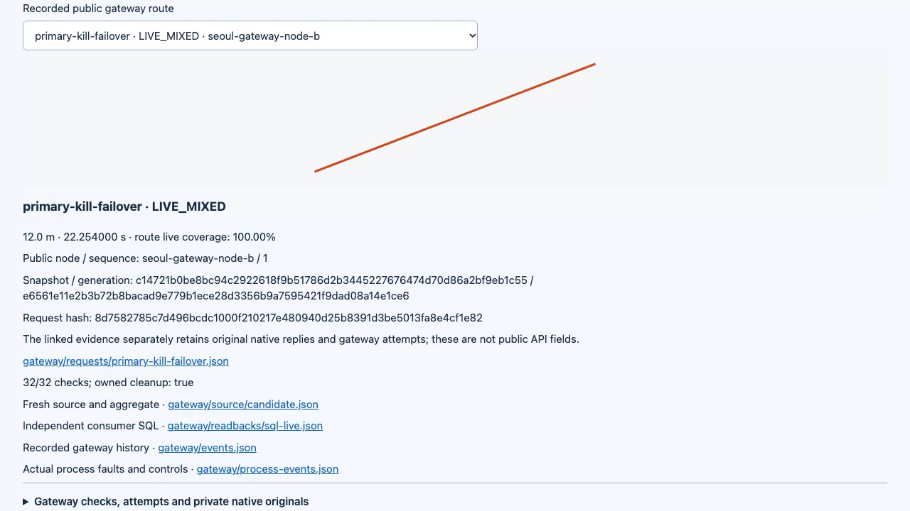
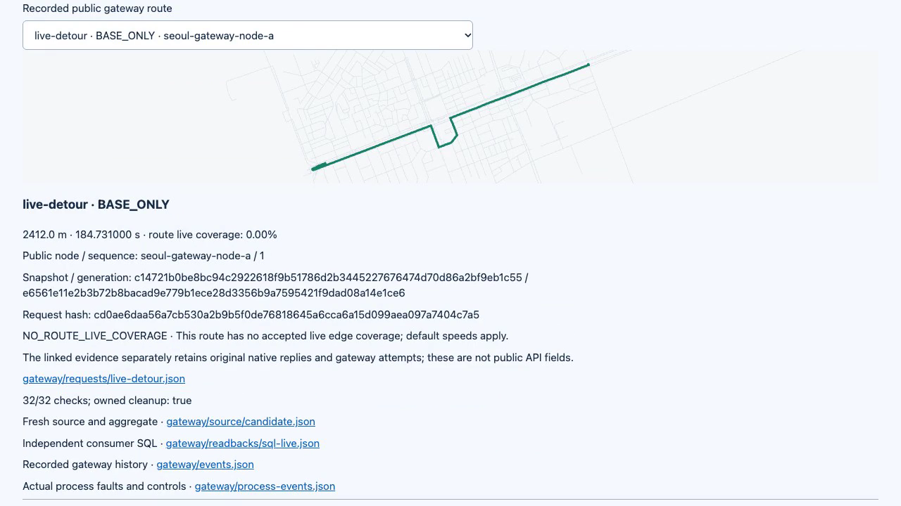
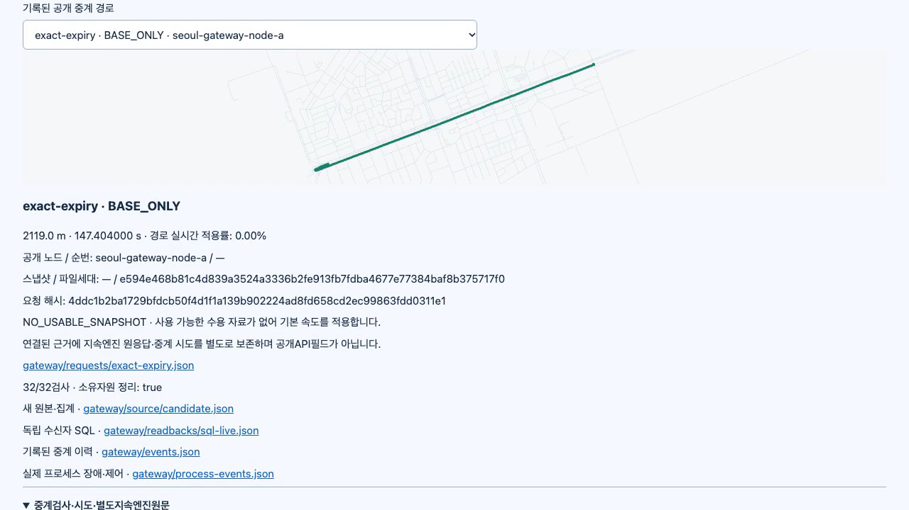

# Verified route gateway on Seoul roads / 서울 도로망 경로 중계 검증

**The fresh, clean P01–P10 simulation passed302/302 assertions.** Main independently inspected9,838 unique listed original-file hashes and the actual routes, signed bytes, durable state and resource cleanup. The whole unit suite passed252/252. [Hosted verification](hosted/README.md) passed302/252 with9,691 independently checked hashes; protected P10 delivery is pending; P11–P14 are unfinished.

**깨끗한 소스에서 서울 그래프를 새로 만든 P01~P10 시뮬레이션의302개 판정이 모두 통과했습니다.** 메인이 고유 원문 파일 해시9,838개와 실제 경로·서명·영속 상태·자원 정리를 독립 검사했습니다. 전체 단위252개도 통과했습니다. [P10 원격 검증](hosted/README.md)의302/252개와 독립 해시9,691개를 통과했고 보호 병합은 대기 중이며 P11~P14는 미완료입니다.

[Actual59.75s MP4 / 실제59.75초 영상](demo.mp4) · [GIF](demo.gif) · [Interactive report / 대화형 보고서](report.html) · [Assertions / 판정](assertions.json) · [Media provenance / 영상 출처](media-manifest.json)





## Exact execution / 정확한 실행

| Item / 항목 | Value / 값 |
| --- | --- |
| Clean source / 깨끗한 소스 | `20565218895a7cf50322e9587f2fe6b0bb412b03` |
| Runtime fingerprint / 실행 지문 | `bebae7f5f5e7c8efed69627735ef82a2749570d1bba66937c3507dfe990dc538` |
| Fresh graph / 새 그래프 | `81996661573ee3265fb1633728526f9f54822e7a8aa1db38ca1a6d95bb855f15` |
| Original directory / 원본 폴더 | `data/p10-main-20261025` |
| Runtime / 실행 환경 | Node22.23.4; pinned Docker Valhalla3.9.1 and PostgreSQL |
| Source OSM / 원본 OSM | Geofabrik South Korea2026-10-23; SHA256 `282d012b7629c643695f286d4424d7f6d88548d99edb5577ca5b678906f13c17` |

Main ran `npm test`, then `node dist/tools/pilot_integration.js --output data/p10-main-20261025 --source /Users/dice/Documents/routelens/data/seoul-source-20261023/south-korea-261023.osm.pbf`. Source and HEAD remained fixed throughout execution. The later P09 ancestry merge9d3cb75 changed documentation/evidence only; the verified runtime and recording remain unchanged. [Source manifest](manifest.json), [unit log](main-unit.log.gz), [P09 protected merge](../../repository/p09-protected-merge-2026-10-25.json).

메인이 위 단위·전체 명령을 직접 실행했고 실행 동안 소스와 커밋을 고정했습니다. 이후 P09의 보호 병합 이력을 연결한9d3cb75는 문서·근거만 반영했으므로 검증된 실행 코드와 녹화는 같습니다.

## What changed and what was proved / 변경과 확인한 동작

The gateway has its own signed durable consumer, independently of node A and B. It selects an exact graph/snapshot/generation, sends requests only to matching approved nodes, retries once at the same version, and rechecks accepted state before returning. A real primary-node SIGKILL returns a route from node B. No matching version or a changed accepted version produces explicit failure. The public response contains an exact allowlist, without native process identities, raw traces, credentials or storage paths.

중계 서버는 A·B 노드와 별도의 영속 서명 수신자를 갖습니다. 정확한 지도·교통정보·파일 세대를 정하고 같은 버전의 승인 노드에만 요청합니다. 한 번 재시도할 때도 버전을 유지하며 반환 직전에 수용 상태를 다시 검사합니다. 첫 노드를 실제 강제 종료해도 B 노드가 경로를 반환합니다. 적합한 버전이 없거나 도중에 수용 버전이 바뀌면 명확히 실패합니다. 공개 응답에는 허용 필드만 남기고 엔진 내부 식별자·원추적·인증정보·저장 경로를 제외합니다.

| Direct observation / 직접 관찰 | Result / 결과 |
| --- | --- |
| Gateway source / 중계 원자료 |15 newly executed trips,15 stored target traversals, three standard Ed25519 publications / 새 여행15개·저장 대상 통과15개·표준 서명3개 |
| Original native proof / 엔진 원문 |38 route/trace pairs;18 public successes tied to distinct exact matching pairs / 경로·추적38쌍과 공개 성공18건 연결 |
| Long baseline / 장거리 기본 |2.119km /147.404s |
| Congestion detour / 혼잡 우회 |2.412km /184.731s; route live coverage0 / 경로 실시간 적용률0 |
| Authored short route / 자체 짧은 경로 |12m /22.254s; live coverage1; after non-live correction0.780s / 적용률1, 비실시간 정정 후0.780초 |
| Shared12s deadline / 전체12초 기한 |12.018s observed /12.018초 관찰 |
| Propagated4s lease / 전달한4초 요청 |4.165s observed, within predeclared500ms allowance / 사전 관측 여유500ms 이내 |
| Client disconnect / 연결 취소 |Gateway admission released in34.204ms / 중계 접수 슬롯34.204밀리초에 반환 |
| Exact expiry / 정확한 만료 |At420s, no accepted snapshot and original long baseline restored /420초에 수용 자료 해제·원래 장거리 기본 경로 복구 |

Coverage is calculated from the returned route's matched partial-edge lengths. The long route avoids all three live edges, so its label is BASE_ONLY even though accepted traffic caused the detour. The short request uses coordinates fixed from the original edge's35%→65% interior before execution. This is12m of actual Seoul geometry, not a replacement toy road network. [Length semantics and sources](../../../wiki/sources/valhalla-route-coverage.md).

적용률은 반환 경로의 실제 부분 구간 길이로 계산합니다. 장거리 요청은 교통정보 때문에 우회했지만 실제로 지나는 경로에는 해당 세 구간이 없으므로 BASE_ONLY로 표시합니다. 짧은 요청은 실행 전에 원구간의35%~65% 지점으로 정했습니다. 실제 서울 지형의12m 부분이며 주요 도로망을 단순화한 가상 도로로 대체한 것이 아닙니다.

[Whole inspection](main-verification.json) · [Gateway inspection](main-gateway-verification.json) · [P09 inspection](main-node-verification.json) · [P08 inspection](main-traffic-verification.json) · [Aggregation](main-aggregation-verification.json) · [Signatures](main-signature-verification.json) · [Durable state](main-state-verification.json)

Main also queried the actual running [traffic](main-live-traffic.json), [nodes](main-live-nodes.json) and [gateway](main-live-gateway.json) databases. The separate publication-stage observer missed that completed stage; it is not claimed as a live query. Original publication bytes and SQL readbacks still passed independent inspection. An observer-only multiline JSON parsing correction did not change or rerun the simulation.

메인은 실행 중인 교통·노드·중계 DB도 별도로 조회했습니다. 게시 단계의 별도 관찰자는 이미 끝난 단계를 놓쳤으므로 그 단계의 실시간 조회를 주장하지 않습니다. 게시 원문·SQL 재조회 기록은 독립 검사를 통과했습니다. 관찰기의 여러 줄 JSON 처리만 수정했으며 시뮬레이션을 변경하거나 다시 실행하지 않았습니다.

## Reusable evidence and recording / 재사용 가능한 근거와 녹화

The original archive contains10,512 files.28 regenerable map binaries are individually listed and locally hashed in [omitted-files.json](omitted-files.json); three supplemental inspector outputs are kept separately.298 viewer-linked files are available directly. The archive is split into three parts at most20MiB each to avoid larger individual Git files. [Exact inventory, ordered part hashes and reconstructed archive hash](archive-verification.json).

원문 압축은10,512개 파일을 포함합니다. 재생성 가능한 지도 바이너리28개는 개별 경로·로컬 해시를 남겼고 추가 검사 결과3개는 별도로 보존합니다. 화면에서 연결하는298개 파일은 바로 열 수 있습니다. Git의 개별 파일이 너무 커지지 않도록 압축을20MiB 이하의 세 부분으로 나누었으며 목록과 재결합 해시를 검사했습니다.

```sh
cat evidence.tar.gz.part-00 evidence.tar.gz.part-01 evidence.tar.gz.part-02 > evidence.tar.gz
tar -xzf evidence.tar.gz
```

[Part00](evidence.tar.gz.part-00) · [Part01](evidence.tar.gz.part-01) · [Part02](evidence.tar.gz.part-02). Standalone inspectors are under `inspectors/`; omitted map bytes must be available for full local byte inspection. Archive file count and9,838 independently checked listed hashes describe different sets and must not be interchanged.

전체 로컬 바이트 검사를 하려면 제외한 지도 바이트도 있어야 합니다. 압축 파일 수와 독립 검사한 목록 해시9,838개는 범위가 서로 다릅니다.

The actual59.75s recording is1280×720 at20fps. Main decoded the full MP4 and reviewed11 frames. Both languages,390px layout, expanded32 gateway cases and absence of browser errors were checked in the in-app browser. Nine owned capture processes, the report server and the browser tab were closed; viewport reset. [UI proof](ui-verification.json), [capture cleanup](capture-cleanup.json), [original WebM](capture.webm).

실제 녹화는59.75초·1280×720·20fps입니다. 전체 MP4 디코딩과11개 화면을 확인했고 내장 브라우저에서 한영·390픽셀·펼친32개·오류 없음을 검사했습니다. 촬영 프로세스9개·보고서 서버·검증 탭을 종료하고 화면 크기 설정을 원복했습니다.

## Preserved corrections and limits / 보존한 수정과 한계

[Development evidence](development/README.md) retains build/test failures and the evidence-write admission leak found by main. No failing run was relabeled. Nodes are approved local peers, not hostile public peers. HTTP502/proxy cases do not prove packet-loss behavior. Native requests omit public request IDs, so identical repeated calculations can have multiple exact original candidates; the inspector records candidate counts. Explicit base_only requests remain unsupported and are rejected. Roads are actual OSM data, but movement/traffic is synthetic. Geographic100/100, P11 client, remaining P12–P14 work, production deployment and real-driving accuracy remain separate. © OpenStreetMap contributors, ODbL; [NOTICE](../../../NOTICE).

개발 근거에는 빌드·검사 실패와 메인이 찾은 기록 실패의 접수 누수를 보존합니다. 실패를 성공으로 바꿔 적지 않았습니다. 노드는 승인된 로컬 노드이며 악성 공개 노드가 아닙니다. HTTP502·시험 대리 서버는 패킷 손실의 증거가 아닙니다. 엔진 요청에는 공개 요청ID가 없어 같은 계산의 원문 후보가 여러 개일 수 있으며 검사기에 그 수를 남겼습니다. 명시적 base_only 요청은 아직 미지원으로 거부합니다. 도로는 실제 OSM이지만 이동·교통은 합성입니다. 실제 지역100/100·P11 클라이언트·남은 P12~P14·운영 배포·실주행 정확도는 별도입니다.
