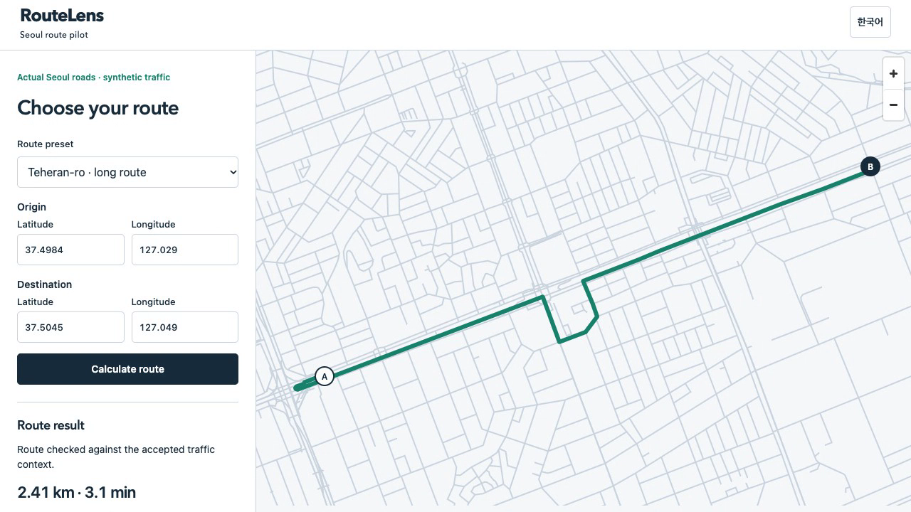
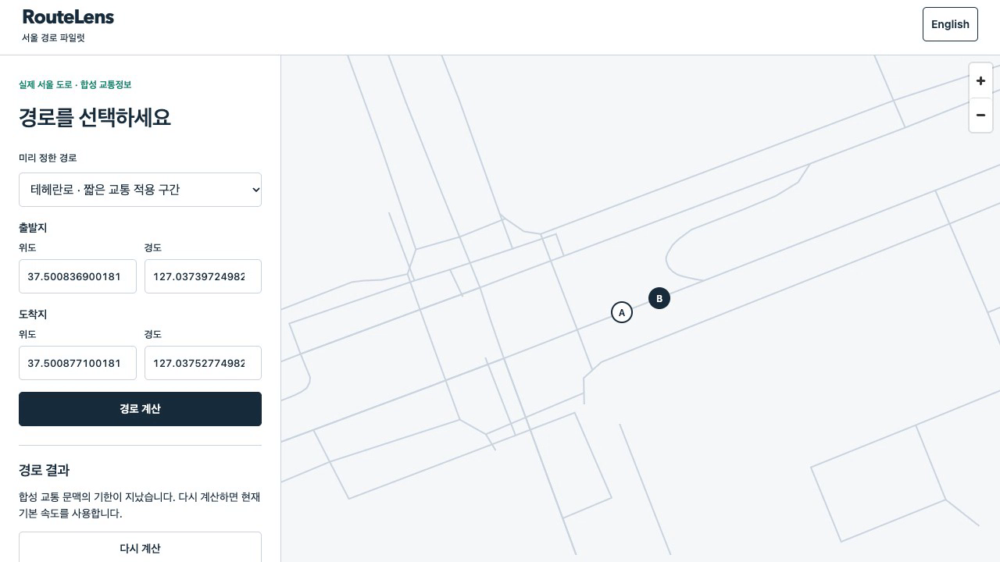
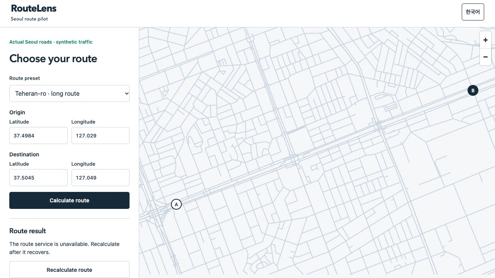

# P11 actual route client / P11 실제 경로 클라이언트

Clean source `c63c556e460c9e172b2a6a628e6c193c58f073eb` passed **285 unit tests and334 fresh whole-system assertions** on Node22.23.4. Runtime `bcc635c55326ef1306aa04805355c14ea62b3fd115bb4385bcd002942e8c3430`; newly built Seoul graph `4df7433fbbdb6c66a951e23feaff2ede7ab1b0f7eb97310bc60308c6d1569e95`. Main designed/reviewed; the existing Sol core/integration implementers wrote P11. Main Sol executed the clean whole run, inspected originals, manually used IAB and recorded the actual client. Protected P10 ancestry was subsequently merged without changing runtime bytes.

깨끗한 위 소스에서 Node22.23.4 단위285개와 새 전체334개를 통과했습니다. 실행 지문·새 서울 그래프를 위에 고정했습니다. 메인이 설계·검토하고 기존 Sol 코어·통합 담당자가 구현했습니다. 메인 Sol이 전체 실행·원문 검사·내장 브라우저 직접 조작·실제 화면 녹화를 수행했습니다. 이후 실행 바이트 변경 없이 P10 보호 병합 이력을 포함했습니다.

## What changed / 변경 내용

The browser now sends real requests through a same-origin local app server, the accepted-version gateway and two actual Valhalla nodes. MapLibre renders local OSM roads and the returned geometry; no map API key, external tiles, fonts or real geolocation is used. Input changes cancel obsolete requests. Version change, expiry or failed freshness checks clear the current route. The UI provides English/Korean text, keyboard submission and a390px layout. Six public freshness fields distinguish simulation event time from actual request time. Private supervisor controls never become browser endpoints.

브라우저가 같은 출처 로컬 서버·버전을 검증하는 중계·실제 Valhalla 노드 두 개로 요청합니다. MapLibre가 로컬 OSM 도로와 반환 지형을 표시하며 지도 API 키·외부 타일·글꼴·실제 위치 수집은 사용하지 않습니다. 입력 변경 시 이전 요청을 취소하고 버전 변경·만료·신선도 확인 실패 시 이전 경로를 지웁니다. 한영 문구·키보드 제출·390픽셀 화면을 제공하고, 공개 신선도 필드 여섯 개로 모의 시각과 실제 요청 시각을 구분합니다. 감독 제어는 브라우저 API로 공개하지 않습니다.

## Direct execution and independent evidence / 직접 실행·독립 근거

```sh
npm test
node dist/tools/pilot_integration.js --output data/p11-main-20261025 --source /Users/dice/Documents/routelens/data/seoul-source-20261023/south-korea-261023.osm.pbf
```

The absolute source path is this host's retained public OSM copy; other users supply their own path with the pinned bytes. [Source](source.json), [unit output](unit-tests.log.gz), [whole manifest](manifest.json), [334 assertions](assertions.json), [interactive report](report.html).

절대 경로는 이 장비에 보존한 공개 OSM 원본이며 다른 사용자는 같은 해시의 자신의 경로를 지정합니다. 소스·단위 출력·전체 목록·334개 판정·대화형 보고서를 연결했습니다.

- [Whole independent audit](main-verification.json):12,225 unique inventoried file hashes, exact source/graph/runtime linkage, fixed334 cases and exact local cleanup. / 원문 해시12,225개·소스/그래프/실행 지문·고정334개·정확한 로컬 정리.
- [Client audit](main-client-verification.json):2,411 hashes,4 standard Ed25519 publications,27 original native pairs and12 distinct successful browser/API/native/rendered-map bindings. / 클라이언트 해시2,411개·표준 서명4개·엔진27쌍·브라우저/API/엔진/표시지도 성공12건.
- [Live SQL](main-live-client.json):15 stored traversals, one publication, gateway and both nodes accepting the same sequence1 and snapshot. / 실행 중 DB의 통과15개·게시1개·중계/두 노드 동일 순번·자료 확인.
- [Gateway](main-gateway-verification.json), [nodes](main-node-verification.json), [traffic](main-traffic-verification.json), [aggregation](main-aggregation-verification.json), [publication signatures](main-signature-verification.json), [durable state](main-state-verification.json) passed. / 이전 모듈별 독립 검사도 통과.
- [Archive](archive-verification.json):12,898 original files,29 exact map omissions, four ordered parts. Original local map bytes were checked before archive omission. Three added audit files remain separate. / 원문12,898개·정확한 지도 제외29개·순서 있는4조각. 로컬 지도 바이트는 제외 전에 검사했고 추가 감사3개는 별도 보존.

## Actual demonstration / 실제 시연

[Watch102.8s MP4](../../../docs/media/demo.mp4) · [GIF](../../../docs/media/demo.gif) · [provenance](media-manifest.json) · [demo native/cleanup audit](demo-verification.json) · [demo originals](demo-archive-verification.json).

The recording is actual Chrome interaction with a fresh supervised client on the same verified graph. It shows baseline2.119km/147.404s, publication invalidation, detour2.412km/184.731s, a short segment with100% accepted coverage, primary-node kill followed by nodeB, exact420s expiry, baseline restoration and both nodes unavailable. Eight successful demo API replies bind to distinct native originals. All22 owned container names, the database volume, pilot processes and app port were absent after shutdown; all9 recording-process identities were gone. IAB390px English/Korean checks found no horizontal overflow, matching rendered geometry, expiry/unavailable line removal and no captured warnings/errors. The recording console retains expected unavailable503 and a favicon404. These do not count as engine failures or hidden evidence.

같은 검증 그래프에 새 감독 파일럿을 띄워 실제 Chrome 조작을 녹화했습니다. 기본 경로·게시 후 무효화·우회·짧은 구간100% 적용·첫 노드 종료 후 B 전환·정확한420초 만료·기본값 복귀·두 노드 사용 불가를 담았습니다. 성공8건은 서로 다른 엔진 원문에 연결했습니다. 종료 후 소유 컨테이너 이름22개·DB 볼륨·파일럿 프로세스·화면 포트가 없고 녹화 프로세스9개의 원래 식별자도 사라졌습니다. 내장 브라우저390픽셀 한영 화면에서 가로 넘침 없음·표시 지형 일치·만료/불가 시 경로 제거를 확인했고 수집된 경고/오류는 없었습니다. 녹화 콘솔의 의도된503과 favicon404는 보존하며 엔진 실패나 숨긴 근거로 취급하지 않습니다.





The initial demo audit assumed request directory names equaled request IDs; actual directories include a UUID suffix. The first failure log is retained and the corrected lookup requires exactly one matching original request file. The first27s detour frame showed invalidation;33s was selected from the unchanged recording. No runtime test or recording was repeated to hide either observation. [Development history](development/README.md) retains earlier build/test corrections and the narrower startup interruption proof.

첫 시연 감사는 요청 ID와 폴더 이름이 같다고 가정했지만 실제 폴더에는 UUID가 추가됩니다. 실패 로그를 보존하고 같은 ID의 원요청 파일이 정확히 하나인지 확인하도록 조회를 고쳤습니다. 처음27초 화면은 무효화 상태여서 같은 원영상33초의 실제 우회를 선택했습니다. 두 관찰을 숨기기 위해 제품 검사나 녹화를 반복하지 않았습니다. 이전 빌드·검사 수정과 준비 중 종료의 제한된 검증은 개발 기록에 보존했습니다.

## Limits and next work / 한계·다음 작업

Road geometry is actual Seoul OSM; vehicles, speeds, waits and GPS remain synthetic. Neither whole334 nor the demo proves real-driving accuracy, live traffic, public-peer honesty, production authentication, hardware performance or geographic100/100 completion. Independent audits use only Node built-ins and ran on local Node25; product execution used Node22. Browser regression used Chromium156.0.8078.4 with software WebGL; manual IAB and recording Chrome are separate observations. This is a local route client, not turn-by-turn navigation. P11 hosted delivery is pending; P12 scenario gaps, P13 local Cloudflare parity and P14b final integration remain.

도로는 실제 서울 OSM이며 차량·속도·대기·GPS는 합성입니다. 전체334개나 시연으로 실주행 정확도·실시간 교통·공개 노드 정직성·운영 인증·하드웨어 성능·실제 지역100/100 완료를 주장하지 않습니다. 기본 라이브러리만 쓰는 독립 감사는 로컬 Node25, 제품은 Node22에서 실행했습니다. 자동 브라우저는 Chromium156.0.8078.4와 소프트웨어 WebGL이며 수동 내장 브라우저·녹화 Chrome은 별도 관찰입니다. 로컬 경로 클라이언트이며 회전별 주행 안내는 아닙니다. P11 원격 반영과 P12 장애 공백·P13 로컬 Cloudflare 비교·P14b 최종 통합이 남았습니다.
