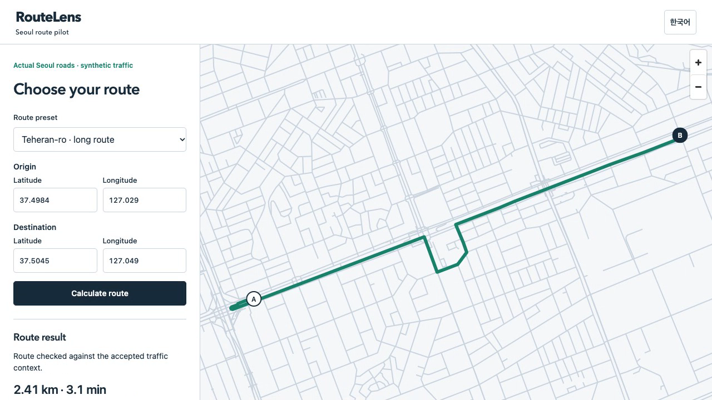
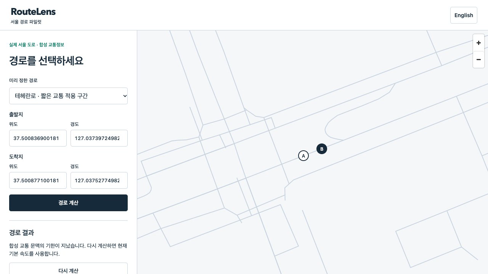
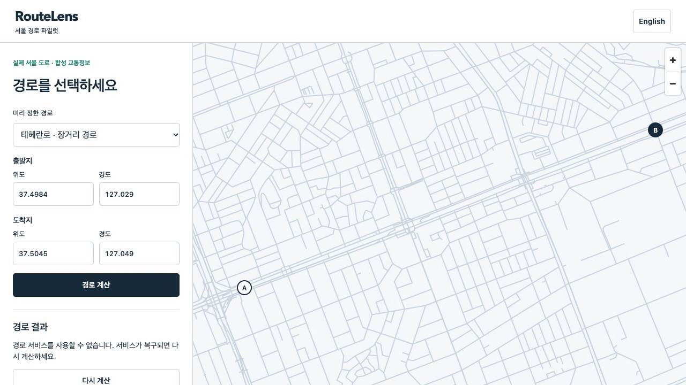
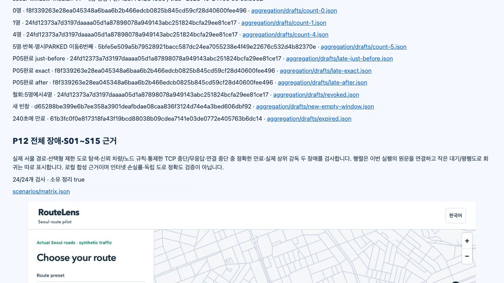

# P12 whole-system scenarios / P12 전체 시나리오

Clean source `5c9d4c4b07a513cd67c7f0f2bed3bb9c74548d69` passed **296 unit tests and358 fresh whole-system assertions** on Node22.23.4. Runtime `45f3b1315195c5374ae89dd9e6b8a3ee3357ae77ceb2475b9b505d06fc81d12d`; fresh actual Seoul graph `2e7db7d29f48f8896d57a49989d42a37454068c54e15ccf9e4fa0a56d3038ed3`. Main Sol designed, implemented, ran the complete stack, independently inspected saved originals, manually checked IAB and recorded the actual client. Hosted inspection and protected delivery are pending.

깨끗한 위 소스에서 Node22.23.4 단위296개·새 전체358개를 통과했습니다. 메인 Sol이 설계·구현·전체 실행·저장 원문 독립 검사·내장 브라우저 직접 확인·실제 클라이언트 녹화를 수행했습니다. 원격 검사·보호 반영은 남아 있습니다.

## Changes and direct execution / 변경·직접 실행

P12 preserves all334 previous assertions and adds24 checks. Optional100m road search preserves legacy request bytes when omitted. Exact native400 codes171 and170/442 become distinct bounded public domain errors, with the same request/version/generation/final-authority checks as success. Verified graph bounds reject outside-coverage input before dispatch. Trusted excluded-node and vehicle-class settings cannot be overridden by request bodies. Actual TCP reset/stall, disconnected expiry, two live outer-supervisor failures and exact owned shutdown are exercised. The S01–S15 matrix binds saved assertion and original evidence bytes from this single run. Tiny waiting/parallel-road regressions stay explicitly labeled. [Contract](../../../docs/32-p12-whole-scenarios.md).

기존334개를 유지하고24개를 추가했습니다. 선택형100m 탐색을 생략하면 기존 요청 바이트를 유지합니다. 실제 엔진400의171과170/442를 구분하되 성공과 같은 요청·버전·세대·최종 승인 검사를 적용합니다. 검증 지도 범위 밖은 전달 전에 거부합니다. 신뢰 설정의 제외 노드·차량 종류는 요청 본문이 덮어쓰지 못합니다. 실제 TCP 중단/무응답·연결 중단 중 만료·살아 있는 상위 감독 두 장애·소유 자원 종료를 검사했습니다. S01~S15 행렬은 이번 실행의 저장 판정·원문 바이트에 연결하고 작은 대기/평행도로 회귀는 따로 표시합니다.

```sh
npm test
node dist/tools/pilot_integration.js --output data/p12-main-json-20261025 --source /Users/dice/Documents/routelens/data/seoul-source-20261023/south-korea-261023.osm.pbf
```

The absolute source path is this host's retained public OSM copy; other users provide the pinned bytes at their own path. [Source](source.json), [unit output](p12-matrix-fix-all-unit.log.gz), [whole process](p12-main-json-20261025.log.gz), [manifest](manifest.json), [358 assertions](assertions.json), [interactive report](report.html), [matrix](scenarios/matrix.json).

절대 경로는 이 장비에 보존한 공개 OSM이며 다른 사용자는 같은 해시의 자신의 경로를 사용합니다. 소스·단위 출력·전체 프로세스·목록·358개 판정·대화형 보고서·행렬을 연결했습니다.

## Independent saved-byte checks / 저장 바이트 독립 검사

- [Whole](main-verification.json):15,888 unique original hashes, exact source/runtime/graph, all358 IDs,15 matrix rows, exact persisted354-input prefix, two live supervisor faults and owned cleanup. / 원문 해시15,888개·출처·358개 ID·행렬15행·저장 입력354개·감독 장애 두 경우·정리.
- [P12 domain](main-domain-verification.json):3,302 hashes, standard Ed25519 verification, original171/442 HTTP400, request/native provenance, actual reset/stall and unchanged CAR rows/aggregates. StallA4004.603042ms; total fallback5634.699166ms. / 해시3,302개·표준 서명·원 엔진 오류·요청/엔진 출처·실제 통신 장애·자동차 행/집계 보존.
- [Client](main-client-verification.json):2,412 hashes,27 native pairs,12 browser/API/native/rendered-geometry bindings and4 publications. / 해시2,412개·엔진27쌍·브라우저 연결12건·게시4개.
- [Gateway](main-gateway-verification.json):2,732 original and94 graph hashes,38 native pairs/18 successful replies; measured shared deadline12012.124417ms under the unchanged tolerance. [Nodes](main-node-verification.json), [traffic](main-traffic-verification.json), [aggregation](main-aggregation-verification.json), [signatures](main-signature-verification.json) and [durable publication](main-state-verification.json) also passed. / 중계 원문2,732개·지도94개·엔진38쌍/성공18건·기존 허용 범위의 기한 측정과 이전 모듈별 독립 검사를 통과했습니다.
- [Actual read-only SQL](main-live-sql.json):15 traversals, one publication, both nodes and gateway accepting the same sequence1/snapshot while alive. / 실행 중 실제 읽기 전용 SQL로 통과15개·게시1개·두 노드/중계 동일 순번과 자료를 확인했습니다.
- [Archive](archive-verification.json):16,229 original files,32 exact map omissions, four ordered parts; all local map hashes were checked before omission. Three later audits remain supplemental. / 원문16,229개·정확한 지도 제외32개·4조각이며 지도 해시는 제외 전에 검사하고 나중 감사3개는 별도 보존합니다.

The first audit of this corrected run omitted the sealed tiny matching child manifest from its own inventory traversal. Two actual reference hashes already matched. Main retained that [audit failure](p12-main-json-independent.log.gz), added the missing child inventory with tiny-graph binding, and the [corrected audit](p12-main-json-independent-corrected.log.gz) passed. No product original or assertion was changed.

수정 실행의 첫 독립 감사는 자신의 목록 순회에서 작은 매칭 하위 목록을 빠뜨렸습니다. 참조 두 파일의 실제 해시는 이미 같았습니다. 감사 실패를 보존하고 작은 지도 연결을 검사하며 하위 목록을 포함한 뒤 통과했습니다. 제품 원문·판정은 바꾸지 않았습니다.

## Actual screen and recording / 실제 화면·녹화

[126.45s MP4](../../../docs/media/demo.mp4), [GIF](../../../docs/media/demo.gif), [unaltered281.45s capture](capture-original.webm), [media provenance](media-manifest.json), [IAB observations](main-iab.json), [demo native/cleanup audit](demo-verification.json), [demo originals](demo-archive-verification.json).

The retained raw recording uses1280×720/20fps. Excerpts30–50s and175–281.45s remove idle time without changing playback speed or inserting outcomes. The first part is a fresh interactive client; the last part opens the completed report and its recorded S15 screenshots. The2.412km detour is brief; the195.8s original frame below preserves its actual display. Seven successful demo replies, including two manual IAB requests, bind to distinct native originals. All22 owned container names, database volume,21 recorded pilot PIDs and app port are absent after normal shutdown. The recording's9 original PID/start identities are gone. IAB English/Korean390px views have no horizontal overflow; keyboard submission and57-point rendered geometry match were checked. Manual IAB notes and automated/recorded stills are separate observations.

원본은1280×720·20fps입니다.30~50초·175~281.45초를 원속도로 이어 대기만 제거했고 결과를 삽입하지 않았습니다. 앞부분은 새 대화형 클라이언트, 마지막은 완료된 보고서와 기록된 S15 화면입니다.2.412km 우회는 짧게 나타나므로 원본195.8초의 실제 화면도 보존했습니다. 내장 브라우저 두 요청을 포함한 성공7건은 서로 다른 엔진 원문에 연결했습니다. 정상 종료 뒤 소유 컨테이너 이름22개·DB 볼륨·기록한 파일럿 PID21개·화면 포트가 없고 녹화의 원래 PID/시작 식별자9개도 사라졌습니다. 수동 한영390픽셀·가로 넘침 없음·키보드 제출·57점 표시 지형 일치를 확인했습니다. 수동 관찰과 자동/녹화 화면 근거를 구분합니다.






Recording console diagnostics retain expected favicon404 and unavailable503. Initial253s/266s frame guesses still showed baseline/unavailable; they were replaced by263s/273s from the same unchanged recording after visual inspection. No product run or recording was repeated to hide this.

녹화 콘솔은 예상한 favicon404·사용 불가503을 보존합니다. 처음253초/266초로 추정한 화면은 기본 경로/사용 불가였으므로 같은 원영상의263초/273초를 직접 보고 선택했습니다. 이를 숨기기 위해 제품 실행이나 녹화를 반복하지 않았습니다.

## Preserved rejection and limits / 보존한 거부·한계

The first clean internal358 run at8821c4d is **rejected as final proof**: its matrix hash did not match saved JSON. Three P06 pg Date timestamps hashed as empty objects in memory but serialized as ISO strings; reviving exactly those three reproduces the original hash. The correction materializes strict persisted JSON at the matrix boundary; shared request/JWS hashes are unchanged. Initial Buffer attribution was unconfirmed and corrected. [Complete rejected originals and diagnosis](matrix-failure/README.md); [earlier development failures](development/README.md). This report uses the new clean5c9d4c4 run.

첫 깨끗한 내부358개 실행은 저장 JSON과 행렬 해시가 달라 최종 근거로 거부했습니다. P06 pg Date 시각 세 개가 메모리에서는 빈 객체, 저장에서는 ISO 문자열이었고 정확히 세 날짜를 복원하면 원 해시가 재현됩니다. 행렬 경계에서 저장 JSON을 확정하는 수정만 적용하고 공유 요청/JWS 해시는 유지했습니다. 처음의 Buffer 추정은 미확인으로 정정했습니다. 거부한 원문·진단·개발 실패를 보존하고 이 보고서는 새5c9d4c4 실행을 사용합니다.

Actual Seoul OSM geometry and synthetic movement remain distinct. Controlled TCP faults do not measure Internet loss rates. Same-engine synthetic success does not certify real-driving accuracy, live traffic, public-peer honesty, production authentication, turn-by-turn guidance or mobile driving. S15 covers the observed live-baseline phase, not every instruction boundary. Independent built-in-only auditors ran on Node25.4.0; product tests ran on Node22. P13 local Cloudflare parity and P14b final integration remain.

실제 서울 OSM과 합성 이동을 구분합니다. 통제한 TCP 장애는 인터넷 손실률 측정이 아닙니다. 같은 엔진의 합성 성공은 실주행 정확도·실시간 교통·공개 노드 정직성·운영 인증·회전별 안내·모바일 주행을 인증하지 않습니다. S15는 관측한 기본 경로 단계이며 모든 명령 위치의 중단 보장은 아닙니다. 기본 라이브러리 독립 감사는 Node25.4.0, 제품 검사는 Node22에서 수행했습니다. P13 로컬 Cloudflare 비교·P14b 최종 통합은 남아 있습니다.

Publication check / 게시 검사:20,513 original text files,2,037,115,941 bytes and Git-index link targets passed. The first checker treated versioned directories as missing files and flagged the exact synthetic `invalid-private-field` rejection marker. Its log is retained; the corrected checker requires a tracked child for directory links and allows only that exact known marker. No real secret value or original is changed. An editorial script was also made repeat-safe after detecting duplicate README sections before commit.

원문 텍스트20,513개·2,037,115,941바이트·Git 목록 링크를 검사했습니다. 첫 검사기의 폴더 링크 오판과 정확한 합성 거부 표식 탐지를 보존하고, 추적 자식이 있는 폴더 및 그 무효 표식만 인정했습니다. 실제 비밀값이나 원문은 바꾸지 않았습니다. 커밋 전 README 중복을 발견해 문서 생성도 반복 실행에 안전하게 고쳤습니다.
