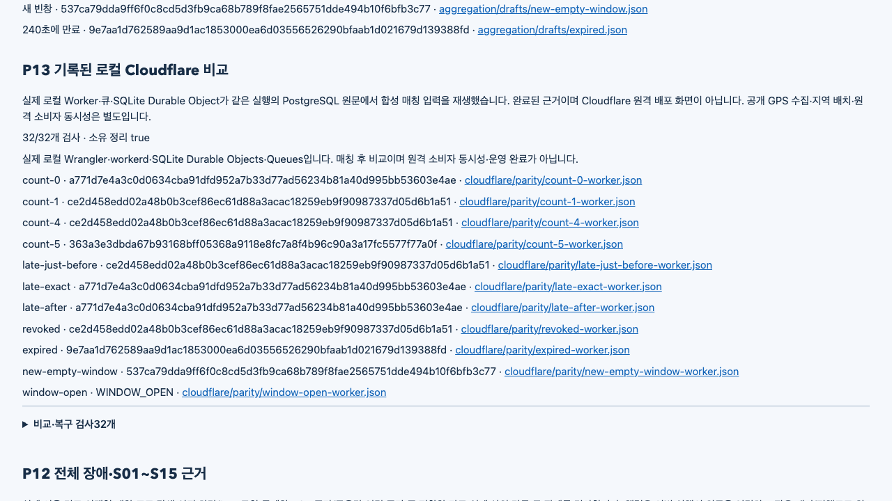

# P13 local parity and P14b gate / P13 로컬 비교·P14b 조건

Status: local and hosted runtime acceptance complete. Main Sol owns design, implementation and direct review. Protected delivery is tracked by [PR #14](https://github.com/dicebattle/routelens/pull/14). / 상태: 로컬·원격 실행 수용 완료. 메인 Sol이 설계·구현·직접 검토했으며 보호 반영은 PR #14에서 확인합니다.

The fresh clean whole run passed390 on actual Seoul OSM, including32 local Worker/Queue/SQLite cases. Main independently checked16061 original hashes; the Cloudflare audit checked184, eleven complete PostgreSQL/Worker pairs,14 actor databases and21 SQLite/WAL copies. Originals were hashed again after copied-database inspection. / 실제 서울 OSM의 새 깨끗한 전체390개·로컬 Worker/큐/SQLite32개를 통과했습니다. 메인이 원문16061해시·Cloudflare184해시·전체집계11쌍·객체DB14개·SQLite/WAL21개를 독립 확인하고 복사본 검사 뒤 원문 해시를 재대조했습니다.

- Source / 소스: `d2fb9643e2b6d69826c5eaf2f8918dfe2108e9ab` (clean / 깨끗함).
- Runtime / 실행 지문: `ba9395ec5ba3ac6dc5d1e296a9334b0bbebd72053b46674692f1c58a84556bfa`.
- Fresh graph / 새 지도: `7d07bab4cc4e8a9928ed77c2263a8986ed7aa43e82eb0ac1c1b835d6990f218d`.
- [Interactive completed report / 완료 보고서](report.html), [summary / 요약](summary.md), [whole audit / 전체 감사](main-verification.json), [SQLite and parity audit / SQLite·집계 감사](main-cloudflare-verification.json).
- Node22 candidate303 units and generated bindings passed; after the narrow-report correction, strict build and existing focused report9 passed. The final clean390 includes that correction. / Node22후보 단위303개·생성 바인딩, 좁은 보고서 수정 뒤 엄격 빌드·기존 보고서 집중9개를 통과했고 최종390개에 수정을 포함합니다.

## Use the client / 클라이언트 사용

The first README video is now a32s ordinary user flow: choose a preset, calculate, then read the map/distance/time. The same actual Korean UI has English and Korean explanatory caption versions. Captions are outside the application frame. No result is inserted or relabeled. Raw95s and the exact retained interval are preserved. / README첫 영상은 경로 선택·계산·지도/거리/시간 확인의32초 일반 사용 과정입니다. 같은 실제 한국어 화면에 한영 설명 자막을 별도로 넣었고 원 화면 밖에만 표시합니다. 결과를 삽입하거나 표시를 바꾸지 않았으며 원본95초·정확한 사용 구간을 보존합니다.

- [English video / 영어 영상](../../../docs/media/demo.mp4), [Korean video / 한국어 영상](../../../docs/media/demo.ko.mp4), [original / 원본](user-demo/capture-original.webm), [actual HTTP/native binding / 실제 HTTP·엔진 연결](user-demo/verification.json).
- A fresh clean source checkout runs the ordinary automatic client, matching the documented pilot:serve behavior. Its one successful HTTP route binds to original native request/route/trace bytes:2412m,184.731s, accepted snapshot,0 returned-route live coverage because the route avoids the congested edges. / 새 깨끗한 체크아웃에서 문서와 같은 자동 진행 클라이언트를 실행했고 성공 HTTP한 건을 엔진 원요청/경로/추적과 연결했습니다.2412m·184.731초·수용 자료가 있으며 정체 구간을 피해 반환 경로의 적용률은0입니다.
- An optional recording-only zoom action used an English locator after switching the UI to Korean and timed out. The current snapshot shows the actual Korean controls. No zoom occurred; the published three-step story claims no zoom. Preserve the failed action log and full raw recording. / 선택형 녹화 확대 동작이 한국어 화면에 영어 이름으로 접근해 시간 초과됐습니다. 실제 한국어 조작 이름을 확인했고 확대는 일어나지 않았습니다. 공개한 세 단계 사용 과정은 확대를 주장하지 않으며 실패 로그·전체 원본을 보존합니다.

## Full developer proof / 전체 개발 검증

[Developer walkthrough / 개발 검증 영상](developer-walkthrough.mp4) keeps all155.05s of the first actual capture, including baseline, publication invalidation, detour, short live coverage, nodeB failover, exact expiry/restored baseline, unavailable service and completed Cloudflare/P12 evidence. Recorded report sections are completed test evidence. / 첫 실제 촬영155.05초 전체에 기본 경로·게시 변경 무효화·우회·짧은 적용 구간·노드B전환·정확 만료와 기본값 복귀·사용 불가·완료 Cloudflare/P12근거가 있습니다. 보고서 부분은 완료된 검사 근거입니다.

Manual IAB390px EN/KO passed: two actual baseline requests,57 original points equal the rendered map, no horizontal overflow and no console warnings/errors. The report390px fix passed both languages;11 parity links and lazy-loaded P12 images were inspected. All owned IAB tabs closed; user tab2 was preserved. / 수동 내장 브라우저390픽셀 한영에서 실제 기본 경로 두 건·원좌표57개와 지도 일치·가로 넘침 없음·경고/오류 없음을 확인했습니다. 보고서 한영390픽셀·비교 링크11개·P12지연 이미지도 확인하고 소유 탭만 닫았습니다.

The developer recording's7 successes bind to distinct native originals;22 container names,21 pilot PIDs and9 capture process identities are absent, with app/report ports closed. Expected503 is the unavailable-service scene. Browser favicon404 entries remain documented. / 개발 녹화의 성공7건을 서로 다른 엔진 원문과 연결하고 컨테이너22개·파일럿PID21개·녹화식별9개·앱/보고서 포트 정리를 확인했습니다.503은 의도한 사용 불가 장면이며 favicon404도 원문에 남깁니다.

Actual read-only SQL confirmed15 traversals and one identical signed snapshot accepted by three consumers. P12 domain/native171/442/TCP and saved15-row matrix, client27 native pairs/12 browser bindings, gateway38 pairs/18 replies and previous module/signature/state audits passed. [SQL](main-live-sql.json), [domain](main-domain-verification.json), [client](main-client-verification.json), [gateway](main-gateway-verification.json), [signatures](main-signature-verification.json). / 실제 읽기SQL의15통과·세 수신자 동일 자료와 업무 오류/TCP/행렬·브라우저·중계·이전 모듈·표준서명을 직접 확인했습니다.

## Reconstruct and inspect / 복원·검사

All16402 whole-run originals except32 exact declared map binaries are retained in five ordered parts. XML and SQLite/WAL/SHM are included. Reconstruct with `cat originals.tar.gz.part* > originals.tar.gz`, verify [archive hash](archive-verification.json), then extract into a new directory. [Exact file inventory](original-files.json.gz), [map omissions](omitted-files.json), [inspectors](inspectors/), and separate demo archive receipts are included. Supplemental audits are separate from originals. / 전체 원문과 정확한 지도 제외를 구분하고 XML·SQLite/WAL/SHM·원문 목록·해시·독립 감사기를 보존합니다. 조각 합치기·해시 확인 뒤 새 폴더에 풀며 추가 감사를 원문과 구분합니다.

[First390/media rejection](prelayout/README.md) preserves the old568px narrow layout and successful runtime originals; [unrecorded first client](prelayout-demo/README.md) was stopped before capture. The packager's mixed diagnostic log is explained by [this note](packaging-note.json); archive bytes/inventory/reconstruction stayed valid. / 첫390개 처리 통과·좁은 화면 거부·촬영 전 종료를 보존하고 묶음 진단 로그 충돌도 따로 정정했습니다. 원문·목록·복원은 그대로입니다.

P12's first hosted run was rejected for missing XML. Its corrected run passed independent15,975 hashes and protected PR13 merged as1f1f1a0; [corrected hosted record](../2026-10-25-p12/hosted/README.md), [rejected originals](../2026-10-25-p12/hosted-rejected/README.md). P13 includes this protected ancestry without runtime changes after capture. / P12의 원격XML누락 거부·수정 원문·정상 보호 병합을 보존하고 P13에 같은 실행바이트로 이력을 포함했습니다.

## Scope / 범위

P13 proves supported local post-matching aggregation parity using one unchanged core. It does not establish hosted Cloudflare consumer concurrency, cloud placement, public GPS authentication, production deployment, independent real-road accuracy or live traffic. Geographic100/100 and real mobile driving remain separate gates. / P13은 같은 집계 함수를 쓰는 로컬 매칭 후 비교입니다. 원격 소비자 동시성·배치·공개GPS인증·운영 배포·독립 실도로 정확도·실시간 교통을 증명하지 않으며 실제 지역100/100·모바일 주행은 별도입니다.

## Hosted original inspection / 원격 원문 검사

P01–P14 local-pilot runtime acceptance is complete locally and on GitHub Actions: whole 390, Node.js 22/24 each 303. Main independently checked 16,236 hosted original hashes, 11 complete PostgreSQL/Worker pairs and 21 SQLite copies across 14 actors. The runtime fingerprint matches the accepted local run and actual recordings. Protected integration and the latest checked head are tracked by [PR #14](https://github.com/dicebattle/routelens/pull/14). Geographic 100/100, real driving, live traffic and production deployment remain separate.

P01~P14 로컬 파일럿의 실행 검증을 로컬과 GitHub Actions에서 마쳤습니다. 전체 390개와 Node.js 22·24 각각 303개를 통과했고, 메인이 원격 원문 해시 16,236개·집계 전체 11쌍·객체 14개의 SQLite 복사본 21개를 독립 확인했습니다. 실행 지문은 수용한 로컬 실행·실제 녹화와 같습니다. 보호 병합과 최신 검사 커밋은 [PR #14](https://github.com/dicebattle/routelens/pull/14)에서 확인합니다. 실제 지역 100/100·실주행·실시간 교통·운영 배포는 별도입니다.

[Permanent downloaded originals, audits and reconstruction / 다운로드 원문·감사·복원](hosted/README.md). Push run 40155530440 and PR run 40155546456 both passed at 5c4f098. The final documentation commit must pass its own required checks before normal protected merge. / 두 원격 실행이 같은 소스에서 통과했습니다. 최종 문서 커밋도 자체 필수 검사를 통과한 뒤 정상 보호 병합합니다.
