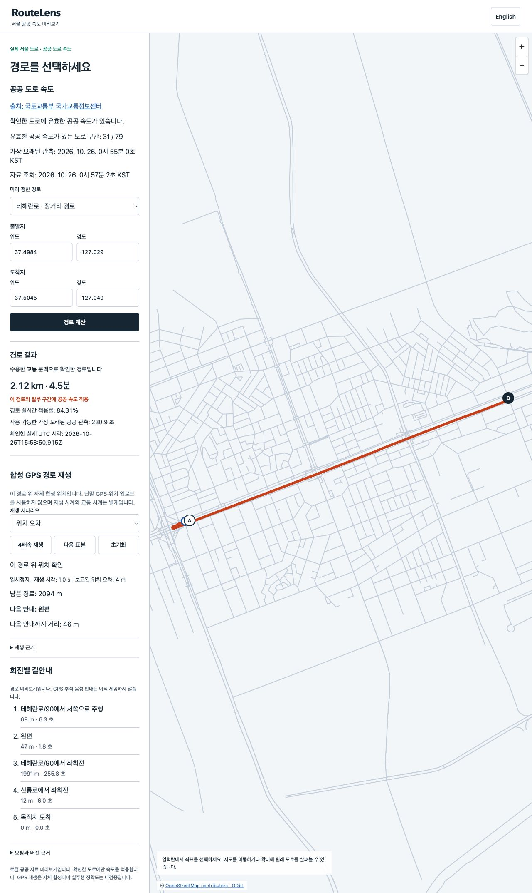

# Public speed runtime development / 공공 속도 실행 개발

This is preserved development evidence, not final clean whole acceptance or a deployed service. Main Sol designed, implemented and inspected the work. Existing verified Seoul graph `a859e9adaf913b14bf6b47a161247ec1c3b6c6c59b6e8d6334a9466646cb2079` was reused; source was dirty during development. Actual public observations and authored provider-protocol fault responses are separated below. [Contract](../../../docs/38-public-road-speeds.md) and [source inventory](../../../wiki/sources/public-road-speeds.md).

메인 Sol이 설계·구현·직접 확인한 개발 근거이며 최종 깨끗한 전체 수용이나 배포가 아닙니다. 기존 검증 서울 그래프를 재사용했고 소스는 개발 중이었습니다. 실제 기관 관측과 자체 제공자 규격 장애 응답을 아래에서 구분합니다.

## Actual agency path / 실제 기관 자료 연결

- The real HTTPS numeric feed reached signed immutable traffic, native routing and the same-origin browser. First IAB review confirmed original observation/retrieval time,3/79 catalog edges, a115m100%-covered route, EN/KO guidance, authored GPS next/remaining and390px layout without overflow. Later acquisition changed the data and invalidated the old route; different source batches are not a controlled accuracy comparison.
- Dual advertised official WMS layers provided exact current provider F/T node IDs, unlike both2025 and2026 national downloads. Existing12m whole-edge mapping thresholds stayed unchanged. Development34-point acquisition retained66 responses, verified18 official links and mapped31/79 graph edges. Fifteen point reads failed, including HTTP200 XML exceptions; these never became usable geometry. [Provenance and omissions](provider-map-summary.json). Original government geometry stays local under separate terms.
- A real2119m route had84.3100189% length coverage and269.977s native duration. The identical baseline request returned the same geometry and147.404s. All31 raw immutable speed records independently matched their original public entries. This proves influence on routing, not ETA accuracy, device GPS accuracy or nationwide coverage. [Corrected inspection](broader-baseline-development-01/verification-corrected.json).
- The first inspector incorrectly required equality between encoded speed and native time-dependent blended speed. Four edges differed by1km/h. Its [FAIL](broader-baseline-development-01/verification.json) remains. Reinspection reads the same originals, independently checks exact8-byte records and native values against baseline/live bounds; no product algorithm or acceptance threshold changed. Current-time blending is already specified in contract27 and [upstream GetSpeed](https://github.com/valhalla/valhalla/blob/3.9.1/valhalla/baldr/graphtile.h).
- The second IAB review confirmed EN/KO guidance/progress at the broader coverage. Full-page screenshot capture produced one MapLibre canvas-size warning; no application error was recorded. Owned native containers and servers were closed. [Actual runtime cleanup](runtime-development-02/cleanup-independent.json).

실제 HTTPS 수치가 서명·불변 파일·엔진·화면까지 전달됐습니다. 첫 한영/390픽셀 확인 뒤 공식 지도 두 레이어로 제공자 노드와 방향 곡선을 대조해 기존 기준을 유지하면서3개에서31/79구간으로 늘렸습니다. 34지점 중 오류 응답15개는 제외하고 정부 지형 원문은 로컬에 남겼습니다. 실제2119m 경로의 거리 적용률84.31%·269.977초와 같은 기본 경로147.404초를 확인했습니다.31개 원 레코드는 모두 일치합니다. 첫 검사기가 엔진의 시각별 속도 혼합을 빠뜨린 실패와 원문 재검사를 함께 보존하고, 이를 정확도·전국 적용으로 확대하지 않습니다. 큰 전체 화면의 지도 경고1건과 애플리케이션 오류 없음·소유 정리도 구분합니다.



[English screen](iab-development-02/en-long-public.png) · [Korean mobile](iab-development-01/ko-public-mobile.png) · [English route/progress text](iab-development-02/en-long-ax.txt) · [Korean route/progress text](iab-development-02/ko-long-ax.txt).

The file `iab-development-01/en-public-progress.png` actually captured the route after source-refresh invalidation; its original filename is preserved and it must not be described as an active progress screenshot. / 해당 첫 영어 파일은 갱신으로 경로가 무효화된 뒤 촬영됐습니다. 원래 파일명을 보존하며 활성 진행 화면으로 설명하지 않습니다.

## Controlled runtime faults / 통제된 실행 장애

[Twenty-four assertions](runtime-checks-development-01/assertions.json) passed against actual native Seoul routing using **AUTHORED_PROVIDER_PROTOCOL_NOT_ACTUAL_AGENCY_SPEED** and a controlled clock. They cover session/origin/input, native speed/Korean guidance, slow refresh without context blocking, outage without expiry renewal, individual/exact final expiry, baseline/recovery, zero-speed withdrawal, restart/high-water preservation, deadline/scope, independent Ed25519/hash verification and exact owned cleanup. [Original readbacks](runtime-checks-development-01/readbacks.json).

실제 서울 엔진 위 자체 규격 응답과 통제 시계24개를 통과했습니다. 수집 지연/장애·개별/전체 만료·기본값/복구·0속도 철회·재시작/순번·기한/범위·서명·소유 정리 등을 확인하며 실제 기관 속도 관측으로 세지 않습니다.

| Stage / 단계 | Route coverage / 경로 적용률 | Native seconds / 엔진 초 |
|---|---:|---:|
| Authored12km/h / 자체12시속 | 100% | 18.877 |
| Exact expiry baseline / 정확한 만료 뒤 기본값 | 0% | 3.974 |
| Authored36km/h recovery / 자체36시속 복구 | 100% | 6.292 |

High-water sequences1→2(partial expiry)→3(recovery)→3(withdrawal/restart) were retained. Five exact containers were independently absent after these checks. The initial runtime's separate cleanup inspector used case-sensitive matching against Docker's lowercase message, falsely marking absence unverified; [first receipt](runtime-development-01/cleanup-independent.json) and [corrected inspection](runtime-development-01/cleanup-independent-corrected.json) are both retained.

순번은1→2(부분 만료)→3(복구)→3(철회/재시작)을 유지했고 소유 컨테이너5개의 부재를 독립 확인했습니다. 첫 실제 실행의 별도 정리 검사기는 대소문자 비교 오류가 있었으며 첫 영수증과 수정 검사를 보존합니다.

## Commands and limits / 명령과 한계

```sh
npm test
npm run public:speeds -- provider-map --graph data/nav02-whole02/seoul/graph --batch data/public-road-research/collected-v1/batch.json --output data/your-new-provider-map
npm run public:check -- --graph data/nav02-whole02/seoul/graph --bundle data/nav02-whole02/traffic/bundle --output data/your-new-public-checks
```

Node22 full369/369 passed. [Full TAP](receipts/all-tests-development-01.tap). The new map-focused first run failed because its two fixture objects shared an array; independent cloning fixed the fixture, one retry passed6/6. [First TAP](receipts/provider-map-tests-01.tap) · [retry](receipts/provider-map-tests-02.tap). A first strict build had two type errors, corrected before testing; [original](receipts/provider-map-build-01.log). No real GPS was collected. No private credential or signing state is included. [Exact copied-file hashes and bounded credential scan](receipt.json) intentionally exclude government geometry/map/traffic binaries. These exclusions do not attest omitted bytes. Fresh clean462 integration, final current media/report and branch push remain pending.

Node22 전체369개를 통과했고 지도 집중 검사의 공유 배열 실패와 한 번 재검사6개·형식 오류 원문을 보존합니다. 실제 GPS·인증키·서명 비밀 상태는 포함하지 않습니다. 복사 파일 해시와 지정 키 검사 범위는 영수증에 명시하며 제외 바이트 검증을 주장하지 않습니다. 새 깨끗한462개·최종 현재 영상/보고서·브랜치 푸시가 남아 있습니다.
